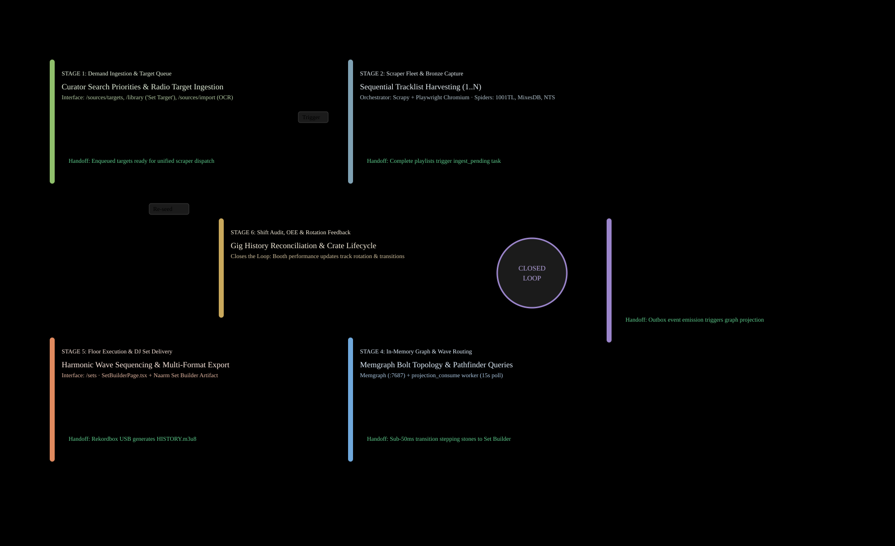
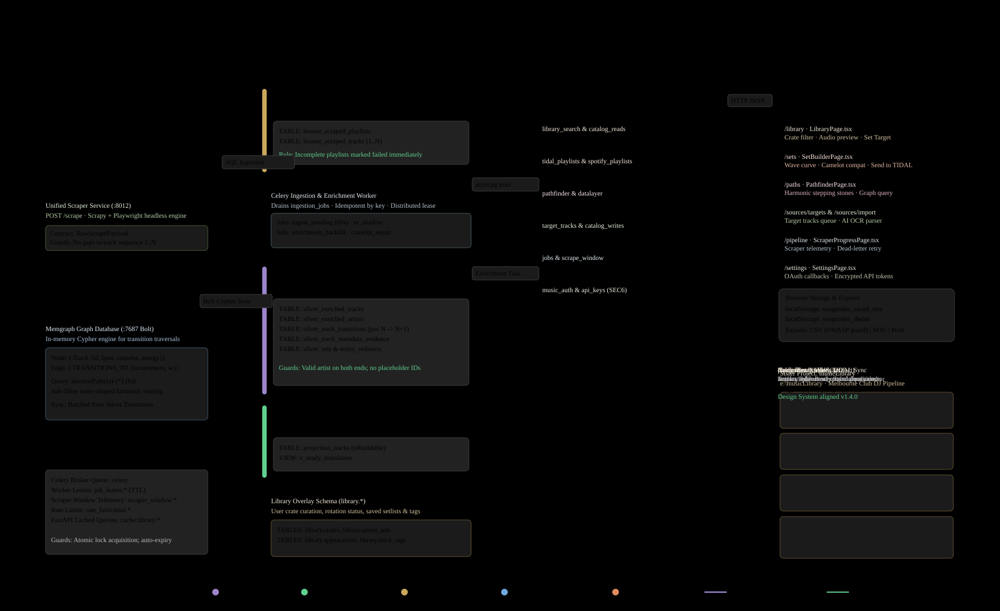

# SongNodes · Data flow report · 7 Nov 2026

Built 7 Nov 2026, 11:45 AEDT by Claude (Opus 5.5) for Markus, session 01NvWNfTGjhUeGYwDZx2H948. songnodes `7429821` (docs/data-flow-investigation), musicLibrary snapshot 7 Nov 2026, `findings.json` sha256 `9239a01d7141`. Web report: `report/index.html`; PDF: `DATA_FLOW_AND_PAGE_INTERACTION_REPORT.pdf`. Every number below is computed from `findings.json`.

> Read as: one estate of two projects. songnodes (git, main @7429821) is the source of truth for SongNodes; E:\musicLibrary (no git) is read from a snapshot taken 7 Nov 2026 without its 58 GB data folder. Queued = open PRs #576–#580, musicLibrary plan/jules_payloads and unmerged briefs.

## 1. Executive summary

| Figure | Label |
|---|---|
| 115 | Pages and entry points |
| 87 | Numbered data flows |
| 28 | Critical data gaps |
| 8 | Personas |
| 48 | Stores and external systems |
| 404 | Signals extracted |
| 17 | Standing-rule violations |
| 42 | Doc claims corrected or refuted |
| 14 | Queued items |
| 29 | Sister-project tasks |

**What holds**

- songnodes is Git-first with one integration branch, a scope guard and design-system CI; the frontend copy of the design system is in sync and its checkers report zero findings.
- The scraping core is one unified-scraper container with complete-playlist rules, idempotency keys on ingest jobs and FOR UPDATE SKIP LOCKED job claiming.
- musicLibrary's weekly run is a clear eight-step file pipeline with an append-only ledger, a resumable resolve step and a full SQLite rebuild every run.
- Both projects already share one design system, one TIDAL developer app and one saved-set idea, so the join points are few and nameable.

**What strains**

- Contracts between the two projects have drifted: the documented sync script and file do not exist, and the two Set Builders no longer share a saved-set shape.
- The medallion model in CLAUDE.md is not what runs: the scraper writes silver directly and no gold or operational job runs in compose.
- Feedback loops are missing: play history, overrides and proven transitions never flow back into curation or set building, and no track has a BPM or key yet.
- Security posture is not ready for the queued tunnel: write and admin routes are open and the queued login falls back to a default account.

**Closed loop.** The estate serves one loop: radio plays and DJ tracklists come in, become a curated club library, feed set building and the graph of proven transitions, play out in TIDAL and Rekordbox, and should come back as play history and corrections. Today the loop is open at the last step.

**D1 Closed loop.** The loop is open at one hop: reconciliation does not feed demand ingestion automatically. *n = 6 · stages · state built · source loop[] (name, mapping, systems, domain, gap) · method hand-placed ring of 6 cards, orthogonal hops; 0 crossings*

## 2. Architecture and numbered flows

**D2a System architecture – ingest, musiclibrary.** Every ingest, musiclibrary flow, numbered as in the flow table; all of them are built. *n = 11 · flows · state built · source flows[] (n, id, from, to, label, domain, state); pages[]/stores[] (title, name, domain, kind, classification, state); domain_order; colour_map · method graphviz dot layered layout (TB, order reverse; 12 rank directions and input orders tried, scored by legibility then crossings), splines=ortho, own number badges, type floor 15 units; 1 crossings, 0 edges through nodes*

**D2b System architecture – ingest, songnodes.** Every ingest, songnodes flow, numbered as in the flow table; all of them are built. *n = 14 · flows · state built · source flows[] (n, id, from, to, label, domain, state); pages[]/stores[] (title, name, domain, kind, classification, state); domain_order; colour_map · method graphviz dot layered layout (LR, order given; 12 rank directions and input orders tried, scored by legibility then crossings), splines=ortho, own number badges, type floor 15 units; 4 crossings, 0 edges through nodes*

**D2c System architecture – library, musiclibrary.** Every library, musiclibrary flow, numbered as in the flow table; all of them are built. *n = 16 · flows · state built · source flows[] (n, id, from, to, label, domain, state); pages[]/stores[] (title, name, domain, kind, classification, state); domain_order; colour_map · method graphviz dot layered layout (TB, order given; 12 rank directions and input orders tried, scored by legibility then crossings), splines=ortho, own number badges, type floor 15 units; 5 crossings, 0 edges through nodes*

**D2d System architecture – library, songnodes.** Every library, songnodes flow, numbered as in the flow table; all of them are built. *n = 8 · flows · state built · source flows[] (n, id, from, to, label, domain, state); pages[]/stores[] (title, name, domain, kind, classification, state); domain_order; colour_map · method graphviz dot layered layout (TB, order given; 12 rank directions and input orders tried, scored by legibility then crossings), splines=ortho, own number badges, type floor 12 units; 0 crossings, 0 edges through nodes*

**D2e System architecture – graph and sets.** Every graph and sets flow, numbered as in the flow table; 1 queued flow appears only in the Projected view. *n = 17 · flows · state built+queued · source flows[] (n, id, from, to, label, domain, state); pages[]/stores[] (title, name, domain, kind, classification, state); domain_order; colour_map · method graphviz dot layered layout (TB, order given; 12 rank directions and input orders tried, scored by legibility then crossings), splines=ortho, own number badges, type floor 15 units; 0 crossings, 0 edges through nodes*

**D2f System architecture – services.** Every services flow, numbered as in the flow table; all of them are built. *n = 11 · flows · state built · source flows[] (n, id, from, to, label, domain, state); pages[]/stores[] (title, name, domain, kind, classification, state); domain_order; colour_map · method graphviz dot layered layout (LR, order given; 12 rank directions and input orders tried, scored by legibility then crossings), splines=ortho, own number badges, type floor 12 units; 0 crossings, 0 edges through nodes*

**D2g System architecture – ops and design.** Every ops and design flow, numbered as in the flow table; 1 queued flow appears only in the Projected view. *n = 10 · flows · state built+queued · source flows[] (n, id, from, to, label, domain, state); pages[]/stores[] (title, name, domain, kind, classification, state); domain_order; colour_map · method graphviz dot layered layout (TB, order given, components packed 4 across, ungrouped; 12 rank directions and input orders tried, scored by legibility then crossings), splines=ortho, own number badges, type floor 12 units; 0 crossings, 0 edges through nodes*

| Flow | From | To | Data contract | Domain | State | Evidence |
|---|---|---|---|---|---|---|
| 1 | ext-3rrr | ml-cli-scrape | 3RRR episode tracks | ingest | built | – |
| 2 | ext-abc-plays | ml-cli-scrape | triple j Doof plays | ingest | built | – |
| 3 | ext-aria | ml-cli-scrape | ARIA Club rank and weeks | ingest | built | – |
| 4 | ext-balance-wp | ml-cli-scrape | Balance tracklists | ingest | built | – |
| 5 | ext-deezer | ml-cli-resolve | Deezer versions, BPM, ISRC, genre, label | ingest | built | – |
| 6 | ext-metabrainz | ml-store-data | MusicBrainz dumps | ingest | built | – |
| 7 | ext-pbs-airnet | ml-cli-scrape | PBS playlists | ingest | built | – |
| 8 | ext-tidal | ml-cli-resolve | TIDAL versions | ingest | built | – |
| 9 | ml-cli-ingest | ml-cli-resolve | to_resolve list | ingest | built | – |
| 10 | ml-cli-scrape | ml-cli-ingest | raw rows | ingest | built | – |
| 11 | ml-store-inbox | ml-cli-scrape | manual adds | ingest | built | – |
| 12 | sn-be-svc-rest-api | sn-be-tbl-bronze | manual tracklist import | ingest | built | – |
| 13 | sn-be-svc-unified-scraper | sn-be-store-redis | daily quota + setlist dedupe | ingest | built | – |
| 14 | sn-be-svc-unified-scraper | sn-be-tbl-bronze | bronze playlists/tracks | ingest | built | – |
| 15 | sn-be-svc-unified-scraper | sn-be-tbl-silver | layer-skipping silver writes | ingest | built | – |
| 16 | sn-be-svc-worker | sn-be-svc-unified-scraper | scrape request | ingest | built | – |
| 17 | sn-be-tbl-bronze | sn-be-tbl-silver | ingest_pending bronze->silver + transitions | ingest | built | – |
| 18 | sn-be-tbl-silver | sn-be-tbl-outbox | track/artist/setlist events | ingest | built | – |
| 19 | sn-be-tbl-target-tracks | sn-be-tbl-ingestion-jobs | scrape_targets hourly fan-out per source | ingest | built | – |
| 20 | sn-fe-library | sn-be-svc-rest-api | mark library track as target (+ local sn-target-tracks-v1) | ingest | built | – |
| 21 | sn-fe-library | sn-be-svc-rest-api | musicLibrary library.json export -> ingest job | ingest | built | – |
| 22 | sn-fe-pipeline | sn-be-svc-rest-api | scrape trigger (source, search_query, Idempotency-Key) | ingest | built | – |
| 23 | sn-fe-sources-import | sn-be-svc-rest-api | AI-found setlists -> import-tracklist | ingest | built | – |
| 24 | sn-fe-sources-targets | sn-be-svc-rest-api | target track CRUD | ingest | built | – |
| 25 | sn-fe-sources-targets | sn-fe-sources-import | Import a tracklist with AI link | ingest | built | – |
| 26 | ml-agent-beatport-sync | ml-cli-confirm | Beatport sync result | library | built | – |
| 27 | ml-agent-weekly-run | ml-store-artifact-files | republish library.json | library | built | – |
| 28 | ml-cli-build-db | ml-store-outputs | library.json | library | built | – |
| 29 | ml-cli-build-db | ml-store-sqlite | SQLite rebuild | library | built | – |
| 30 | ml-cli-db | sn-be-svc-rest-api | library.json ingest | library | built | – |
| 31 | ml-cli-process | ext-rekordbox | Rekordbox XML | library | built | – |
| 32 | ml-cli-process | ml-agent-beatport-sync | sync plan and buy list | library | built | – |
| 33 | ml-cli-process | ml-store-ledger | tracks, pending, rejected, rotation | library | built | – |
| 34 | ml-cli-resolve | ml-cli-process | resolved versions | library | built | – |
| 35 | ml-cli-sync-songnodes | sn-be-svc-rest-api | library.json bulk ingest | library | built | – |
| 36 | ml-cli-sync-tidal | ext-tidal | crate playlists | library | built | – |
| 37 | ml-cli-sync-tidal | ml-cli-confirm | sync result | library | built | – |
| 38 | ml-store-artifact-files | ml-page-set-builder | LibraryFile | library | built | – |
| 39 | ml-store-ledger | ml-cli-build-db | full ledger | library | built | – |
| 40 | ml-store-ledger | ml-cli-sync-tidal | crates | library | built | – |
| 41 | ml-store-overrides | ml-cli-process | hand corrections | library | built | – |
| 42 | sn-be-cli-import-music-library | sn-be-svc-rest-api | library.json via import-music-library.sh | library | built | – |
| 43 | sn-be-svc-rest-api | sn-fe-library | library tracks (uuid ids) | library | built | – |
| 44 | sn-be-svc-rest-api | sn-fe-library | library.tracks rows (compact keys) | library | built | – |
| 45 | sn-be-svc-worker | sn-be-tbl-library | library_ingest | library | built | – |
| 46 | sn-be-tbl-library | sn-be-tbl-target-tracks | auto-promote new library tracks | library | built | – |
| 47 | sn-be-tbl-outbox | sn-be-tbl-projection-tracks | projection_consume | library | built | – |
| 48 | sn-be-tbl-projection-tracks | sn-be-svc-rest-api | library search | library | built | – |
| 49 | sn-fe-home | sn-fe-library | AppHeader search / Ctrl K -> /library?focus=search | library | built | – |
| 50 | ml-cli-sync-songnodes | sn-be-svc-rest-api | setlists.v1 (shape mismatch) | graph | built | – |
| 51 | sn-be-svc-graph-api | sn-fe-graph | graph nodes/edges for PIXI | graph | built | – |
| 52 | sn-be-svc-graph-api | sn-fe-graph | neighbourhood view loaded from API (view=neighbourhood&center&steps&max) instead of full graph | graph | queued | songnodes/STATUS.md:2505 (GV2 Next) |
| 53 | sn-be-tbl-outbox | sn-be-store-memgraph | graph_projection_consume (disabled) | graph | built | – |
| 54 | sn-be-tbl-silver | sn-be-svc-graph-api | graph read (silver direct) | graph | built | – |
| 55 | sn-fe-paths | sn-fe-graph | Open Pathfinder in Graph | graph | built | – |
| 56 | ml-agent-weekly-run | ml-cli-build-db | artifact_sets.json | sets | built | – |
| 57 | ml-cli-build-db | ml-cli-sync-sets | sets marked tidal | sets | built | – |
| 58 | ml-cli-sync-sets | ext-tidal | SET · <name> playlists | sets | built | – |
| 59 | ml-page-set-builder | ml-store-artifact-db | SavedSet documents | sets | built | – |
| 60 | ml-store-artifact-db | ml-agent-weekly-run | saved sets rows | sets | built | – |
| 61 | sn-be-svc-rest-api | sn-be-tbl-library | saved sets | sets | built | – |
| 62 | sn-fe-library | ml-store-inbox | artifact_sets.json download (manual copy) | sets | built | – |
| 63 | sn-fe-library | sn-be-tbl-library | saved sets | sets | built | – |
| 64 | sn-fe-library | sn-fe-sets | crate filters + pool=crate in URL; draft slots in sn-set-draft | sets | built | – |
| 65 | sn-fe-sets | ml-store-inbox | artifact_sets.json download (manual copy to musicLibrary inbox) | sets | built | – |
| 66 | sn-fe-sets | sn-be-svc-rest-api | SavedSet upsert {name,description,tracks[{track_id}]} | sets | built | – |
| 67 | ml-svc-ref-mb | sn-be-store-refmb | MusicBrainz reference lookups | services | built | – |
| 68 | sn-be-svc-rest-api | sn-be-legacy-metadata-enrichment | music search proxy (dead target) | services | built | – |
| 69 | sn-be-svc-rest-api | sn-be-store-redis | OAuth state | services | built | – |
| 70 | sn-be-svc-rest-api | sn-be-tbl-oauth | OAuth tokens and saved keys | services | built | – |
| 71 | sn-be-svc-worker | sn-be-svc-audio-analysis | analyse Deezer preview | services | built | – |
| 72 | sn-be-svc-worker | sn-be-tbl-silver | enrichment evidence/consensus | services | built | – |
| 73 | sn-be-tbl-oauth | sn-be-svc-worker | saved provider keys override env | services | built | – |
| 74 | sn-fe-oauth-callback | sn-be-svc-rest-api | tokens stored server-side for enrichment | services | built | – |
| 75 | sn-fe-oauth-callback | sn-fe-settings | oauth-success tokens (pop-up only) | services | built | – |
| 76 | sn-fe-sets | sn-be-svc-rest-api | send set to TIDAL | services | built | – |
| 77 | sn-fe-settings | sn-fe-oauth-callback | OAuth redirect with state in sessionStorage | services | built | – |
| 78 | ml-plan-jules | ext-jules | work-package sessions | ops | built | – |
| 79 | sn-be-q-store-cloudflare-tunnel | sn-be-svc-rest-api | public HTTPS via frontend nginx /api proxy | ops | queued | – |
| 80 | sn-be-svc-rest-api | sn-be-svc-unified-scraper | live scrape progress poll | ops | built | – |
| 81 | sn-be-svc-rest-api | sn-be-tbl-ingestion-jobs | scrape/library_ingest job enqueue (idempotency key) | ops | built | – |
| 82 | sn-be-svc-rest-api | sn-fe-pipeline | jobs, outbox status, stages (polled) | ops | built | – |
| 83 | sn-be-svc-worker | sn-be-store-rabbitmq | Celery beat ticks | ops | built | – |
| 84 | sn-fe-home | sn-fe-sets | LauncherCard links to every module via MODULE_ROUTES | ops | built | – |
| 85 | sn-fe-work-queue-tracker | ml-store-artifact-db | window.claude db collections meta, tasks (seeded from seed.json) | ops | built | – |
| 86 | sn-fe-library | ml-page-set-builder | compiled pages via build.mjs | design | built | – |
| 87 | sn-fe-settings | sn-fe-index-html | display prefs read before first paint | design | built | – |

**D12 Sister-project dependency graph.** Only 8 of 87 flows cross between songnodes and musicLibrary; the rest stay inside one project or reach an external service. *n = 15 · project pairs · state built · source flows[] aggregated by repo pair (pages[]/stores[].repo); tasks[].project; design-system pages · method graphviz dot layered layout (TB, order degree; 12 rank directions and input orders tried, scored by legibility then crossings), splines=ortho, own number badges, type floor 17 units; 0 crossings, 0 edges through nodes*

## 3. Page catalogue and standing rules

115 pages and entry points: 44 production, 71 non-final. Standing rules:

| Rule | Text | Source |
|---|---|---|
| R1 | The NavDrawer is the only site navigation. | songnodes/CLAUDE.md §4 Rules: Interaction |
| R2 | One primary button per view. | songnodes/CLAUDE.md §4 Rules: Interaction |
| R3 | Never alert, confirm or prompt; use ConfirmDialog and Toast. | songnodes/CLAUDE.md §4 Rules: Interaction |
| R4 | Tokens and sn-* classes only: no hex, rgb, named colours, px font sizes, ad-hoc radii, shadows or z-index numbers. | songnodes/CLAUDE.md §4 Rules: Colour and values |
| R5 | No emoji in the interface; en-AU sentence case; missing values are an en dash. | songnodes/CLAUDE.md §4 Rules: Writing |
| R6 | Pages register their route (G2) and REST routers register themselves (G3); do not wire App.tsx or main.py. | songnodes/AGENTS.md rule 12 |
| R7 | unified-scraper is the only scraper container. | songnodes/CLAUDE.md Critical requirement 3 |
| R8 | Valid artists on both endpoints of every transition; no NULL or Unknown Artist in the graph. | songnodes/CLAUDE.md Critical requirement 1 |

**C1 Pages by domain and status.** ops holds the most pages (56 of 115); 67 pages are non-final and 4 queued. *n = 115 · pages · state projected · source pages[].domain, pages[].classification, pages[].state · method Count of pages per domain; built pages split by classification, queued pages counted separately; sorted by total.*

**C8 Standing-rule conformance.** 17 of 128 page results are violations; R5 has the most (6). *n = 128 · page results · state built · source rule_results[] (rule, result), standing_rules[] · method Count of page results per rule R1–R8 (ordinal, not sorted) split by result.*

**C7 Sizes against limits.** None of the 11 measured limits is within 10 % of its limit; the one with least headroom is ARIA parse sanity floor at 125 % of its floor. *n = 11 · per cent of limit · state built · source limits[] with current (value, unit, current) · method Bullet chart: current / limit. Text currents take their first number; a file map takes its largest file (the limit is per file), bytes to MB at 1,048,576. Floors (name says floor or minimum) are near when under 110 %, others when at or over 90 %.*

The full page catalogue with rule results is in `PAGE_CLASSIFICATION_AUDIT.md`.

## 4. Stores, signals and contracts

**C2 Page and store access matrix.** The 21 most connected pages against the 15 most used stores (of 23 pages and 35 stores with 61 access links); letters give the access, R read, W write, RW both. *n = 61 · page–store links · state projected · source signals[] (from, to, direction, state), flows[] (from, to, state) · method A link is any signal or flow between a page and a store; signal direction gives R/W/RW, a flow into a store is W and out of a store is R. Rows and columns ranked by distinct connections (ties by id) and capped at 25 by 15.*

**C4 Store fan-in and fan-out.** silver_enriched_tracks is the busiest store (3 flows in, 2 out); 31 of 48 stores sit on a numbered flow. *n = 49 · flows · state projected · source flows[] (from, to, channel, state), stores[], signals[] for the contract · method In = flows whose target is the store, out = flows whose source is the store; main contract = the signal named by the store's most frequent flow channel.*

**C3 Signal primitives, built and projected.** http-endpoint carries 225 of 404 signals; queued work adds 7 signals (cookie, fetch, http-endpoint, redis). *n = 404 · signals · state projected · source signals[].type, signals[].state · method Count of signals per type; Built = state built, Projected = built + queued; sorted by projected count.*

| Store | Kind | Location | Writer | Readers | Concurrency | State |
|---|---|---|---|---|---|---|
| config (`ml-store-config`) | file | config/rules.json, config/sources.json | Markus (hand-edited; weekly agent must not edit thresholds) | ml-cli-scrape, ml-cli-ingest, ml-cli-process, ml-cli-build-db, ml-cli-test-pipeline | none; read-only at run time | built |
| inbox (`ml-store-inbox`) | folder | inbox/ | scrape, ingest, resolve, sync-tidal, weekly agent (artifact_sets.json), beatport agent (resolved/sync_result), Markus (manual_adds.csv) | ml-cli-ingest, ml-cli-resolve, ml-cli-process, ml-cli-confirm, ml-cli-build-db, ml-cli-sync-sets, ml-cli-sync-songnodes | date-keyed files, whole-file overwrite (dump_json); resolved_<date> is incremental (load, skip done keys, flush every 20). No lock between the Beatport agent and the weekly run writing the same resolved_/sync_result_<date> file. | built |
| DJ library ledger (`ml-store-ledger`) | file | ledger/dj_library_ledger.json (+ ledger/history/) | run_weekly ingest/process/confirm | ml-cli-build-db, ml-cli-calibrate, ml-cli-sync-tidal, ml-cli-sync-sets, ml-cli-status, ml-agent-beatport-sync | single mutable JSON document (not append-only): write to .tmp then os.replace (atomic); process copies the old file to history/ledger_before_<date>.json first (overwritten if process re-runs the same date). No run lock; two runs would last-writer-win. | built |
| outputs (`ml-store-outputs`) | folder | outputs/<date>/, outputs/crates/, outputs/artifact/library.json, outputs/rekordbox_musicLibrary.xml | process, build_db, calibrate | ml-cli-build-db, ml-agent-weekly-run, ml-agent-beatport-sync, sn-scripts, ml-persona-curator | overwrite per run; deletes avoided on the synced drive (empty crates truncated) | built |
| overrides (`ml-store-overrides`) | folder | overrides/energy_overrides.csv, overrides/rekordbox_collection.xml (absent) | Markus | ml-cli-process, ml-cli-calibrate | re-applied every process run; header only today | built |
| dj_library.sqlite (`ml-store-sqlite`) | sqlite | db/dj_library.sqlite | build_db | ml-persona-curator (DB Browser) | full rebuild in a temp dir then shutil.copyfile over the target (copy, not atomic rename); row count and integrity_check afterwards; journal_mode DELETE. Current: 413 tracks, 0 sets, 4 runs, v_review_queue 413. | built |
| secrets (`ml-store-secrets`) | folder | secrets/ (tidal_app.json, tidal_user_token.json, tidal_pkce_pending.json, tidal_playlists.json); ref_mb/secrets/*.txt | tidal_cli, sync-tidal, sync-sets; Markus | ml-cli-resolve, ml-cli-sync-tidal, ml-cli-sync-sets, ml-svc-ref-mb | plain files, rewritten on refresh; pending cleared by writing {} (deletes blocked on synced drive). musicLibrary/secrets/ absent from this copy. | built |
| Set Builder artifact database, collection sets (`ml-store-artifact-db`) | artifact-db | claude.ai artifact GcqZTGjk6obdpjWaU7WFRq | Markus via the page (only-you-write rule) | ml-page-set-builder, ml-agent-weekly-run | page writes queued one document at a time; init merges shared-wins-by-id with local-only uploads; weekly agent read-only | built |
| Set Builder published files (`ml-store-artifact-files`) | artifact-files | claude.ai artifact GcqZTGjk6obdpjWaU7WFRq: index.html, app.js, assets/*, library.json | weekly agent (library.json), supervised rebuild (app.js) | ml-page-set-builder | publish refused unless read first; agent stops if live shell differs | built |
| ref_mb Postgres (`ml-store-ref-mb`) | postgres | 127.0.0.1:55433, data E:\musicLibrary\data\ref_mb_pgdata | ref_mb load scripts | sn-be-refmb, ml-cli-ref-mb-eval | read-only role default_transaction_read_only=on; stop with -t 600 | built |
| data (58 GB, not copied) (`ml-store-data`) | folder | data/: metabrainz/ (canonical, json, postgres dumps, logs), metabrainz_scratch/ (inventory, slice, sql benches, tools, a MusicBrainz server git checkout mbs/, PROGRESS.md), ref_mb_pgdata/pgdata (Postgres cluster, postmaster.pid 2026-11-06) | fetch_metabrainz.*, ref_mb scripts and compose, MB investigation agents | ml-svc-ref-mb | Postgres owns pgdata; downloads resumable by size | built |
| plan (`ml-store-plan`) | folder | plan/ | prompt builders and launchers | ext-jules | none | built |
| songnodes Postgres 18 (`sn-be-store-postgres`) | postgres | compose service postgres, volume songnodes-dev_dev-postgres-18 (not published) | rest-api, worker, unified-scraper, graph-api | sn-be-svc-rest-api, sn-be-svc-graph-api, sn-be-svc-worker, sn-be-svc-unified-scraper | row locks: FOR UPDATE SKIP LOCKED on ingestion_jobs and target_tracks; FOR UPDATE on bronze/silver playlist during ingest; outbox ordered by (txid,id) below pg_snapshot_xmin | built |
| bronze_scraped_playlists / bronze_scraped_tracks / bronze_scraped_artists (`sn-be-tbl-bronze`) | postgres | public schema (medallion 001) | unified-scraper persistence pipeline; rest-api import-tracklist | sn-be-svc-worker (ingest), sn-be-svc-rest-api (catalog_reads, jobs) | upsert on source keys; per-row savepoints; bronze_incomplete marker | built |
| bronze_api_enrichments (`sn-be-tbl-bronze-api-enrichments`) | postgres | medallion 001 | none | – | none | built |
| silver_enriched_tracks / _artists / _playlists / silver_playlist_tracks / silver_track_transitions / silver_track_metadata_evidence / silver_camelot_corrections (`sn-be-tbl-silver`) | postgres | medallion 002, 006, migration 014, 270 | worker datalayer (ingest, evidence, identity); also scraper persistence pipeline and rest-api catalog writes | sn-be-svc-graph-api, sn-be-svc-rest-api, sn-be-svc-worker | transitions ON CONFLICT (from_track_id,to_track_id); silver_enriched_tracks has no unique key (lookup-then-insert in upsert_track) | built |
| gold_track_graph (materialized view) (`sn-be-tbl-gold-track-graph`) | postgres | medallion 006 | created at init; refreshed only by restore_and_promote.sh and remove_same_artist_edges.sql | – | REFRESH CONCURRENTLY needs migration 008 unique index, which compose does not apply | built |
| gold_track_analytics / gold_playlist_analytics / gold_artist_analytics (`sn-be-tbl-gold-analytics`) | postgres | medallion 003 (not applied by compose) | data-transformer and gold_layer_processor (not deployed) | legacy gold-to-operational-etl, metadata-enrichment medallion_metrics | n/a | built |
| projection_tracks (`sn-be-tbl-projection-tracks`) | postgres | migration 014 | worker projection_consume / rebuild | sn-be-svc-rest-api (library_search, preview) | outbox consumer projection_tracks; keyed upserts; reconcile job | built |
| ingestion_jobs (`sn-be-tbl-ingestion-jobs`) | postgres | migration 013 | rest-api (enqueue, retry), worker (schedule, claim, settle), start-dev.sh (transition_scoring seed) | sn-be-svc-rest-api, sn-be-svc-worker, import-music-library.sh via API | unique (kind, idempotency_key); SKIP LOCKED claim; lease 300s (scrape 1800s); attempts/max_attempts; exponential backoff to 3600s; dead state; prune succeeded after 14 days | built |
| outbox_events / outbox_consumers / outbox_dead_letters (`sn-be-tbl-outbox`) | postgres | migration 014, 220 | every catalog write in the same transaction | projection_tracks consumer, graph_projection consumer, GET /api/v1/outbox/status | at-least-once; handler+offset in one transaction; 3 in-process attempts then dead letter; rebase_after_restore for txid reset | built |
| library schema (tracks, track_xref, appearances, chart_positions, rotation_history, pending, rejected, beatport_check, sources, runs, sets, set_tracks, v_crates) (`sn-be-tbl-library`) | postgres | migrations 101, 180-185 | worker library_ingest; rest-api sets routes | sn-be-svc-graph-api, sn-be-svc-rest-api, sn-be-svc-worker | one transaction per ingest payload; job idempotency key | built |
| target_tracks (`sn-be-tbl-target-tracks`) | postgres | migration 012, 280 | rest-api target_tracks router; library ingest auto-promotion; scrape_targets | sn-be-svc-worker, sn-be-svc-rest-api | scheduler UPDATE ... FOR UPDATE SKIP LOCKED; playlists_found under row lock; unique live (artist,title) once 280 applies | built |
| web_call_log (`sn-be-tbl-web-call-log`) | postgres | migration 170 | common/providers/web_call_log.py | – | append-only | built |
| user_oauth_tokens + api_keys (`sn-be-tbl-oauth`) | postgres | sql/init/07-api-keys.sql | rest-api music_auth and api_keys routers | sn-be-svc-rest-api, sn-be-svc-worker (saved keys) | upsert on (service,user_id); single user default_user | built |
| song_adjacency (`sn-be-tbl-song-adjacency`) | postgres | only in sql/init/05 and scrapers/music_schema.sql (not applied) | scraper persistence pipeline | – | n/a | built |
| musicdb.* legacy schema (tracks, user_setlists, tracks_audio_analysis, target_track_searches) (`sn-be-tbl-musicdb-legacy`) | postgres | not created by compose | graph-api user-setlists, audio-analysis queue path, root SQL scripts | graph-api suggestions/test routes | none | built |
| Redis 8.10 (`sn-be-store-redis`) | redis | compose service redis (anonymous volume /data) | rest-api (OAuth state), graph-api (batch status), unified-scraper spiders (quota, dedupe) | same writers | TTL keys only; no locks | built |
| RabbitMQ 4.3 (`sn-be-store-rabbitmq`) | rabbitmq | compose service rabbitmq, volume dev-rabbitmq-4, guest/guest | Celery beat in worker | Celery worker | acks_late, reject_on_worker_lost, prefetch 1; task expiry; remote control/gossip/mingle off | built |
| Memgraph (`sn-be-store-memgraph`) | external-api | bolt://memgraph:7687 (no service in compose) | graph_projection consumer when enabled | – | n/a | built |
| ref_mb MusicBrainz mirror (`sn-be-store-refmb`) | postgres | host.docker.internal:55433 db ref_mb (optional, MB_LOCAL_ENABLED=false) | external (musicLibrary fetch_metabrainz) | sn-be-svc-worker, sn-be-svc-rest-api | read-only role, 2000ms statement timeout | built |
| unified scraper in-memory progress (`sn-be-store-scraper-progress`) | memory | OrderedDict in unified_scraper_api process | unified-scraper | rest-api job stages | ContextVar per request; lost on restart | built |
| Cloudflare tunnel song.aiwfe.com (`sn-be-q-store-cloudflare-tunnel`) | external-api | cloudflared container (queued) | operator | public internet | n/a | queued |
| useStore (Zustand, persist songnodes-store, devtools "SongNodes Store") (`sn-fe-store-zustand`) | localStorage | browser localStorage songnodes-store | frontend store slices (graph, credentials, pathfinding, search) | sn-fe-graph, sn-fe-settings, sn-fe-sets | none: last writer per tab wins, no storage-event rehydrate across tabs | built |
| useUnifiedTracksStore (in-memory zustand) (`sn-fe-store-unified-tracks`) | memory | browser memory | hooks/useUnifiedTracks.ts refresh() | sn-fe-paths, sn-fe-harmony, sn-fe-sources-import, sn-fe-library | none; local sn-target-tracks-v1 overrides backend target state | built |
| loadLibrary() promise cache (`sn-fe-store-library-cache`) | memory | module scope features/musicLibrary/data.ts | loadLibrary | sn-fe-home, sn-fe-library, sn-fe-sets, sn-fe-store-unified-tracks | single shared promise, reset on error or forceRefresh | built |
| per-device localStorage keys (sn-*, songnodes_*) (`sn-fe-store-browser-ls`) | localStorage | browser origin http://127.0.0.1:3006 | see signals sn-fe-ls-* | all routes | append/overwrite; only sn-favs-library-crate listens to storage events; token refresh uses navigator.locks with localStorage mutex fallback | built |
| frontend nginx (inline default.conf) (`sn-fe-store-nginx`) | proxy | frontend image :8080, published 127.0.0.1:3006 | frontend/Dockerfile | browser | n/a; resolver 127.0.0.11 valid=10s | built |
| PBS airnet API (`ext-pbs-airnet`) | external-api | internet | third party | – | rate limits and retries on the caller side | built |
| 3RRR episode pages (`ext-3rrr`) | external-api | internet | third party | – | rate limits and retries on the caller side | built |
| ABC plays API (triple j, Double J) (`ext-abc-plays`) | external-api | internet | third party | – | rate limits and retries on the caller side | built |
| ARIA Club Chart (`ext-aria`) | external-api | internet | third party | – | rate limits and retries on the caller side | built |
| Balance Selections WordPress API (`ext-balance-wp`) | external-api | internet | third party | – | rate limits and retries on the caller side | built |
| TIDAL developer API (`ext-tidal`) | external-api | internet | third party | – | rate limits and retries on the caller side | built |
| Deezer API (`ext-deezer`) | external-api | internet | third party | – | rate limits and retries on the caller side | built |
| MetaBrainz dumps (`ext-metabrainz`) | external-api | internet | third party | – | rate limits and retries on the caller side | built |
| Rekordbox / Lexicon (XML) (`ext-rekordbox`) | external-api | internet | third party | – | rate limits and retries on the caller side | built |
| Jules sessions (Google) (`ext-jules`) | external-api | internet | third party | – | rate limits and retries on the caller side | built |

### Signals (404)

| ID | Primitive | Key or endpoint | Direction | From | To | Format | State | Evidence |
|---|---|---|---|---|---|---|---|---|
| ml-sig-sources-config | file-read | config/sources.json | read | ml-store-config | ml-cli-scrape | json | built | musicLibrary/pipeline/run_weekly.py:45-48 |
| ml-sig-rules-config | file-read | config/rules.json | read | ml-store-config | ml-cli-process | json | built | musicLibrary/pipeline/run_weekly.py:45-48 |
| ml-sig-ext-pbs | fetch | https://airnet.org.au/rest/stations/3pbs/programs/<slug>/episodes and <episodeRestUrl>/playlists | read | ext-pbs-airnet | ml-cli-scrape | json | built | musicLibrary/pipeline/djlib/scrapers.py:45-63 |
| ml-sig-ext-rrr | fetch | https://www.rrr.org.au/explore/programs/<slug>[/episodes/<id>-<slug>] | read | ext-3rrr | ml-cli-scrape | html | built | musicLibrary/pipeline/djlib/scrapers.py:128-155 |
| ml-sig-ext-abc | fetch | https://music.abcradio.net.au/api/v1/plays/search.json?station&from&to&limit=100 | read | ext-abc-plays | ml-cli-scrape | json | built | musicLibrary/pipeline/djlib/scrapers.py:82-104 |
| ml-sig-ext-aria | fetch | ARIA Club Chart page (sources.json url) | read | ext-aria | ml-cli-scrape | html | built | musicLibrary/pipeline/djlib/scrapers.py:108-124 |
| ml-sig-ext-balance | fetch | Balance Selections WordPress REST posts (sources.json api) | read | ext-balance-wp | ml-cli-scrape | json | built | musicLibrary/pipeline/djlib/scrapers.py:159-171 |
| ml-sig-manual-adds | file-write | inbox/manual_adds.csv | both | ml-persona-curator | ml-cli-scrape | csv | built | musicLibrary/pipeline/run_weekly.py:378-394 |
| ml-sig-raw | file-write | inbox/raw_<date>.json | both | ml-cli-scrape | ml-cli-ingest | json | built | musicLibrary/pipeline/run_weekly.py:395 |
| ml-sig-scrape-log | file-write | outputs/<date>/scrape_log.txt | write | ml-cli-scrape | ml-agent-weekly-run | text | built | musicLibrary/pipeline/run_weekly.py:396-398 |
| ml-sig-to-resolve | file-write | inbox/to_resolve_<date>.json | both | ml-cli-ingest | ml-cli-resolve | json | built | musicLibrary/pipeline/run_weekly.py:62-64 |
| ml-sig-resolved | file-write | inbox/resolved_<date>.json | both | ml-cli-resolve | ml-cli-process | json | built | musicLibrary/pipeline/run_weekly.py:417-462 |
| ml-sig-ext-tidal-catalogue | fetch | https://openapi.tidal.com/v2 /searchResults, /tracks, /tracks/{id}/relationships/genres (client credentials) | read | ext-tidal | ml-cli-resolve | json:api | built | musicLibrary/pipeline/djlib/tidal.py:207-234 |
| ml-sig-ext-deezer | fetch | https://api.deezer.com /search, /track/{id}, /album/{id} | read | ext-deezer | ml-cli-resolve | json | built | musicLibrary/pipeline/djlib/deezer.py:7-50 |
| ml-sig-ext-tidal-token | fetch | https://auth.tidal.com/v1/oauth2/token and https://login.tidal.com/authorize (PKCE, redirect http://127.0.0.1:3006/oauth/callback) | both | ml-cli-tidal | ext-tidal | form | built | musicLibrary/pipeline/djlib/tidal.py:62-114 |
| ml-sig-secrets-tidal-app | file-read | secrets/tidal_app.json | read | ml-store-secrets | ml-cli-resolve | json | built | musicLibrary/pipeline/djlib/tidal.py:52-56 |
| ml-sig-secrets-tidal-token | file-write | secrets/tidal_user_token.json and tidal_pkce_pending.json | both | ml-cli-tidal | ml-cli-sync-tidal | json | built | musicLibrary/pipeline/djlib/tidal.py:57-58 |
| ml-sig-tidal-playlists-map | file-write | secrets/tidal_playlists.json | both | ml-cli-sync-tidal | ml-cli-sync-sets | json | built | musicLibrary/pipeline/run_weekly.py:476-496 |
| ml-sig-ext-tidal-playlists | fetch | openapi.tidal.com/v2 POST /playlists, GET/POST/DELETE /playlists/{id}/relationships/items (user token, Idempotency-Key uuid5) | write | ml-cli-sync-tidal | ext-tidal | json:api | built | musicLibrary/pipeline/djlib/tidal.py:237-272 |
| ml-sig-ledger | file-write | ledger/dj_library_ledger.json | both | ml-cli-process | ml-cli-build-db | json | built | musicLibrary/pipeline/djlib/ledger.py:45-70 |
| ml-sig-ledger-history | file-write | ledger/history/ledger_before_<date>.json | write | ml-cli-process | ml-persona-developer | json | built | musicLibrary/pipeline/djlib/ledger.py:67-69 |
| ml-sig-overrides | file-read | overrides/energy_overrides.csv | read | ml-persona-curator | ml-cli-process | csv | built | musicLibrary/pipeline/run_weekly.py:152-182 |
| ml-sig-sync-plan | file-write | outputs/<date>/sync_plan.json | write | ml-cli-process | ml-agent-beatport-sync | json | built | musicLibrary/pipeline/djlib/export.py:308-332 |
| ml-sig-crates-csv | file-write | outputs/crates/<crate>.csv | write | ml-cli-process | ml-persona-curator | csv | built | musicLibrary/pipeline/djlib/export.py:285-305 |
| ml-sig-buy-list | file-write | outputs/<date>/buy_list.csv | write | ml-cli-process | ml-agent-beatport-sync | csv | built | musicLibrary/pipeline/djlib/export.py:335-346 |
| ml-sig-review-queue | file-write | outputs/<date>/review_queue.csv | write | ml-cli-process | ml-persona-curator | csv | built | musicLibrary/pipeline/run_weekly.py:298-304 |
| ml-sig-rejected-csv | file-write | outputs/<date>/rejected.csv | write | ml-cli-process | ml-persona-curator | csv | built | musicLibrary/pipeline/run_weekly.py:305-308 |
| ml-sig-weekly-report | file-write | outputs/<date>/weekly_report.md | both | ml-cli-process | ml-cli-build-db | markdown | built | musicLibrary/pipeline/run_weekly.py:310-312 |
| ml-sig-rekordbox-xml | file-write | outputs/rekordbox_musicLibrary.xml | write | ml-cli-process | ext-rekordbox | xml | built | musicLibrary/pipeline/djlib/export.py:356-385 |
| ml-sig-rekordbox-collection | file-read | overrides/rekordbox_collection.xml | read | ext-rekordbox | ml-cli-calibrate | xml | built | musicLibrary/pipeline/calibrate.py:55-81 |
| ml-sig-calibration | file-write | outputs/calibration_suggestions.json | write | ml-cli-calibrate | ml-persona-curator | json | built | musicLibrary/pipeline/calibrate.py:24 |
| ml-sig-sync-result | file-write | inbox/sync_result_<date>.json | both | ml-cli-sync-tidal | ml-cli-confirm | json | built | musicLibrary/pipeline/run_weekly.py:518 |
| ml-sig-alert | file-write | outputs/<date>/ALERT_tidal.txt, ALERT_tidal_sets.txt | write | ml-cli-sync-tidal | ml-agent-weekly-run | text | built | musicLibrary/pipeline/run_weekly.py:514-515 |
| ml-sig-artifact-sets-export | file-write | inbox/artifact_sets.json | both | ml-agent-weekly-run | ml-cli-build-db | json | built | musicLibrary/agent/weekly_run.md:5 |
| ml-sig-sqlite | sql | db/dj_library.sqlite | write | ml-cli-build-db | ml-persona-curator | sqlite | built | musicLibrary/pipeline/build_db.py:22-73 |
| ml-sig-library-json | file-write | outputs/artifact/library.json | write | ml-cli-build-db | ml-page-set-builder | json | built | musicLibrary/pipeline/build_db.py:190-229 |
| ml-sig-library-json-copy | file-write | artifact/build/library.json | both | ml-agent-weekly-run | ml-page-set-builder | json | built | musicLibrary/agent/weekly_run.md:8 |
| ml-sig-artifact-fetch-library | fetch | library.json (relative, cache no-cache) | read | ml-store-artifact-files | ml-page-set-builder | json | built | musicLibrary/artifact/app/artifact-data.ts:14-23 |
| ml-sig-artifact-db-sets | postMessage | window.claude.use('db') collection 'sets' (get, doc.set, doc.delete; legacy page also onSnapshot and use('user').can('data.write')) | both | ml-page-set-builder | ml-store-artifact-db | json | built | musicLibrary/artifact/app/artifact-data.ts:25-72 |
| ml-sig-artifactdata-list | cli | ArtifactData list collection 'sets' limit 1000 (weekly agent) | read | ml-store-artifact-db | ml-agent-weekly-run | json | built | musicLibrary/agent/weekly_run.md:5 |
| ml-sig-artifact-publish | cli | Artifact publish url=GcqZTGjk6obdpjWaU7WFRq file_path=weekly_publish/index.html files{library.json} | write | ml-agent-weekly-run | ml-store-artifact-files | html+json | built | musicLibrary/agent/weekly_run.md:8 |
| ml-sig-ls-sets | localStorage | sn-music-library-sets | both | ml-page-set-builder | ml-page-set-builder | json | built | musicLibrary/artifact/app/artifact-data.ts:11 |
| ml-sig-ls-draft | localStorage | sn-set-draft | both | ml-page-set-builder | ml-page-set-builder | json | built | songnodes/frontend/src/features/musicLibrary/storage.ts:24 |
| ml-sig-ls-filters | localStorage | sn-filters-library | both | ml-page-set-builder | ml-page-set-builder | json | built | songnodes/frontend/src/features/musicLibrary/storage.ts:22 |
| ml-sig-ls-density | localStorage | sn-density | both | ml-page-set-builder | ml-page-set-builder | string | built | musicLibrary/artifact/app/main.tsx:90 |
| ml-sig-ls-banner | localStorage | sn-banner-keyed-<page> | both | ml-page-set-builder | ml-page-set-builder | json | built | songnodes/frontend/src/features/musicLibrary/storage.ts:30 |
| ml-sig-ls-legacy | localStorage | nsb:view, nsb:filters, nsb:draft | both | ml-page-set-builder-legacy | ml-page-set-builder-legacy | json | built | musicLibrary/artifact/index.html:231 |
| ml-sig-clipboard-legacy | clipboard | navigator.clipboard.writeText tracklist | write | ml-page-set-builder-legacy | ext-clipboard | text | built | musicLibrary/artifact/index.html:525-530 |
| ml-sig-sn-ingest | http-endpoint | POST http://127.0.0.1:8082/api/v1/library/ingest (Idempotency-Key import-<md5>) | write | ml-cli-sync-songnodes | sn-be-svc-rest-api | json | built | musicLibrary/pipeline/run_weekly.py:574-597 |
| ml-sig-sn-import-tracklist | http-endpoint | POST /api/v1/tracks/import-tracklist with songnodes.setlists.v1 documents | write | ml-cli-sync-songnodes | sn-be-svc-rest-api | json | built | musicLibrary/pipeline/run_weekly.py:599-616 |
| ml-sig-setlists-files | file-read | JohnCourse.json, kiki.json (root), JohnCourse.json.bak | read | ml-persona-developer | ml-cli-sync-songnodes | json | built | musicLibrary/JohnCourse.json |
| ml-sig-sn-import-script | cli | songnodes scripts/import-music-library.sh (MUSIC_LIBRARY_DIR default ../musicLibrary) | read | sn-be-cli-import-music-library | ml-store-outputs | json | built | songnodes/scripts/import-music-library.sh:13-46 |
| ml-sig-sn-frontend-library | http-endpoint | GET /api/v1/library/search?limit=5000 (songnodes /library, /sets) | read | sn-be-svc-rest-api | sn-fe-library | json | built | songnodes/frontend/src/features/musicLibrary/data.ts:108-136 |
| ml-sig-sn-sets-api | http-endpoint | GET/PUT/DELETE /api/v1/library/sets[/id], GET /api/v1/library/sets/export | both | sn-fe-library | sn-store-library-sets | json | built | songnodes/frontend/src/features/musicLibrary/data.ts:193-283 |
| ml-sig-sn-export-sets-download | file-write | artifact_sets.json download from songnodes /sets (Export sets for the weekly run) | write | sn-fe-library | ml-sig-artifact-sets-export | json | built | songnodes/frontend/src/features/musicLibrary/SetBuilderPage.tsx:223-225 |
| ml-sig-sn-tidal-send | http-endpoint | POST /api/v1/tidal/sets/send (songnodes Send to TIDAL dialog) | write | sn-fe-library | ext-tidal | json | built | songnodes/frontend/src/features/setBuilder/sendToTidal.ts:44 |
| ml-sig-refmb-read | sql | postgres://ref_mb_reader@host.docker.internal:55433/ref_mb (MB_LOCAL_*) | read | ml-svc-ref-mb | sn-be-store-refmb | sql | built | songnodes/services/common/refmb/settings.py:21-34 |
| ml-sig-ext-metabrainz | fetch | https://data.metabrainz.org/pub/musicbrainz (dumps 20261024-102842, 20261024-001001, 20261017-080003) | read | ext-metabrainz | ml-cli-fetch-metabrainz | tar.zst/tar.bz2 | built | musicLibrary/pipeline/fetch_metabrainz.py:6-8 |
| ml-sig-ext-beatport | fetch | https://www.beatport.com/search/tracks?q=… via Claude in Chrome (supervised) | both | ml-agent-beatport-sync | ext-beatport | html | built | musicLibrary/agent/beatport_sync.md:3-4 |
| ml-sig-ext-jules | fetch | POST https://jules.googleapis.com/v1alpha/sessions (X-Goog-Api-Key from JULES_API_KEY env) | write | ml-plan-jules | ext-jules | json | built | musicLibrary/plan/launch_jules.py:10 |
| ml-sig-env-songnodes-api | env | SONGNODES_API_URL (run_weekly) vs SONGNODES_API (import script) | read | ml-store-env | ml-cli-sync-songnodes | string | built | musicLibrary/pipeline/run_weekly.py:574 |
| sn-be-ep-dlq-manager-get-health | http-endpoint | GET /health | both | client | sn-be-legacy-dlq-manager | json | built | songnodes/services/dlq-manager/main.py:549 |
| sn-be-ep-dlq-manager-get-metrics | http-endpoint | GET /metrics | both | client | sn-be-legacy-dlq-manager | json | built | songnodes/services/dlq-manager/main.py:560 |
| sn-be-ep-dlq-manager-get-dlq-messages | http-endpoint | GET /dlq/messages | both | client | sn-be-legacy-dlq-manager | json | built | songnodes/services/dlq-manager/main.py:566 |
| sn-be-ep-dlq-manager-get-dlq-stats | http-endpoint | GET /dlq/stats | both | client | sn-be-legacy-dlq-manager | json | built | songnodes/services/dlq-manager/main.py:587 |
| sn-be-ep-dlq-manager-post-dlq-replay-message-id | http-endpoint | POST /dlq/replay/{message_id} | both | client | sn-be-legacy-dlq-manager | json | built | songnodes/services/dlq-manager/main.py:601 |
| sn-be-ep-dlq-manager-post-dlq-replay-batch | http-endpoint | POST /dlq/replay/batch | both | client | sn-be-legacy-dlq-manager | json | built | songnodes/services/dlq-manager/main.py:623 |
| sn-be-ep-dlq-manager-delete-dlq-message-message-id | http-endpoint | DELETE /dlq/message/{message_id} | both | client | sn-be-legacy-dlq-manager | json | built | songnodes/services/dlq-manager/main.py:640 |
| sn-be-ep-dlq-manager-get-dlq-errors-grouped | http-endpoint | GET /dlq/errors/grouped | both | client | sn-be-legacy-dlq-manager | json | built | songnodes/services/dlq-manager/main.py:664 |
| sn-be-ep-nlp-processor-get-health | http-endpoint | GET /health | both | client | sn-be-legacy-nlp-processor | json | built | songnodes/services/nlp-processor/main.py:349 |
| sn-be-ep-nlp-processor-get-metrics | http-endpoint | GET /metrics | both | client | sn-be-legacy-nlp-processor | json | built | songnodes/services/nlp-processor/main.py:363 |
| sn-be-ep-nlp-processor-post-analyze | http-endpoint | POST /analyze | both | client | sn-be-legacy-nlp-processor | json | built | songnodes/services/nlp-processor/main.py:395 |
| sn-be-ep-nlp-processor-post-extract-artists | http-endpoint | POST /extract-artists | both | client | sn-be-legacy-nlp-processor | json | built | songnodes/services/nlp-processor/main.py:424 |
| sn-be-ep-nlp-processor-post-extract-tracklist | http-endpoint | POST /extract_tracklist | both | client | sn-be-legacy-nlp-processor | json | built | songnodes/services/nlp-processor/main.py:450 |
| sn-be-ep-nlp-processor-post-analyze-text | http-endpoint | POST /analyze_text | both | client | sn-be-legacy-nlp-processor | json | built | songnodes/services/nlp-processor/main.py:478 |
| sn-be-ep-nlp-processor-post-extract-timestamps | http-endpoint | POST /extract_timestamps | both | client | sn-be-legacy-nlp-processor | json | built | songnodes/services/nlp-processor/main.py:510 |
| sn-be-ep-nlp-processor-post-llm-extract-tracklist | http-endpoint | POST /llm/extract_tracklist | both | client | sn-be-legacy-nlp-processor | json | built | songnodes/services/nlp-processor/main.py:544 |
| sn-be-ep-nlp-processor-post-llm-classify-genre | http-endpoint | POST /llm/classify_genre | both | client | sn-be-legacy-nlp-processor | json | built | songnodes/services/nlp-processor/main.py:622 |
| sn-be-ep-nlp-processor-post-llm-generate | http-endpoint | POST /llm/generate | both | client | sn-be-legacy-nlp-processor | json | built | songnodes/services/nlp-processor/main.py:695 |
| sn-be-ep-data-transformer-get-health | http-endpoint | GET /health | both | client | sn-be-legacy-data-transformer | json | built | songnodes/services/data-transformer/main.py:1043 |
| sn-be-ep-data-transformer-post-transform | http-endpoint | POST /transform | both | client | sn-be-legacy-data-transformer | json | built | songnodes/services/data-transformer/main.py:1185 |
| sn-be-ep-data-transformer-get-tasks-task-id | http-endpoint | GET /tasks/{task_id} | both | client | sn-be-legacy-data-transformer | json | built | songnodes/services/data-transformer/main.py:1205 |
| sn-be-ep-data-transformer-get-tasks | http-endpoint | GET /tasks | both | client | sn-be-legacy-data-transformer | json | built | songnodes/services/data-transformer/main.py:1216 |
| sn-be-ep-data-transformer-get-stats | http-endpoint | GET /stats | both | client | sn-be-legacy-data-transformer | json | built | songnodes/services/data-transformer/main.py:1231 |
| sn-be-ep-data-transformer-get-metrics | http-endpoint | GET /metrics | both | client | sn-be-legacy-data-transformer | json | built | songnodes/services/data-transformer/main.py:1273 |
| sn-be-ep-data-transformer-post-normalize | http-endpoint | POST /normalize | both | client | sn-be-legacy-data-transformer | json | built | songnodes/services/data-transformer/main.py:1278 |
| sn-be-ep-data-transformer-get-fingerprints-duplicates | http-endpoint | GET /fingerprints/duplicates | both | client | sn-be-legacy-data-transformer | json | built | songnodes/services/data-transformer/main.py:1298 |
| sn-be-ep-graph-api-get-api-graph-nodes | http-endpoint | GET /api/graph/nodes | both | client | sn-be-svc-graph-api | json | built | songnodes/services/graph-visualization-api/main.py:555 |
| sn-be-ep-graph-api-get-api-graph-edges | http-endpoint | GET /api/graph/edges | both | client | sn-be-svc-graph-api | json | built | songnodes/services/graph-visualization-api/main.py:563 |
| sn-be-ep-graph-api-get-api-graph-data | http-endpoint | GET /api/graph/data | both | client | sn-be-svc-graph-api | json | built | songnodes/services/graph-visualization-api/main.py:574 |
| sn-be-ep-graph-api-get-api-graph-stats | http-endpoint | GET /api/graph/stats | both | client | sn-be-svc-graph-api | json | built | songnodes/services/graph-visualization-api/main.py:593 |
| sn-be-ep-graph-api-get-api-graph-search | http-endpoint | GET /api/graph/search | both | client | sn-be-svc-graph-api | json | built | songnodes/services/graph-visualization-api/main.py:598 |
| sn-be-ep-graph-api-get-api-v1-visualization-search | http-endpoint | GET /api/v1/visualization/search | both | client | sn-be-svc-graph-api | json | built | songnodes/services/graph-visualization-api/main.py:599 |
| sn-be-ep-graph-api-get-test-adjacency | http-endpoint | GET /test/adjacency | both | client | sn-be-svc-graph-api | json | built | songnodes/services/graph-visualization-api/main.py:608 |
| sn-be-ep-graph-api-get-test-nodes | http-endpoint | GET /test/nodes | both | client | sn-be-svc-graph-api | json | built | songnodes/services/graph-visualization-api/main.py:631 |
| sn-be-ep-graph-api-get-health | http-endpoint | GET /health | both | client | sn-be-svc-graph-api | json | built | songnodes/services/graph-visualization-api/main.py:704 |
| sn-be-ep-graph-api-get-metrics | http-endpoint | GET /metrics | both | client | sn-be-svc-graph-api | json | built | songnodes/services/graph-visualization-api/main.py:797 |
| sn-be-ep-graph-api-post-api-user-setlists | http-endpoint | POST /api/user-setlists | both | client | sn-be-svc-graph-api | json | built | songnodes/services/graph-visualization-api/main.py:808 |
| sn-be-ep-graph-api-post-api-v1-visualization-graph | http-endpoint | POST /api/v1/visualization/graph | both | client | sn-be-svc-graph-api | json | built | songnodes/services/graph-visualization-api/main.py:845 |
| sn-be-ep-graph-api-post-api-v1-visualization-nodes-batch | http-endpoint | POST /api/v1/visualization/nodes/batch | both | client | sn-be-svc-graph-api | json | built | songnodes/services/graph-visualization-api/main.py:892 |
| sn-be-ep-graph-api-get-api-v1-visualization-batch-batch-id-status | http-endpoint | GET /api/v1/visualization/batch/{batch_id}/status | both | client | sn-be-svc-graph-api | json | built | songnodes/services/graph-visualization-api/main.py:902 |
| sn-be-ep-graph-api-websocket-api-graph-ws-room-id | websocket | WEBSOCKET /api/graph/ws/{room_id} | both | client | sn-be-svc-graph-api | json | built | songnodes/services/graph-visualization-api/main.py:915 |
| sn-be-ep-graph-api-get-api-graph-neighborhood-node-id | http-endpoint | GET /api/graph/neighborhood/{node_id} | both | client | sn-be-svc-graph-api | json | built | songnodes/services/graph-visualization-api/main.py:962 |
| sn-be-ep-graph-api-get-api-graph | http-endpoint | GET /api/graph | both | client | sn-be-svc-graph-api | json | built | songnodes/services/graph-visualization-api/main.py:978 |
| sn-be-ep-graph-api-get-api-v1-graph | http-endpoint | GET /api/v1/graph | both | client | sn-be-svc-graph-api | json | built | songnodes/services/graph-visualization-api/main.py:979 |
| sn-be-ep-rest-api-get-health | http-endpoint | GET /health | both | client | sn-be-svc-rest-api | json | built | songnodes/services/rest_api/main.py:282 |
| sn-be-ep-rest-api-patch-api-tracks-track-id | http-endpoint | PATCH /api/tracks/{track_id} | both | client | sn-be-svc-rest-api | json | built | songnodes/services/rest_api/main.py:419 |
| sn-be-ep-rest-api-get-api-v1-tracks-track-id-preview | http-endpoint | GET /api/v1/tracks/{track_id}/preview | both | client | sn-be-svc-rest-api | json | built | songnodes/services/rest_api/main.py:461 |
| sn-be-ep-rest-api-get-api-graph-nodes | http-endpoint | GET /api/graph/nodes | both | client | sn-be-svc-rest-api | json | built | songnodes/services/rest_api/main.py:501 |
| sn-be-ep-rest-api-get-api-graph-edges | http-endpoint | GET /api/graph/edges | both | client | sn-be-svc-rest-api | json | built | songnodes/services/rest_api/main.py:570 |
| sn-be-ep-rest-api-get-api-v1-music-search-service | http-endpoint | GET /api/v1/music-search/{service} | both | client | sn-be-svc-rest-api | json | built | songnodes/services/rest_api/main.py:672 |
| sn-be-ep-rest-api-get-api-v1-library-search | http-endpoint | GET /api/v1/library/search | both | client | sn-be-svc-rest-api | json | built | songnodes/services/rest_api/routers/library_search.py:54 |
| sn-be-ep-rest-api-get-api-v1-library-tracks-track-id-preview | http-endpoint | GET /api/v1/library/tracks/{track_id}/preview | both | client | sn-be-svc-rest-api | json | built | songnodes/services/rest_api/routers/preview.py:80 |
| sn-be-ep-rest-api-get-api-v1-tracks | http-endpoint | GET /api/v1/tracks | both | client | sn-be-svc-rest-api | json | built | songnodes/services/rest_api/routers/catalog_reads.py:66 |
| sn-be-ep-rest-api-get-api-search-tracks | http-endpoint | GET /api/search/tracks | both | client | sn-be-svc-rest-api | json | built | songnodes/services/rest_api/routers/catalog_reads.py:92 |
| sn-be-ep-rest-api-get-api-tracks-track-id | http-endpoint | GET /api/tracks/{track_id} | both | client | sn-be-svc-rest-api | json | built | songnodes/services/rest_api/routers/catalog_reads.py:105 |
| sn-be-ep-rest-api-get-api-v1-tracks-track-id | http-endpoint | GET /api/v1/tracks/{track_id} | both | client | sn-be-svc-rest-api | json | built | songnodes/services/rest_api/routers/catalog_reads.py:106 |
| sn-be-ep-rest-api-get-api-v1-artists | http-endpoint | GET /api/v1/artists | both | client | sn-be-svc-rest-api | json | built | songnodes/services/rest_api/routers/catalog_reads.py:139 |
| sn-be-ep-rest-api-get-api-v1-artists-search | http-endpoint | GET /api/v1/artists/search | both | client | sn-be-svc-rest-api | json | built | songnodes/services/rest_api/routers/catalog_reads.py:146 |
| sn-be-ep-rest-api-get-api-v1-artists-artist-id | http-endpoint | GET /api/v1/artists/{artist_id} | both | client | sn-be-svc-rest-api | json | built | songnodes/services/rest_api/routers/catalog_reads.py:162 |
| sn-be-ep-rest-api-get-api-v1-setlists | http-endpoint | GET /api/v1/setlists | both | client | sn-be-svc-rest-api | json | built | songnodes/services/rest_api/routers/catalog_reads.py:190 |
| sn-be-ep-rest-api-get-api-v1-playlists | http-endpoint | GET /api/v1/playlists | both | client | sn-be-svc-rest-api | json | built | songnodes/services/rest_api/routers/catalog_reads.py:191 |
| sn-be-ep-rest-api-get-api-v1-setlists-playlist-id | http-endpoint | GET /api/v1/setlists/{playlist_id} | both | client | sn-be-svc-rest-api | json | built | songnodes/services/rest_api/routers/catalog_reads.py:221 |
| sn-be-ep-rest-api-get-api-v1-playlists-playlist-id | http-endpoint | GET /api/v1/playlists/{playlist_id} | both | client | sn-be-svc-rest-api | json | built | songnodes/services/rest_api/routers/catalog_reads.py:222 |
| sn-be-ep-rest-api-get-api-v1-setlists-playlist-id-tracks | http-endpoint | GET /api/v1/setlists/{playlist_id}/tracks | both | client | sn-be-svc-rest-api | json | built | songnodes/services/rest_api/routers/catalog_reads.py:229 |
| sn-be-ep-rest-api-post-api-v1-scrape-trigger | http-endpoint | POST /api/v1/scrape/trigger | both | client | sn-be-svc-rest-api | json | built | songnodes/services/rest_api/routers/jobs.py:66 |
| sn-be-ep-rest-api-get-api-v1-jobs | http-endpoint | GET /api/v1/jobs | both | client | sn-be-svc-rest-api | json | built | songnodes/services/rest_api/routers/jobs.py:109 |
| sn-be-ep-rest-api-get-api-v1-jobs-job-id | http-endpoint | GET /api/v1/jobs/{job_id} | both | client | sn-be-svc-rest-api | json | built | songnodes/services/rest_api/routers/jobs.py:133 |
| sn-be-ep-rest-api-post-api-v1-jobs-job-id-retry | http-endpoint | POST /api/v1/jobs/{job_id}/retry | both | client | sn-be-svc-rest-api | json | built | songnodes/services/rest_api/routers/jobs.py:140 |
| sn-be-ep-rest-api-get-api-v1-jobs-job-id-stages | http-endpoint | GET /api/v1/jobs/{job_id}/stages | both | client | sn-be-svc-rest-api | json | built | songnodes/services/rest_api/routers/jobs.py:266 |
| sn-be-ep-rest-api-post-api-v1-spotify-playlists-create | http-endpoint | POST /api/v1/spotify/playlists/create | both | client | sn-be-svc-rest-api | json | built | songnodes/services/rest_api/routers/spotify_playlists.py:104 |
| sn-be-ep-rest-api-get-api-v1-spotify-playlists-list | http-endpoint | GET /api/v1/spotify/playlists/list | both | client | sn-be-svc-rest-api | json | built | songnodes/services/rest_api/routers/spotify_playlists.py:175 |
| sn-be-ep-rest-api-post-api-v1-spotify-playlists-playlist-id-tracks | http-endpoint | POST /api/v1/spotify/playlists/{playlist_id}/tracks | both | client | sn-be-svc-rest-api | json | built | songnodes/services/rest_api/routers/spotify_playlists.py:237 |
| sn-be-ep-rest-api-post-api-v1-spotify-tracks-search | http-endpoint | POST /api/v1/spotify/tracks/search | both | client | sn-be-svc-rest-api | json | built | songnodes/services/rest_api/routers/spotify_playlists.py:300 |
| sn-be-ep-rest-api-post-api-v1-spotify-tracks-check-availability | http-endpoint | POST /api/v1/spotify/tracks/check-availability | both | client | sn-be-svc-rest-api | json | built | songnodes/services/rest_api/routers/spotify_playlists.py:377 |
| sn-be-ep-rest-api-get-api-v1-artists-dirty | http-endpoint | GET /api/v1/artists/dirty | both | client | sn-be-svc-rest-api | json | built | songnodes/services/rest_api/routers/catalog_writes.py:42 |
| sn-be-ep-rest-api-post-api-v1-artists-artist-id-rename | http-endpoint | POST /api/v1/artists/{artist_id}/rename | both | client | sn-be-svc-rest-api | json | built | songnodes/services/rest_api/routers/catalog_writes.py:58 |
| sn-be-ep-rest-api-post-api-v1-artists-duplicate-id-merge | http-endpoint | POST /api/v1/artists/{duplicate_id}/merge | both | client | sn-be-svc-rest-api | json | built | songnodes/services/rest_api/routers/catalog_writes.py:66 |
| sn-be-ep-rest-api-delete-api-v1-artists-artist-id | http-endpoint | DELETE /api/v1/artists/{artist_id} | both | client | sn-be-svc-rest-api | json | built | songnodes/services/rest_api/routers/catalog_writes.py:73 |
| sn-be-ep-rest-api-get-api-v1-tracks-missing-artist | http-endpoint | GET /api/v1/tracks/missing-artist | both | client | sn-be-svc-rest-api | json | built | songnodes/services/rest_api/routers/catalog_writes.py:80 |
| sn-be-ep-rest-api-post-api-v1-tracks-track-id-assign-artist | http-endpoint | POST /api/v1/tracks/{track_id}/assign-artist | both | client | sn-be-svc-rest-api | json | built | songnodes/services/rest_api/routers/catalog_writes.py:90 |
| sn-be-ep-rest-api-post-api-v1-artists | http-endpoint | POST /api/v1/artists | both | client | sn-be-svc-rest-api | json | built | songnodes/services/rest_api/routers/catalog_writes.py:99 |
| sn-be-ep-rest-api-post-api-v1-tracks | http-endpoint | POST /api/v1/tracks | both | client | sn-be-svc-rest-api | json | built | songnodes/services/rest_api/routers/catalog_writes.py:114 |
| sn-be-ep-rest-api-post-api-v1-tracks-import-tracklist | http-endpoint | POST /api/v1/tracks/import-tracklist | both | client | sn-be-svc-rest-api | json | built | songnodes/services/rest_api/routers/catalog_writes.py:123 |
| sn-be-ep-rest-api-get-api-v1-api-keys-requirements | http-endpoint | GET /api/v1/api-keys/requirements | both | client | sn-be-svc-rest-api | json | built | songnodes/services/rest_api/routers/api_keys.py:125 |
| sn-be-ep-rest-api-get-api-v1-api-keys | http-endpoint | GET /api/v1/api-keys | both | client | sn-be-svc-rest-api | json | built | songnodes/services/rest_api/routers/api_keys.py:151 |
| sn-be-ep-rest-api-post-api-v1-api-keys | http-endpoint | POST /api/v1/api-keys | both | client | sn-be-svc-rest-api | json | built | songnodes/services/rest_api/routers/api_keys.py:204 |
| sn-be-ep-rest-api-delete-api-v1-api-keys-service-name-key-name | http-endpoint | DELETE /api/v1/api-keys/{service_name}/{key_name} | both | client | sn-be-svc-rest-api | json | built | songnodes/services/rest_api/routers/api_keys.py:258 |
| sn-be-ep-rest-api-post-api-v1-api-keys-test | http-endpoint | POST /api/v1/api-keys/test | both | client | sn-be-svc-rest-api | json | built | songnodes/services/rest_api/routers/api_keys.py:290 |
| sn-be-ep-rest-api-post-api-v1-library-ingest | http-endpoint | POST /api/v1/library/ingest | both | client | sn-be-svc-rest-api | json | built | songnodes/services/rest_api/routers/library_ingest.py:10 |
| sn-be-ep-rest-api-get-api-v1-library-sets | http-endpoint | GET /api/v1/library/sets | both | client | sn-be-svc-rest-api | json | built | songnodes/services/rest_api/routers/library_ingest.py:21 |
| sn-be-ep-rest-api-put-api-v1-library-sets-set-id | http-endpoint | PUT /api/v1/library/sets/{set_id} | both | client | sn-be-svc-rest-api | json | built | songnodes/services/rest_api/routers/library_ingest.py:28 |
| sn-be-ep-rest-api-delete-api-v1-library-sets-set-id | http-endpoint | DELETE /api/v1/library/sets/{set_id} | both | client | sn-be-svc-rest-api | json | built | songnodes/services/rest_api/routers/library_ingest.py:36 |
| sn-be-ep-rest-api-get-api-v1-library-sets-export | http-endpoint | GET /api/v1/library/sets/export | both | client | sn-be-svc-rest-api | json | built | songnodes/services/rest_api/routers/library_ingest.py:44 |
| sn-be-ep-rest-api-post-api-v1-pathfinder-find-path | http-endpoint | POST /api/v1/pathfinder/find-path | both | client | sn-be-svc-rest-api | json | built | songnodes/services/rest_api/routers/pathfinder.py:480 |
| sn-be-ep-rest-api-post-api-v1-jobs | http-endpoint | POST /api/v1/jobs | both | client | sn-be-svc-rest-api | json | built | songnodes/services/rest_api/routers/datalayer.py:39 |
| sn-be-ep-rest-api-get-api-v1-metadata-review | http-endpoint | GET /api/v1/metadata/review | both | client | sn-be-svc-rest-api | json | built | songnodes/services/rest_api/routers/datalayer.py:53 |
| sn-be-ep-rest-api-get-api-v1-tracks-track-id-canonical | http-endpoint | GET /api/v1/tracks/{track_id}/canonical | both | client | sn-be-svc-rest-api | json | built | songnodes/services/rest_api/routers/datalayer.py:72 |
| sn-be-ep-rest-api-post-api-v1-tracks-track-id-merge | http-endpoint | POST /api/v1/tracks/{track_id}/merge | both | client | sn-be-svc-rest-api | json | built | songnodes/services/rest_api/routers/datalayer.py:85 |
| sn-be-ep-rest-api-get-api-v1-merges | http-endpoint | GET /api/v1/merges | both | client | sn-be-svc-rest-api | json | built | songnodes/services/rest_api/routers/datalayer.py:94 |
| sn-be-ep-rest-api-post-api-v1-merges-history-id-revert | http-endpoint | POST /api/v1/merges/{history_id}/revert | both | client | sn-be-svc-rest-api | json | built | songnodes/services/rest_api/routers/datalayer.py:104 |
| sn-be-ep-rest-api-get-api-v1-outbox-status | http-endpoint | GET /api/v1/outbox/status | both | client | sn-be-svc-rest-api | json | built | songnodes/services/rest_api/routers/datalayer.py:114 |
| sn-be-ep-rest-api-post-api-v1-projections-tracks-reconcile | http-endpoint | POST /api/v1/projections/tracks/reconcile | both | client | sn-be-svc-rest-api | json | built | songnodes/services/rest_api/routers/datalayer.py:128 |
| sn-be-ep-rest-api-get-api-v1-attributions | http-endpoint | GET /api/v1/attributions | both | client | sn-be-svc-rest-api | json | built | songnodes/services/rest_api/routers/datalayer.py:135 |
| sn-be-ep-rest-api-get-api-v1-resolution-review | http-endpoint | GET /api/v1/resolution/review | both | client | sn-be-svc-rest-api | json | built | songnodes/services/rest_api/routers/datalayer.py:147 |
| sn-be-ep-rest-api-post-api-v1-resolution-decision-id-review | http-endpoint | POST /api/v1/resolution/{decision_id}/review | both | client | sn-be-svc-rest-api | json | built | songnodes/services/rest_api/routers/datalayer.py:159 |
| sn-be-ep-rest-api-get-api-v1-scrape-window | http-endpoint | GET /api/v1/scrape/window | both | client | sn-be-svc-rest-api | json | built | songnodes/services/rest_api/routers/scrape_window.py:71 |
| sn-be-ep-rest-api-put-api-v1-scrape-window | http-endpoint | PUT /api/v1/scrape/window | both | client | sn-be-svc-rest-api | json | built | songnodes/services/rest_api/routers/scrape_window.py:82 |
| sn-be-ep-rest-api-get-api-v1-target-tracks-suggestions | http-endpoint | GET /api/v1/target-tracks/suggestions | both | client | sn-be-svc-rest-api | json | built | songnodes/services/rest_api/routers/target_tracks.py:52 |
| sn-be-ep-rest-api-get-api-v1-target-tracks | http-endpoint | GET /api/v1/target-tracks | both | client | sn-be-svc-rest-api | json | built | songnodes/services/rest_api/routers/target_tracks.py:69 |
| sn-be-ep-rest-api-post-api-v1-target-tracks | http-endpoint | POST /api/v1/target-tracks | both | client | sn-be-svc-rest-api | json | built | songnodes/services/rest_api/routers/target_tracks.py:111 |
| sn-be-ep-rest-api-put-api-v1-target-tracks-track-id | http-endpoint | PUT /api/v1/target-tracks/{track_id} | both | client | sn-be-svc-rest-api | json | built | songnodes/services/rest_api/routers/target_tracks.py:129 |
| sn-be-ep-rest-api-delete-api-v1-target-tracks-track-id | http-endpoint | DELETE /api/v1/target-tracks/{track_id} | both | client | sn-be-svc-rest-api | json | built | songnodes/services/rest_api/routers/target_tracks.py:153 |
| sn-be-ep-rest-api-post-api-v1-target-tracks-track-id-search | http-endpoint | POST /api/v1/target-tracks/{track_id}/search | both | client | sn-be-svc-rest-api | json | built | songnodes/services/rest_api/routers/target_tracks.py:161 |
| sn-be-ep-rest-api-post-api-v1-music-auth-test-tidal | http-endpoint | POST /api/v1/music-auth/test/tidal | both | client | sn-be-svc-rest-api | json | built | songnodes/services/rest_api/routers/music_auth.py:150 |
| sn-be-ep-rest-api-post-api-v1-music-auth-test-spotify | http-endpoint | POST /api/v1/music-auth/test/spotify | both | client | sn-be-svc-rest-api | json | built | songnodes/services/rest_api/routers/music_auth.py:270 |
| sn-be-ep-rest-api-get-api-v1-music-auth-spotify-authorize | http-endpoint | GET /api/v1/music-auth/spotify/authorize | both | client | sn-be-svc-rest-api | json | built | songnodes/services/rest_api/routers/music_auth.py:360 |
| sn-be-ep-rest-api-get-api-v1-music-auth-spotify-callback | http-endpoint | GET /api/v1/music-auth/spotify/callback | both | client | sn-be-svc-rest-api | json | built | songnodes/services/rest_api/routers/music_auth.py:463 |
| sn-be-ep-rest-api-post-api-v1-music-auth-store-token | http-endpoint | POST /api/v1/music-auth/store-token | both | client | sn-be-svc-rest-api | json | built | songnodes/services/rest_api/routers/music_auth.py:613 |
| sn-be-ep-rest-api-post-api-v1-music-auth-spotify-token | http-endpoint | POST /api/v1/music-auth/spotify/token | both | client | sn-be-svc-rest-api | json | built | songnodes/services/rest_api/routers/music_auth.py:662 |
| sn-be-ep-rest-api-post-api-v1-music-auth-spotify-refresh | http-endpoint | POST /api/v1/music-auth/spotify/refresh | both | client | sn-be-svc-rest-api | json | built | songnodes/services/rest_api/routers/music_auth.py:749 |
| sn-be-ep-rest-api-get-api-v1-music-auth-spotify-search | http-endpoint | GET /api/v1/music-auth/spotify/search | both | client | sn-be-svc-rest-api | json | built | songnodes/services/rest_api/routers/music_auth.py:848 |
| sn-be-ep-rest-api-post-api-v1-music-auth-tidal-device-init | http-endpoint | POST /api/v1/music-auth/tidal/device/init | both | client | sn-be-svc-rest-api | json | built | songnodes/services/rest_api/routers/music_auth.py:915 |
| sn-be-ep-rest-api-post-api-v1-music-auth-tidal-device-poll | http-endpoint | POST /api/v1/music-auth/tidal/device/poll | both | client | sn-be-svc-rest-api | json | built | songnodes/services/rest_api/routers/music_auth.py:996 |
| sn-be-ep-rest-api-post-api-v1-music-auth-tidal-oauth-init | http-endpoint | POST /api/v1/music-auth/tidal/oauth/init | both | client | sn-be-svc-rest-api | json | built | songnodes/services/rest_api/routers/music_auth.py:1075 |
| sn-be-ep-rest-api-get-api-v1-music-auth-tidal-oauth-callback | http-endpoint | GET /api/v1/music-auth/tidal/oauth/callback | both | client | sn-be-svc-rest-api | json | built | songnodes/services/rest_api/routers/music_auth.py:1158 |
| sn-be-ep-rest-api-get-api-v1-music-auth-reddit-callback | http-endpoint | GET /api/v1/music-auth/reddit/callback | both | client | sn-be-svc-rest-api | json | built | songnodes/services/rest_api/routers/music_auth.py:1230 |
| sn-be-ep-rest-api-get-api-v1-music-auth-lastfm-callback | http-endpoint | GET /api/v1/music-auth/lastfm/callback | both | client | sn-be-svc-rest-api | json | built | songnodes/services/rest_api/routers/music_auth.py:1235 |
| sn-be-ep-rest-api-post-api-v1-music-auth-tidal-oauth-refresh | http-endpoint | POST /api/v1/music-auth/tidal/oauth/refresh | both | client | sn-be-svc-rest-api | json | built | songnodes/services/rest_api/routers/music_auth.py:1240 |
| sn-be-ep-rest-api-post-api-v1-music-auth-tidal-refresh | http-endpoint | POST /api/v1/music-auth/tidal/refresh | both | client | sn-be-svc-rest-api | json | built | songnodes/services/rest_api/routers/music_auth.py:1241 |
| sn-be-ep-rest-api-get-api-v1-music-auth-health | http-endpoint | GET /api/v1/music-auth/health | both | client | sn-be-svc-rest-api | json | built | songnodes/services/rest_api/routers/music_auth.py:1305 |
| sn-be-ep-rest-api-get-api-v1-music-auth-spotify-token-status | http-endpoint | GET /api/v1/music-auth/spotify/token/status | both | client | sn-be-svc-rest-api | json | built | songnodes/services/rest_api/routers/music_auth.py:1310 |
| sn-be-ep-rest-api-post-api-v1-music-auth-spotify-token-refresh-manual | http-endpoint | POST /api/v1/music-auth/spotify/token/refresh-manual | both | client | sn-be-svc-rest-api | json | built | songnodes/services/rest_api/routers/music_auth.py:1361 |
| sn-be-ep-rest-api-get-api-v1-youtube-quota | http-endpoint | GET /api/v1/youtube/quota | both | client | sn-be-svc-rest-api | json | built | songnodes/services/rest_api/routers/youtube_api.py:116 |
| sn-be-ep-rest-api-get-api-v1-youtube-search | http-endpoint | GET /api/v1/youtube/search | both | client | sn-be-svc-rest-api | json | built | songnodes/services/rest_api/routers/youtube_api.py:155 |
| sn-be-ep-rest-api-post-api-v1-youtube-quota-reset | http-endpoint | POST /api/v1/youtube/quota/reset | both | client | sn-be-svc-rest-api | json | built | songnodes/services/rest_api/routers/youtube_api.py:248 |
| sn-be-ep-rest-api-post-api-v1-ai-complete | http-endpoint | POST /api/v1/ai/complete | both | client | sn-be-svc-rest-api | json | built | songnodes/services/rest_api/routers/ai_proxy.py:56 |
| sn-be-ep-rest-api-post-api-v1-tidal-playlists-create | http-endpoint | POST /api/v1/tidal/playlists/create | both | client | sn-be-svc-rest-api | json | built | songnodes/services/rest_api/routers/tidal_playlists.py:66 |
| sn-be-ep-rest-api-get-api-v1-tidal-playlists-list | http-endpoint | GET /api/v1/tidal/playlists/list | both | client | sn-be-svc-rest-api | json | built | songnodes/services/rest_api/routers/tidal_playlists.py:114 |
| sn-be-ep-rest-api-post-api-v1-tidal-playlists-playlist-id-tracks | http-endpoint | POST /api/v1/tidal/playlists/{playlist_id}/tracks | both | client | sn-be-svc-rest-api | json | built | songnodes/services/rest_api/routers/tidal_playlists.py:162 |
| sn-be-ep-rest-api-post-api-v1-tidal-tracks-search | http-endpoint | POST /api/v1/tidal/tracks/search | both | client | sn-be-svc-rest-api | json | built | songnodes/services/rest_api/routers/tidal_playlists.py:196 |
| sn-be-ep-rest-api-post-api-v1-tidal-tracks-check-availability | http-endpoint | POST /api/v1/tidal/tracks/check-availability | both | client | sn-be-svc-rest-api | json | built | songnodes/services/rest_api/routers/tidal_playlists.py:244 |
| sn-be-ep-rest-api-post-api-v1-tidal-sets-send | http-endpoint | POST /api/v1/tidal/sets/send | both | client | sn-be-svc-rest-api | json | built | songnodes/services/rest_api/routers/tidal_playlists.py:318 |
| sn-be-ep-metadata-enrichment-get-health | http-endpoint | GET /health | both | client | sn-be-legacy-metadata-enrichment | json | built | songnodes/services/metadata-enrichment/main.py:616 |
| sn-be-ep-metadata-enrichment-get-metrics | http-endpoint | GET /metrics | both | client | sn-be-legacy-metadata-enrichment | json | built | songnodes/services/metadata-enrichment/main.py:697 |
| sn-be-ep-metadata-enrichment-post-enrich | http-endpoint | POST /enrich | both | client | sn-be-legacy-metadata-enrichment | json | built | songnodes/services/metadata-enrichment/main.py:702 |
| sn-be-ep-metadata-enrichment-post-enrich-batch | http-endpoint | POST /enrich/batch | both | client | sn-be-legacy-metadata-enrichment | json | built | songnodes/services/metadata-enrichment/main.py:731 |
| sn-be-ep-metadata-enrichment-post-enrich-trigger | http-endpoint | POST /enrich/trigger | both | client | sn-be-legacy-metadata-enrichment | json | built | songnodes/services/metadata-enrichment/main.py:778 |
| sn-be-ep-metadata-enrichment-post-enrich-reset-circuit-breaker-service | http-endpoint | POST /enrich/reset-circuit-breaker/{service} | both | client | sn-be-legacy-metadata-enrichment | json | built | songnodes/services/metadata-enrichment/main.py:813 |
| sn-be-ep-metadata-enrichment-get-stats | http-endpoint | GET /stats | both | client | sn-be-legacy-metadata-enrichment | json | built | songnodes/services/metadata-enrichment/main.py:956 |
| sn-be-ep-metadata-enrichment-get-admin-config | http-endpoint | GET /admin/config | both | client | sn-be-legacy-metadata-enrichment | json | built | songnodes/services/metadata-enrichment/main.py:1146 |
| sn-be-ep-metadata-enrichment-post-admin-config-reload | http-endpoint | POST /admin/config/reload | both | client | sn-be-legacy-metadata-enrichment | json | built | songnodes/services/metadata-enrichment/main.py:1175 |
| sn-be-ep-metadata-enrichment-get-admin-config-field-field-name | http-endpoint | GET /admin/config/field/{field_name} | both | client | sn-be-legacy-metadata-enrichment | json | built | songnodes/services/metadata-enrichment/main.py:1209 |
| sn-be-ep-metadata-enrichment-put-admin-config-field-field-name | http-endpoint | PUT /admin/config/field/{field_name} | both | client | sn-be-legacy-metadata-enrichment | json | built | songnodes/services/metadata-enrichment/main.py:1259 |
| sn-be-ep-metadata-enrichment-get-admin-config-providers | http-endpoint | GET /admin/config/providers | both | client | sn-be-legacy-metadata-enrichment | json | built | songnodes/services/metadata-enrichment/main.py:1379 |
| sn-be-ep-metadata-enrichment-post-enrich-multi-tier-resolve | http-endpoint | POST /enrich/multi-tier-resolve | both | client | sn-be-legacy-metadata-enrichment | json | built | songnodes/services/metadata-enrichment/main.py:1446 |
| sn-be-ep-metadata-enrichment-post-enrich-hunt-labels | http-endpoint | POST /enrich/hunt-labels | both | client | sn-be-legacy-metadata-enrichment | json | built | songnodes/services/metadata-enrichment/main.py:1523 |
| sn-be-ep-metadata-enrichment-post-enrich-cooldown-migrate | http-endpoint | POST /enrich/cooldown/migrate | both | client | sn-be-legacy-metadata-enrichment | json | built | songnodes/services/metadata-enrichment/main.py:1586 |
| sn-be-ep-metadata-enrichment-post-enrich-cooldown-process | http-endpoint | POST /enrich/cooldown/process | both | client | sn-be-legacy-metadata-enrichment | json | built | songnodes/services/metadata-enrichment/main.py:1636 |
| sn-be-ep-metadata-enrichment-get-enrich-cooldown-stats | http-endpoint | GET /enrich/cooldown/stats | both | client | sn-be-legacy-metadata-enrichment | json | built | songnodes/services/metadata-enrichment/main.py:1687 |
| sn-be-ep-metadata-enrichment-post-enrich-probabilistic-match | http-endpoint | POST /enrich/probabilistic-match | both | client | sn-be-legacy-metadata-enrichment | json | built | songnodes/services/metadata-enrichment/main.py:1725 |
| sn-be-ep-metadata-enrichment-get-api-v1-search-service | http-endpoint | GET /api/v1/search/{service} | both | client | sn-be-legacy-metadata-enrichment | json | built | songnodes/services/metadata-enrichment/search_routes.py:11 |
| sn-be-ep-api-gateway-internal-get-health | http-endpoint | GET /health | both | client | sn-be-legacy-api-gateway-internal | json | built | songnodes/services/api-gateway-internal/main.py:308 |
| sn-be-ep-api-gateway-internal-post-api-provider-search | http-endpoint | POST /api/{provider}/search | both | client | sn-be-legacy-api-gateway-internal | json | built | songnodes/services/api-gateway-internal/main.py:333 |
| sn-be-ep-api-gateway-internal-get-api-provider-track-track-id | http-endpoint | GET /api/{provider}/track/{track_id} | both | client | sn-be-legacy-api-gateway-internal | json | built | songnodes/services/api-gateway-internal/main.py:416 |
| sn-be-ep-api-gateway-internal-get-admin-circuit-breakers | http-endpoint | GET /admin/circuit-breakers | both | client | sn-be-legacy-api-gateway-internal | json | built | songnodes/services/api-gateway-internal/main.py:451 |
| sn-be-ep-api-gateway-internal-post-admin-circuit-breakers-provider-reset | http-endpoint | POST /admin/circuit-breakers/{provider}/reset | both | client | sn-be-legacy-api-gateway-internal | json | built | songnodes/services/api-gateway-internal/main.py:469 |
| sn-be-ep-api-gateway-internal-get-admin-cache-stats | http-endpoint | GET /admin/cache/stats | both | client | sn-be-legacy-api-gateway-internal | json | built | songnodes/services/api-gateway-internal/main.py:487 |
| sn-be-ep-audio-analysis-get-health | http-endpoint | GET /health | both | client | sn-be-svc-audio-analysis | json | built | songnodes/services/audio-analysis/main.py:202 |
| sn-be-ep-audio-analysis-get-metrics | http-endpoint | GET /metrics | both | client | sn-be-svc-audio-analysis | json | built | songnodes/services/audio-analysis/main.py:292 |
| sn-be-ep-audio-analysis-post-analyze-url | http-endpoint | POST /analyze-url | both | client | sn-be-svc-audio-analysis | json | built | songnodes/services/audio-analysis/main.py:360 |
| sn-be-ep-audio-analysis-post-analyze | http-endpoint | POST /analyze | both | client | sn-be-svc-audio-analysis | json | built | songnodes/services/audio-analysis/main.py:393 |
| sn-be-ep-websocket-api-get-health | http-endpoint | GET /health | both | client | sn-be-legacy-websocket-api | json | built | songnodes/services/websocket-api/main.py:402 |
| sn-be-ep-websocket-api-get-stats | http-endpoint | GET /stats | both | client | sn-be-legacy-websocket-api | json | built | songnodes/services/websocket-api/main.py:481 |
| sn-be-ep-websocket-api-get-metrics | http-endpoint | GET /metrics | both | client | sn-be-legacy-websocket-api | json | built | songnodes/services/websocket-api/main.py:496 |
| sn-be-ep-websocket-api-websocket-ws-public | websocket | WEBSOCKET /ws/public | both | client | sn-be-legacy-websocket-api | json | built | songnodes/services/websocket-api/main.py:505 |
| sn-be-ep-websocket-api-websocket-ws-user-id | websocket | WEBSOCKET /ws/{user_id} | both | client | sn-be-legacy-websocket-api | json | built | songnodes/services/websocket-api/main.py:554 |
| sn-be-ep-websocket-api-post-api-v1-graph-broadcast | http-endpoint | POST /api/v1/graph/broadcast | both | client | sn-be-legacy-websocket-api | json | built | songnodes/services/websocket-api/main.py:785 |
| sn-be-ep-websocket-api-post-api-v1-graph-nodes-added | http-endpoint | POST /api/v1/graph/nodes/added | both | client | sn-be-legacy-websocket-api | json | built | songnodes/services/websocket-api/main.py:802 |
| sn-be-ep-websocket-api-post-api-v1-graph-nodes-updated | http-endpoint | POST /api/v1/graph/nodes/updated | both | client | sn-be-legacy-websocket-api | json | built | songnodes/services/websocket-api/main.py:815 |
| sn-be-ep-websocket-api-post-api-v1-graph-nodes-removed | http-endpoint | POST /api/v1/graph/nodes/removed | both | client | sn-be-legacy-websocket-api | json | built | songnodes/services/websocket-api/main.py:828 |
| sn-be-ep-websocket-api-post-api-v1-broadcast-room-id | http-endpoint | POST /api/v1/broadcast/{room_id} | both | client | sn-be-legacy-websocket-api | json | built | songnodes/services/websocket-api/main.py:841 |
| sn-be-ep-websocket-api-get-api-v1-rooms-room-id-history | http-endpoint | GET /api/v1/rooms/{room_id}/history | both | client | sn-be-legacy-websocket-api | json | built | songnodes/services/websocket-api/main.py:864 |
| sn-be-ep-data-validator-get-health | http-endpoint | GET /health | both | client | sn-be-legacy-data-validator | json | built | songnodes/services/data-validator/main.py:1242 |
| sn-be-ep-data-validator-post-validate | http-endpoint | POST /validate | both | client | sn-be-legacy-data-validator | json | built | songnodes/services/data-validator/main.py:1351 |
| sn-be-ep-data-validator-post-validate-sync | http-endpoint | POST /validate/sync | both | client | sn-be-legacy-data-validator | json | built | songnodes/services/data-validator/main.py:1371 |
| sn-be-ep-data-validator-get-tasks-task-id | http-endpoint | GET /tasks/{task_id} | both | client | sn-be-legacy-data-validator | json | built | songnodes/services/data-validator/main.py:1382 |
| sn-be-ep-data-validator-get-tasks | http-endpoint | GET /tasks | both | client | sn-be-legacy-data-validator | json | built | songnodes/services/data-validator/main.py:1393 |
| sn-be-ep-data-validator-get-rules | http-endpoint | GET /rules | both | client | sn-be-legacy-data-validator | json | built | songnodes/services/data-validator/main.py:1408 |
| sn-be-ep-data-validator-get-stats | http-endpoint | GET /stats | both | client | sn-be-legacy-data-validator | json | built | songnodes/services/data-validator/main.py:1419 |
| sn-be-ep-data-validator-get-metrics | http-endpoint | GET /metrics | both | client | sn-be-legacy-data-validator | json | built | songnodes/services/data-validator/main.py:1466 |
| sn-be-ep-browser-collector-get-health | http-endpoint | GET /health | both | client | sn-be-legacy-browser-collector | json | built | songnodes/services/browser-collector/main.py:357 |
| sn-be-ep-browser-collector-post-collect | http-endpoint | POST /collect | both | client | sn-be-legacy-browser-collector | json | built | songnodes/services/browser-collector/main.py:422 |
| sn-be-ep-browser-collector-post-extract-raw-data-id | http-endpoint | POST /extract/{raw_data_id} | both | client | sn-be-legacy-browser-collector | json | built | songnodes/services/browser-collector/main.py:636 |
| sn-be-ep-browser-collector-get-metrics | http-endpoint | GET /metrics | both | client | sn-be-legacy-browser-collector | json | built | songnodes/services/browser-collector/main.py:685 |
| sn-be-ep-db-connection-pool-get-health | http-endpoint | GET /health | both | client | sn-be-legacy-db-connection-pool | json | built | songnodes/services/db-connection-pool/main.py:294 |
| sn-be-ep-db-connection-pool-get-stats | http-endpoint | GET /stats | both | client | sn-be-legacy-db-connection-pool | json | built | songnodes/services/db-connection-pool/main.py:360 |
| sn-be-ep-db-connection-pool-get-metrics | http-endpoint | GET /metrics | both | client | sn-be-legacy-db-connection-pool | json | built | songnodes/services/db-connection-pool/main.py:368 |
| sn-be-ep-db-connection-pool-post-reload | http-endpoint | POST /reload | both | client | sn-be-legacy-db-connection-pool | json | built | songnodes/services/db-connection-pool/main.py:376 |
| sn-be-ep-db-connection-pool-post-query | http-endpoint | POST /query | both | client | sn-be-legacy-db-connection-pool | json | built | songnodes/services/db-connection-pool/main.py:381 |
| sn-be-ep-db-connection-pool-get-pool-info | http-endpoint | GET /pool-info | both | client | sn-be-legacy-db-connection-pool | json | built | songnodes/services/db-connection-pool/main.py:386 |
| sn-be-ep-scraper-api-real-get-health | http-endpoint | GET /health | both | client | sn-be-legacy-scraper-api-real | json | built | songnodes/scrapers/scraper_api_real.py:85 |
| sn-be-ep-scraper-api-real-get-metrics | http-endpoint | GET /metrics | both | client | sn-be-legacy-scraper-api-real | json | built | songnodes/scrapers/scraper_api_real.py:89 |
| sn-be-ep-scraper-api-real-post-scrape | http-endpoint | POST /scrape | both | client | sn-be-legacy-scraper-api-real | json | built | songnodes/scrapers/scraper_api_real.py:97 |
| sn-be-ep-scraper-service-get | http-endpoint | GET / | both | client | sn-be-legacy-scraper-service | json | built | songnodes/scrapers/scraper_service.py:59 |
| sn-be-ep-scraper-service-get-health | http-endpoint | GET /health | both | client | sn-be-legacy-scraper-service | json | built | songnodes/scrapers/scraper_service.py:69 |
| sn-be-ep-scraper-service-get-spiders | http-endpoint | GET /spiders | both | client | sn-be-legacy-scraper-service | json | built | songnodes/scrapers/scraper_service.py:79 |
| sn-be-ep-scraper-service-post-run-spider-name | http-endpoint | POST /run/{spider_name} | both | client | sn-be-legacy-scraper-service | json | built | songnodes/scrapers/scraper_service.py:113 |
| sn-be-ep-scraper-service-get-status-spider-name | http-endpoint | GET /status/{spider_name} | both | client | sn-be-legacy-scraper-service | json | built | songnodes/scrapers/scraper_service.py:155 |
| sn-be-ep-scraper-service-post-migrate | http-endpoint | POST /migrate | both | client | sn-be-legacy-scraper-service | json | built | songnodes/scrapers/scraper_service.py:217 |
| sn-be-ep-scraper-service-get-config | http-endpoint | GET /config | both | client | sn-be-legacy-scraper-service | json | built | songnodes/scrapers/scraper_service.py:229 |
| sn-be-ep-unified-scraper-get-health | http-endpoint | GET /health | both | client | sn-be-svc-unified-scraper | json | built | songnodes/scrapers/unified_scraper_api.py:163 |
| sn-be-ep-unified-scraper-get-metrics | http-endpoint | GET /metrics | both | client | sn-be-svc-unified-scraper | json | built | songnodes/scrapers/unified_scraper_api.py:173 |
| sn-be-ep-unified-scraper-get-scrape-progress-job-id | http-endpoint | GET /scrape/progress/{job_id} | both | client | sn-be-svc-unified-scraper | json | built | songnodes/scrapers/unified_scraper_api.py:179 |
| sn-be-ep-unified-scraper-get-sources | http-endpoint | GET /sources | both | client | sn-be-svc-unified-scraper | json | built | songnodes/scrapers/unified_scraper_api.py:188 |
| sn-be-ep-unified-scraper-post-scrape | http-endpoint | POST /scrape | both | client | sn-be-svc-unified-scraper | json | built | songnodes/scrapers/unified_scraper_api.py:578 |
| sn-be-celery-drain | amqp | celery task songnodes.drain (beat every JOB_POLL_SECONDS=5s, expires 15s) | write | sn-be-svc-worker | sn-be-store-rabbitmq | celery | built | songnodes/services/worker/celery_app.py:47 |
| sn-be-celery-schedule | amqp | celery task songnodes.schedule (beat every SCHEDULE_SECONDS=30s) | write | sn-be-svc-worker | sn-be-store-rabbitmq | celery | built | songnodes/services/worker/celery_app.py:48 |
| sn-be-amqp-audio-analysis-queue | amqp | audio_analysis_queue (vhost musicdb) | read | sn-be-store-rabbitmq | sn-be-svc-audio-analysis | json | built | songnodes/services/audio-analysis/main.py:151 |
| sn-be-amqp-legacy-enrichment | amqp | metadata-enrichment / dlq-manager / websocket-api queues | both | sn-be-legacy-metadata-enrichment | sn-be-legacy-dlq-manager | json | built | songnodes/services/metadata-enrichment/queue_init.py |
| sn-be-redis-oauth-state | redis | oauth:spotify:{state} / oauth:tidal:{state} / oauth:tidal:device:{device_code} (setex, deleted on callback) | both | sn-be-svc-rest-api | sn-be-store-redis | json | built | songnodes/services/rest_api/routers/music_auth.py:413 |
| sn-be-redis-batch-status | redis | batch:{batch_id} (setex 3600) | both | sn-be-svc-graph-api | sn-be-store-redis | json | built | songnodes/services/graph-visualization-api/main.py:475 |
| sn-be-redis-graph-cache | redis | cache_result keys (CACHE_TTL 300s) | both | sn-be-svc-graph-api | sn-be-store-redis | json | built | songnodes/services/graph-visualization-api/main.py:332 |
| sn-be-redis-spider-quota | redis | scraped:setlists:{mixesdb\|1001tracklists}:last_run (TTL SCRAPER_RUN_TTL_HOURS=24h) | both | sn-be-svc-unified-scraper | sn-be-store-redis | iso timestamp | built | songnodes/scrapers/spiders/1001tracklists_spider.py:309 |
| sn-be-redis-spider-dedupe | redis | scraped:setlists:{source}:{sha digest} (TTL SCRAPER_SOURCE_TTL_DAYS=30d) | both | sn-be-svc-unified-scraper | sn-be-store-redis | iso timestamp | built | songnodes/scrapers/spiders/mixesdb_spider.py:655 |
| sn-be-redis-spotify-token | redis | spotify spider token/expiry keys | both | sn-be-svc-unified-scraper | sn-be-store-redis | text | built | songnodes/scrapers/spiders/stores/spotify_spider.py:222 |
| sn-be-ws-graph-room | websocket | /api/graph/ws/{room_id} (graph_update, cursor_position, ping) | both | client | sn-be-svc-graph-api | json | built | songnodes/services/graph-visualization-api/main.py:915 |
| sn-be-http-worker-to-scraper | http-endpoint | POST {UNIFIED_SCRAPER_URL}/scrape | write | sn-be-svc-worker | sn-be-svc-unified-scraper | json | built | songnodes/services/common/datalayer/handlers.py:60 |
| sn-be-http-restapi-scrape-progress | http-endpoint | GET {UNIFIED_SCRAPER_URL}/scrape/progress/{job_id} | read | sn-be-svc-rest-api | sn-be-svc-unified-scraper | json | built | songnodes/services/rest_api/routers/jobs.py:213 |
| sn-be-http-worker-to-audio | http-endpoint | POST {AUDIO_ANALYSIS_URL}/analyze-url | write | sn-be-svc-worker | sn-be-svc-audio-analysis | json | built | songnodes/services/common/datalayer/audio.py |
| sn-be-http-restapi-to-metadata-enrichment | http-endpoint | GET {METADATA_ENRICHMENT_URL=http://metadata-enrichment:8086}/search... | read | sn-be-svc-rest-api | sn-be-legacy-metadata-enrichment | json | built | songnodes/services/rest_api/main.py:692 |
| sn-be-sig-import-music-library | cli | scripts/import-music-library.sh -> POST /api/v1/library/ingest (Idempotency-Key import-<md5>) | write | ml-cli-db | sn-be-svc-rest-api | json | built | songnodes/scripts/import-music-library.sh:1 |
| sn-be-file-read-library-json | file-read | $MUSIC_LIBRARY_DIR/outputs/artifact/library.json | read | ml-cli-db | sn-be-cli-import-music-library | json | built | songnodes/scripts/import-music-library.sh:15 |
| sn-be-cli-library-importer-sqlite | cli | python -m library.importer --sqlite <library.db> --api-url (default http://localhost:8080/...) | write | ml-library-db | sn-be-svc-rest-api | sqlite->json | built | songnodes/services/library/importer/__main__.py:15 |
| sn-be-file-write-reconcile-csv | file-write | library.reconcile.cli --out <csv> | write | sn-be-store-postgres | operator | csv | built | songnodes/services/library/reconcile/cli.py:27 |
| sn-be-file-write-pipeline-artifact | file-write | pipeline/build_db.py -> db/library.db and outputs/artifact/library.json | write | sn-be-cli-pipeline | sn-be-file-read-library-json | sqlite/json | built | songnodes/pipeline/build_db.py:10 |
| sn-be-file-write-pgdump | file-write | backup-YYYYMMDD.dump via compose exec pg_dump -U songnodes | write | sn-be-store-postgres | operator | pg custom dump | built | songnodes/CLAUDE.md:300 |
| sn-be-file-write-backup-scripts | file-write | scripts/backup_database.sh -> /backups/postgres/musicdb_backup_*.sql.gz; backup_volumes.sh -> ./backups/volumes/*.tar.gz | write | sn-be-store-postgres | operator | gzip sql / tar.gz | built | songnodes/scripts/backup_database.sh:52 |
| sn-be-file-heartbeat | file-write | /tmp/worker-heartbeat | both | sn-be-svc-worker | docker-healthcheck | mtime | built | songnodes/services/worker/celery_app.py:67 |
| sn-be-env-provider-credentials | env | TIDAL_CLIENT_ID/SECRET, SPOTIFY_CLIENT_ID/SECRET, LASTFM_API_KEY, DISCOGS_TOKEN, GETSONGBPM_API_KEY, MB_LOCAL_* | read | host-env/.env | sn-be-svc-worker | env | built | songnodes/compose.dev.yaml:60 |
| sn-be-env-enrichment-providers | env | ENRICHMENT_PROVIDERS (default none) | read | host-env/.env | sn-be-svc-worker | csv | built | songnodes/compose.dev.yaml:125 |
| sn-be-sql-saved-api-keys | sql | api_keys table via get_api_key(service,key,secret) -> overrides env | read | sn-be-store-postgres | sn-be-svc-worker | pgp_sym encrypted base64 | built | songnodes/services/common/providers/saved_keys.py:19 |
| sn-be-env-api-token | env | SONGNODES_API_TOKEN | read | host-env/.env | sn-be-svc-rest-api | text | built | songnodes/services/rest_api/security/auth.py:28 |
| sn-be-sql-bronze-write-scraper | sql | INSERT bronze_scraped_playlists / bronze_scraped_tracks / bronze_scraped_artists | write | sn-be-svc-unified-scraper | sn-be-tbl-bronze | postgres | built | songnodes/scrapers/pipelines/persistence_pipeline.py:1117 |
| sn-be-sql-silver-write-scraper | sql | INSERT silver_enriched_tracks / silver_enriched_playlists / silver_playlist_tracks directly from the scraper | write | sn-be-svc-unified-scraper | sn-be-tbl-silver | postgres | built | songnodes/scrapers/pipelines/persistence_pipeline.py:910 |
| sn-be-sql-song-adjacency-write | sql | INSERT song_adjacency (scraper) | write | sn-be-svc-unified-scraper | sn-be-tbl-song-adjacency | postgres | built | songnodes/scrapers/pipelines/persistence_pipeline.py:1731 |
| sn-be-sql-bronze-write-import | sql | INSERT bronze_* from POST /api/v1/tracks/import-tracklist, then ingest_playlist synchronously | write | sn-be-svc-rest-api | sn-be-tbl-bronze | postgres | built | songnodes/services/rest_api/catalog_writes.py:300 |
| sn-be-sql-bronze-to-silver | sql | ingest_pending: bronze playlists without silver marker datalayer-ingest-v1 -> silver_enriched_* + silver_track_transitions (N->N+1) + outbox | both | sn-be-svc-worker | sn-be-tbl-silver | postgres | built | songnodes/services/common/datalayer/ingest.py:28 |
| sn-be-sql-silver-to-projection | sql | projection_consume: outbox_events (track/artist) -> projection_tracks | both | sn-be-svc-worker | sn-be-tbl-projection-tracks | postgres | built | songnodes/services/common/datalayer/projection.py:14 |
| sn-be-sql-graph-read-silver | sql | graph-api reads silver_enriched_tracks + silver_track_transitions + library.* (REPEATABLE READ snapshot) | read | sn-be-tbl-silver | sn-be-svc-graph-api | postgres | built | songnodes/services/graph-visualization-api/catalog.py:17 |
| sn-be-sql-library-search-read | sql | library_search / preview read projection_tracks + library.* + evidence | read | sn-be-tbl-projection-tracks | sn-be-svc-rest-api | postgres | built | songnodes/services/rest_api/routers/library_search.py:54 |
| sn-be-sql-library-ingest | sql | library_ingest job -> library.tracks/track_xref/appearances/rotation_history/runs/sets/set_tracks + target_tracks auto-promotion + outbox library.track.* | write | sn-be-svc-worker | sn-be-tbl-library | postgres | built | songnodes/services/library/ingest/handler.py:6 |
| sn-be-sql-library-sets | sql | library.sets / library.set_tracks via PUT/DELETE /api/v1/library/sets/{id}; save appends library.set.saved.v1 | both | sn-be-svc-rest-api | sn-be-tbl-library | postgres | built | songnodes/services/library/model/library_db.py:10 |
| sn-be-sql-target-tracks | sql | target_tracks CRUD (REST), scheduler stamps last_searched (SKIP LOCKED), scrape result writes playlists_found | both | sn-be-svc-rest-api | sn-be-tbl-target-tracks | postgres | built | songnodes/services/rest_api/routers/target_tracks.py:111 |
| sn-be-sql-scrape-window | sql | scrape_window single row (PUT /api/v1/scrape/window) read by scrape_targets | both | sn-be-svc-rest-api | sn-be-svc-worker | postgres | built | songnodes/services/rest_api/routers/scrape_window.py:22 |
| sn-be-sql-ingestion-jobs | sql | ingestion_jobs enqueue/claim/complete/fail/retry/prune | both | sn-be-svc-rest-api | sn-be-svc-worker | postgres | built | songnodes/services/common/datalayer/jobs.py:26 |
| sn-be-sql-outbox | sql | outbox_events append / outbox_consumers offsets / outbox_dead_letters | both | sn-be-svc-rest-api | sn-be-svc-worker | postgres | built | songnodes/services/common/datalayer/outbox.py:21 |
| sn-be-sql-enrichment | sql | enrich_track / enrichment_backfill / audio_analysis -> silver_track_metadata_evidence + silver_enriched_tracks consensus + backfill_checkpoints | write | sn-be-svc-worker | sn-be-tbl-silver | postgres | built | songnodes/services/common/datalayer/evidence.py:37 |
| sn-be-sql-er | sql | er_shadow -> er_decisions; merges -> entity_merge_history / entity_redirects | write | sn-be-svc-worker | sn-be-tbl-silver | postgres | built | songnodes/services/common/datalayer/er.py:159 |
| sn-be-sql-web-call-log | sql | INSERT web_call_log (provider calls) | write | sn-be-svc-worker | sn-be-tbl-web-call-log | postgres | built | songnodes/services/common/providers/web_call_log.py:24 |
| sn-be-sql-oauth-tokens | sql | user_oauth_tokens upsert/update (plain text tokens, user_id default_user) | write | sn-be-svc-rest-api | sn-be-tbl-oauth | postgres | built | songnodes/services/rest_api/routers/music_auth.py:558 |
| sn-be-sql-user-setlists-legacy | sql | POST /api/user-setlists -> CREATE TABLE IF NOT EXISTS musicdb.user_setlists (+tracks) | write | sn-be-svc-graph-api | sn-be-tbl-musicdb-legacy | postgres | built | songnodes/services/graph-visualization-api/main.py:808 |
| sn-be-sql-memgraph | sql | graph_projection_consume -> Memgraph bolt://memgraph:7687 (only if MEMGRAPH_ENABLED/URI) | write | sn-be-svc-worker | sn-be-store-memgraph | postgres | built | songnodes/services/common/datalayer/graph_projection.py:22 |
| sn-be-sql-refmb-local | sql | MusicBrainz local mirror ref_mb (MB_LOCAL_* on host.docker.internal:55433, statement timeout 2000ms) | read | sn-be-store-refmb | sn-be-svc-worker | postgres | built | songnodes/compose.dev.yaml:61 |
| sn-be-ext-tidal | fetch | https://openapi.tidal.com, auth.tidal.com | both | sn-be-svc-worker | sn-be-ext-store-tidal | json | built | songnodes/services/common/providers/tidal.py |
| sn-be-ext-deezer | fetch | api.deezer.com + cdnt-preview.dzcdn.net previews | read | sn-be-svc-worker | sn-be-ext-store-deezer | json | built | songnodes/services/common/providers/deezer.py |
| sn-be-ext-discogs | fetch | api.discogs.com | read | sn-be-svc-worker | sn-be-ext-store-discogs | json | built | songnodes/services/common/providers/discogs.py |
| sn-be-ext-lastfm | fetch | ws.audioscrobbler.com | read | sn-be-svc-worker | sn-be-ext-store-lastfm | json | built | songnodes/services/common/providers/lastfm.py |
| sn-be-ext-musicbrainz | fetch | musicbrainz.org (MUSICBRAINZ_CONTACT UA) | read | sn-be-svc-worker | sn-be-ext-store-musicbrainz | json | built | songnodes/services/common/providers/musicbrainz.py |
| sn-be-ext-getsongbpm | fetch | getsongbpm.com (GETSONGBPM_ENABLED false) | read | sn-be-svc-worker | sn-be-ext-store-getsongbpm | json | built | songnodes/services/common/providers/getsongbpm.py |
| sn-be-ext-spotify | fetch | api.spotify.com / accounts.spotify.com (rest-api OAuth and playlists) | both | sn-be-svc-rest-api | sn-be-ext-store-spotify | json | built | songnodes/services/rest_api/routers/spotify_playlists.py |
| sn-be-ext-tidal-user | fetch | TIDAL user playlists (Bearer from client) | write | sn-be-svc-rest-api | sn-be-ext-store-tidal-user | json | built | songnodes/services/rest_api/routers/tidal_playlists.py |
| sn-be-ext-youtube | fetch | www.googleapis.com YouTube Data API (quota counter) | read | sn-be-svc-rest-api | sn-be-ext-store-youtube | json | built | songnodes/services/rest_api/routers/youtube_api.py |
| sn-be-ext-ai | fetch | api.anthropic.com / api.openai.com / generativelanguage.googleapis.com | both | sn-be-svc-rest-api | sn-be-ext-store-ai | json | built | songnodes/services/rest_api/routers/ai_proxy.py |
| sn-be-ext-mixesdb | fetch | www.mixesdb.com (Scrapy, robots crawl-delay) | read | sn-be-svc-unified-scraper | sn-be-ext-store-mixesdb | json | built | songnodes/scrapers/spiders/mixesdb_spider.py |
| sn-be-ext-1001tracklists | fetch | www.1001tracklists.com (Scrapy + Playwright) | read | sn-be-svc-unified-scraper | sn-be-ext-store-1001tracklists | json | built | songnodes/scrapers/spiders/1001tracklists_spider.py |
| sn-be-ext-scraper-enrichment | fetch | Spotify/MusicBrainz/Last.fm/Discogs/Reddit from scraper item pipelines | read | sn-be-svc-unified-scraper | sn-be-ext-store-scraper-enrichment | json | built | songnodes/scrapers/settings.py |
| sn-be-ext-ollama | fetch | Ollama CAPTCHA/HTML analysis (CLAUDE.md 5.1) | read | sn-be-svc-unified-scraper | sn-be-ext-store-ollama | json | built | songnodes/scrapers/ollama_html_analyzer.py |
| sn-be-q-ep-post-api-v1-auth-login | http-endpoint | POST /api/v1/auth/login | both | client | sn-be-q-user-auth-router | json | queued | PR #578 services/rest_api/routers/user_auth.py |
| sn-be-q-ep-get-api-v1-auth-duo-callback | http-endpoint | GET /api/v1/auth/duo/callback | both | client | sn-be-q-user-auth-router | json | queued | PR #578 services/rest_api/routers/user_auth.py |
| sn-be-q-ep-get-api-v1-auth-me | http-endpoint | GET /api/v1/auth/me | both | client | sn-be-q-user-auth-router | json | queued | PR #578 services/rest_api/routers/user_auth.py |
| sn-be-q-ep-post-api-v1-auth-logout | http-endpoint | POST /api/v1/auth/logout | both | client | sn-be-q-user-auth-router | json | queued | PR #578 services/rest_api/routers/user_auth.py |
| sn-be-q-redis-duo-state | redis | duo:auth_state:{state} (setex 600s; in-memory fallback dict) | both | sn-be-q-user-auth-router | sn-be-store-redis | json | queued | PR #578 services/rest_api/routers/user_auth.py |
| sn-be-q-cookie-session | cookie | songnodes_session (HS256 JWT, 7 days) | write | sn-be-q-user-auth-router | browser | jwt | queued | PR #578 services/rest_api/routers/user_auth.py |
| sn-fe-ls-prefs | localStorage | sn-theme, sn-text-size, sn-density, sn-motion | both | sn-fe-settings | sn-fe-index-html | string | built | songnodes/design-system/components/bundle.js:611-624 |
| sn-fe-ls-zustand | localStorage | songnodes-store | both | sn-fe-store-zustand | sn-fe-store-zustand | json | built | songnodes/frontend/src/store/useStore.ts:1478-1545 |
| sn-fe-ls-saved-sets | localStorage | sn-music-library-sets | both | sn-fe-sets | sn-fe-home | json | built | songnodes/frontend/src/features/musicLibrary/data.ts:138,343-357 |
| sn-fe-ls-set-draft | localStorage | sn-set-draft | both | sn-fe-library | sn-fe-sets | json | built | songnodes/frontend/src/features/musicLibrary/storage.ts:24-27 |
| sn-fe-ls-filters-library | localStorage | sn-filters-library | both | sn-fe-library | sn-fe-library | json | built | songnodes/frontend/src/features/musicLibrary/storage.ts:22 |
| sn-fe-ls-banner | localStorage | sn-banner-keyed-library, sn-banner-keyed-sets | both | sn-fe-library | sn-fe-sets | json number | built | songnodes/frontend/src/features/musicLibrary/storage.ts:30 |
| sn-fe-ls-favs | localStorage | sn-favs-library-crate, sn-favs-pathfinder-waypoints | both | sn-fe-library | sn-fe-paths | json | built | songnodes/frontend/src/utils/favoriteQueries.ts:8-101 |
| sn-fe-ls-recent | localStorage | sn-recent-quick-search, sn-recent-music-service (and per-namespace AutocompleteSearchField) | both | sn-fe-graph | sn-fe-graph | json | built | songnodes/frontend/src/utils/recentSearches.ts:5-103 |
| sn-fe-ls-graph-view | localStorage | sn-graph-view | both | sn-fe-graph | sn-fe-graph | string | built | songnodes/frontend/src/lib/graphView.ts:18-30 |
| sn-fe-ls-target-tracks | localStorage | sn-target-tracks-v1 | both | sn-fe-library | sn-fe-harmony | json | built | songnodes/frontend/src/services/trackSyncAdapter.ts:3-100 |
| sn-fe-ls-dismissed-suggestions | localStorage | sn-dismissed-suggestions | both | sn-fe-sources-targets | sn-fe-sources-targets | json | built | songnodes/frontend/src/hooks/useTargetSuggestions.ts:23-40 |
| sn-fe-ls-ai-ledger | localStorage | songnodes_ai_setlists_ledger | both | sn-fe-sources-import | sn-fe-sources-import | json | built | songnodes/frontend/src/features/aiSetlists/AISetlistsPage.tsx:57,147 |
| sn-fe-ls-ai-config | localStorage | songnodes_ai_key_config, songnodes_ai_keys_server_v1 | both | sn-fe-settings | sn-fe-sources-import | json | built | songnodes/frontend/src/services/apiKeyService.ts:10,170-223 |
| sn-fe-ls-ai-history | localStorage | songnodes_ai_prompt_history | both | sn-fe-graph | sn-fe-graph | json | built | songnodes/frontend/src/services/aiService.ts:62,373-395 |
| sn-fe-ls-legacy-tokens | localStorage | tidal_oauth_tokens, spotify_oauth_tokens | read | sn-fe-oauth-callback | sn-fe-graph | json | built | songnodes/frontend/src/pages/GraphPage.tsx:15-33 |
| sn-fe-ls-mutex | localStorage | mutex_lock_token_refresh_<service> | both | sn-fe-graph | sn-fe-graph | json | built | songnodes/frontend/src/hooks/useTokenRefresh.ts:43-95 |
| sn-fe-ls-ds-previews | localStorage | sn-disclosure:<name>, sn-skip-moved-targets | both | sn-fe-ds-component-previews | sn-fe-ds-component-previews | string | built | songnodes/design-system/components/Disclosure/preview.html:46-49 |
| sn-fe-ss-auth-state | sessionStorage | spotify_auth_state (also checks <service>_auth_state, tidal_auth_state) | both | sn-fe-settings | sn-fe-oauth-callback | string | built | songnodes/frontend/src/pages/SettingsPage.tsx:381-386 |
| sn-fe-ss-oauth-tokens | sessionStorage | <service>_oauth_tokens | write | sn-fe-oauth-callback | – | json | built | songnodes/frontend/src/components/OAuthCallback.tsx:227-229 |
| sn-fe-pm-oauth | postMessage | oauth-success \| oauth-error | write | sn-fe-oauth-callback | sn-fe-settings | json | built | songnodes/frontend/src/components/OAuthCallback.tsx:56-61,258-266 |
| sn-fe-storage-event-presets | storage-event | sn-favs-library-crate | read | sn-fe-library | sn-fe-library | json | built | songnodes/frontend/src/features/musicLibrary/components/FilterPresets.tsx:38-45 |
| sn-fe-url-library | url-param | /library?q,rot,pillar,tier,tags,src,checks,rev,sort,focus=search | both | sn-fe-sets | sn-fe-library | query string | built | songnodes/frontend/src/features/musicLibrary/LibraryPage.tsx:71-140 |
| sn-fe-url-sets | url-param | /sets?open=<setId>&pool=crate&<crate filters> | read | sn-fe-library | sn-fe-sets | query string | built | songnodes/frontend/src/features/musicLibrary/SetBuilderPage.tsx:51,120,633 |
| sn-fe-url-graph | url-param | /graph?mode=play\|plan&tab=analysis\|keymood\|pathfinder\|tidal\|spotify\|targets | read | sn-fe-paths | sn-fe-graph | query string | built | songnodes/frontend/src/components/DJInterface.tsx:95-122 |
| sn-fe-url-settings | url-param | /settings/:settingId and /settings#display | read | sn-fe-settings | sn-fe-settings | path | built | songnodes/frontend/src/pages/SettingsPage.tsx:265 |
| sn-fe-url-oauth | url-param | ?code&state (callback query) | read | – | sn-fe-oauth-callback | query string | built | songnodes/frontend/src/components/OAuthCallback.tsx:68-76 |
| sn-fe-file-library-export | file-read | library export .json (musicLibrary outputs/artifact/library.json) | read | – | sn-fe-library | json | built | songnodes/frontend/src/features/musicLibrary/components/LibraryImportDialog.tsx:6-24,114-130 |
| sn-fe-file-tracklist | file-read | tracklist .txt/.csv | read | – | sn-fe-graph | text | built | songnodes/frontend/src/components/TracklistImporter.tsx:172,220,305 |
| sn-fe-dl-set-export | file-write | <set>.m3u8 \| .csv \| .json \| .xml (Rekordbox) | write | sn-fe-sets | – | m3u8/csv/json/xml | built | songnodes/frontend/src/features/setBuilder/ExportDialog.tsx:70-98 |
| sn-fe-dl-artifact-sets | file-write | artifact_sets.json | write | sn-fe-sets | ml-store-inbox | json | built | songnodes/frontend/src/features/musicLibrary/SetBuilderPage.tsx:223-226 |
| sn-fe-dl-pathfinder | file-write | pathfinder-result.json \| pathfinder-playlist.m3u \| pathfinder-result.csv | write | sn-fe-graph | – | json/m3u/csv | built | songnodes/frontend/src/components/PathfinderPanel/pathfinder.machine.ts:69-111 |
| sn-fe-clipboard | clipboard | navigator.clipboard.writeText | write | sn-fe-library | – | text | built | songnodes/frontend/src/features/musicLibrary/components/ui.tsx:164 |
| sn-fe-env-api-base | env | VITE_API_BASE_URL, VITE_ALLOWED_ORIGINS, VITE_OAUTH_REDIRECT_ORIGIN | read | – | sn-fe-home | string | built | songnodes/frontend/src/lib/apiBase.ts:1-100 |
| sn-fe-fetch-library-search | fetch | GET /api/v1/library/search?limit=5000 | read | sn-fe-library | sn-be-svc-rest-api | json | built | songnodes/frontend/src/features/musicLibrary/data.ts:114 |
| sn-fe-fetch-library-sets | fetch | GET/PUT/DELETE /api/v1/library/sets[/{id}] (PUT /0 creates) | both | sn-fe-sets | sn-be-svc-rest-api | json | built | songnodes/frontend/src/features/musicLibrary/data.ts:196,264,290 |
| sn-fe-fetch-library-ingest | fetch | POST /api/v1/library/ingest (Idempotency-Key) + GET /api/v1/jobs/{id} + POST /api/v1/jobs/{id}/retry | both | sn-fe-library | sn-be-svc-rest-api | json | built | songnodes/frontend/src/features/musicLibrary/components/LibraryImportDialog.tsx:114,136,150 |
| sn-fe-fetch-library-preview | fetch | GET /api/v1/library/tracks/{id}/preview | read | sn-fe-library | sn-be-svc-rest-api | json | built | songnodes/frontend/src/features/musicLibrary/components/LibraryRowPreview.tsx:27 |
| sn-fe-fetch-target-tracks | fetch | GET/POST/PUT/DELETE /api/v1/target-tracks[/{id}], POST /{id}/search, GET /suggestions | both | sn-fe-sources-targets | sn-be-svc-rest-api | json | built | songnodes/frontend/src/components/TargetTracksManager.tsx:97-317 |
| sn-fe-fetch-music-search | fetch | GET /api/v1/music-search/{service} | read | sn-fe-sources-targets | sn-be-svc-rest-api | json | built | songnodes/frontend/src/components/MusicServiceSearch.tsx:73 |
| sn-fe-fetch-graph-data | fetch | GET /api/graph/data?limit=10000 (fallback GET /api/graph) | read | sn-fe-graph | sn-be-svc-graph-api | json | built | songnodes/frontend/src/hooks/useDataLoader.ts:28,82 |
| sn-fe-fetch-graph-edges | fetch | GET /api/graph/edges?node_ids=…&limit=2 | read | sn-fe-graph | sn-be-svc-graph-api | json | built | songnodes/frontend/src/components/EdgeDetailsModal.tsx:29 |
| sn-fe-fetch-pathfinder | fetch | POST /api/v1/pathfinder/find-path | both | sn-fe-paths | sn-be-svc-rest-api | json | built | songnodes/frontend/src/components/PathfinderPanel/pathfinder.machine.ts:47 |
| sn-fe-fetch-scrape-trigger | fetch | POST /api/v1/scrape/trigger?source&search_query (Idempotency-Key) | both | sn-fe-pipeline | sn-be-svc-rest-api | json | built | songnodes/frontend/src/pages/ScraperProgressPage.tsx:105 |
| sn-fe-fetch-scrape-window | fetch | GET/PUT /api/v1/scrape/window | both | sn-fe-pipeline | sn-be-svc-rest-api | json | built | songnodes/frontend/src/features/pipeline/ScrapeWindowCard.tsx:5,22 |
| sn-fe-fetch-jobs | fetch | GET /api/v1/jobs?limit=200, ?kind=scrape&limit=50, GET /api/v1/outbox/status, GET /api/v1/jobs/{id}/stages, POST /jobs/{id}/retry | both | sn-fe-pipeline | sn-be-svc-rest-api | json | built | songnodes/frontend/src/features/pipeline/usePipelineTelemetry.ts:275-277 |
| sn-fe-fetch-api-keys | fetch | GET/POST /api/v1/api-keys, GET /requirements, POST /test, DELETE /{service}/{key} | both | sn-fe-settings | sn-be-svc-rest-api | json | built | songnodes/frontend/src/pages/SettingsPage.tsx:306-442 |
| sn-fe-fetch-music-auth | fetch | POST /api/v1/music-auth/tidal/oauth/init, GET spotify/authorize (navigation), GET spotify/callback \| tidal/oauth/callback, POST store-token, POST {service}/refresh, POST test/{tidal\|spotify} | both | sn-fe-settings | sn-be-svc-rest-api | json | built | songnodes/frontend/src/pages/SettingsPage.tsx:362-394 |
| sn-fe-fetch-tidal-spotify-playlists | fetch | /api/v1/{tidal\|spotify}/playlists/list\|create\|{id}/tracks, /tracks/search, /tracks/check-availability | both | sn-fe-graph | sn-be-svc-rest-api | json | built | songnodes/frontend/src/components/TidalPlaylistManager.tsx:80-240 |
| sn-fe-fetch-tidal-send-set | fetch | POST /api/v1/tidal/sets/send (Bearer browser-held TIDAL token) | both | sn-fe-sets | sn-be-svc-rest-api | json | built | songnodes/frontend/src/features/setBuilder/sendToTidal.ts:38-44 |
| sn-fe-fetch-ai-complete | fetch | POST /api/v1/ai/complete | both | sn-fe-sources-import | sn-be-svc-rest-api | json | built | songnodes/frontend/src/services/aiProxyClient.ts:32 |
| sn-fe-fetch-setlists | fetch | GET /api/v1/setlists | read | sn-fe-sources-import | sn-be-svc-rest-api | json | built | songnodes/frontend/src/features/aiSetlists/AISetlistsPage.tsx:61 |
| sn-fe-fetch-import-tracklist | fetch | POST /api/v1/tracks/import-tracklist | both | sn-fe-sources-import | sn-be-svc-rest-api | json | built | songnodes/frontend/src/features/aiSetlists/api/importRun.ts:29 |
| sn-fe-fetch-artists | fetch | GET /api/v1/tracks/missing-artist, /artists/search, /artists/dirty; POST /tracks/{id}/assign-artist, /artists, /artists/{id}/merge\|rename; DELETE /artists/{id} | both | sn-fe-graph | sn-be-svc-rest-api | json | built | songnodes/frontend/src/components/ArtistAttributionManager.tsx:92-350 |
| sn-fe-fetch-attributions | fetch | GET /api/v1/attributions | read | sn-fe-home | sn-be-svc-rest-api | json | built | songnodes/frontend/src/utils/attributions.ts:28 |
| sn-fe-fetch-scrapers-legacy | fetch | POST /api/v1/scrapers/target-tracks/search, POST /api/v1/scrapers/queue/clear | both | sn-fe-graph | sn-be-svc-rest-api | json | built | songnodes/frontend/src/components/DJInterface.tsx:360,395,432 |
| sn-fe-fetch-dead-api-ts | fetch | /api/v1/search/*, /api/v1/pathfinding/*, /api/v1/tracks/batch, /api/v1/setlists POST/DELETE/export, /api/graph/tracks, /api/graph/positions, /api/v1/tracks/{id}/preview | both | sn-fe-graph | sn-be-svc-rest-api | json | built | songnodes/frontend/src/services/api.ts:242-556 |
| sn-fe-ws-live | websocket | /api/ws | read | sn-fe-graph | sn-be-svc-rest-api | json | built | songnodes/frontend/src/components/LiveDataLoader.tsx:138-140 |
| sn-fe-fetch-edit-track | fetch | PATCH /api/tracks/{id} | write | sn-fe-graph | sn-be-svc-rest-api | json | built | songnodes/frontend/src/components/EditTrackModal.tsx:57 |
| sn-fe-fetch-auth | fetch | GET /api/v1/auth/me, POST /api/v1/auth/login, POST /api/v1/auth/logout (cookie, credentials: include) | both | sn-fe-login | sn-be-svc-rest-api | json | queued | PR #579 frontend/src/features/auth/AuthContext.tsx:40-115 |
| sn-fe-event-toast | postMessage | window CustomEvent 'sn-toast' | both | any page (showToast) | sn-fe-home | js object | built | songnodes/frontend/src/components/ds/index.tsx:1423-1454 |

## 5. Synchronisation protocols, timings and limits

**D6a Sequence – Scrape to bronze, silver and projections.** 11 messages across 7 participants, numbered in order; red marks where the protocol leaks. *n = 11 · messages · state built · source protocols[] sn-be-proto-recurring-schedule, sn-be-proto-job-queue, sn-be-proto-scrape-etl-order, sn-be-proto-outbox (algorithm, conflict_resolution, stale_fallback); timings[] · method hand-placed UML sequence (lifelines in first-use order, one row per message); protocols chosen per theme by flows touching their participants (sn-be-proto-recurring-schedule 6, sn-be-proto-job-queue 31, sn-be-proto-scrape-etl-order 10, sn-be-proto-outbox 0); 0 crossings*

**D6b Sequence – Weekly musicLibrary run to TIDAL and songnodes.** 10 messages across 9 participants, numbered in order; red marks where the protocol leaks. *n = 10 · messages · state built · source protocols[] ml-proto-resolve-resume, ml-proto-sync-sets, ml-proto-songnodes-ingest (algorithm, conflict_resolution, stale_fallback); timings[] · method hand-placed UML sequence (lifelines in first-use order, one row per message); protocols chosen per theme by flows touching their participants (ml-proto-resolve-resume 7, ml-proto-sync-sets 9, ml-proto-songnodes-ingest 2); 0 crossings*

**D6c Sequence – TIDAL and Spotify OAuth connect.** 15 messages across 6 participants, numbered in order; red marks where the protocol leaks. *n = 15 · messages · state built · source protocols[] sn-fe-proto-oauth, sn-be-proto-oauth-pkce (algorithm, conflict_resolution, stale_fallback); timings[] · method hand-placed UML sequence (lifelines in first-use order, one row per message); protocols chosen per theme by flows touching their participants (sn-fe-proto-oauth 4, sn-be-proto-oauth-pkce 25); 0 crossings*

**D7a State machine – Scrape and ingestion job.** 6 states, 7 transitions; every timing on an arrow comes from the timings table. *n = 7 · transitions · state built · source protocols sn-be-proto-job-queue, sn-be-proto-scrape-etl-order; timings sn-be-t-lease-default, sn-be-t-lease-scrape, sn-be-t-backoff-base, sn-be-t-backoff-max · method graphviz dot layered layout (LR, order given; 12 rank directions and input orders tried, scored by legibility then crossings), splines=ortho, own number badges, type floor 12 units; 0 crossings, 0 edges through nodes*

**D7b State machine – Track rotation.** 6 states, 7 transitions; every timing on an arrow comes from the timings table. *n = 7 · transitions · state built · source timings ml-t-promote-window, ml-t-chart-entry, ml-t-high-tenure, ml-t-high-silence, ml-t-std-archive-age, ml-t-std-archive-silence; limits ml-l-promote-sources, ml-l-promote-saves, ml-l-high-cap, ml-l-chart-sat, ml-l-resolve-attempts, ml-l-recheck · method graphviz dot layered layout (LR, order reverse; 12 rank directions and input orders tried, scored by legibility then crossings), splines=ortho, own number badges, type floor 12 units; 0 crossings, 0 edges through nodes*

**D7c State machine – OAuth token.** 5 states, 7 transitions; every timing on an arrow comes from the timings table. *n = 7 · transitions · state built · source protocols sn-fe-proto-oauth, sn-be-proto-oauth-pkce, ml-proto-tidal-login; timings sn-be-t-oauth-state, sn-fe-t-token-buffer, sn-fe-t-token-check, sn-fe-t-token-default-expiry, sn-fe-t-oauth-error-redirect, ml-t-pkce-age · method graphviz dot layered layout (LR, order given; 12 rank directions and input orders tried, scored by legibility then crossings), splines=ortho, own number badges, type floor 12 units; 0 crossings, 0 edges through nodes*

**Resumable resolve** (`ml-proto-resolve-resume`, built). Participants: ml-cli-resolve, ml-agent-weekly-run. Load inbox/resolved_<date>.json if present; todo = to_resolve items whose norm_key is not yet a key; 4 worker threads; results merged in order and the whole file re-dumped every 20 songs and at the end. The agent loops 'timeout 160 ... resolve' until the final line appears. Conflicts: first result per norm_key wins; an empty result (both APIs failed or no match) is stored and never retried for that date Stale data: no TIDAL app secret: Deezer only Evidence: musicLibrary/pipeline/run_weekly.py:414-463, musicLibrary/agent/weekly_run.md:3

**Ledger save and snapshot** (`ml-proto-ledger-save`, built). Participants: ml-cli-ingest, ml-cli-process, ml-cli-confirm. json.dump to <ledger>.tmp; process first copy2's the existing ledger to ledger/history/ledger_before_<date>.json; os.replace tmp over the ledger. Conflicts: last writer wins; no lock or version check Stale data: history snapshots for manual restore Evidence: musicLibrary/pipeline/djlib/ledger.py:62-70

**TIDAL crate reconcile** (`ml-proto-tidal-crate-reconcile`, built). Participants: ml-cli-sync-tidal, ext-tidal, ml-cli-confirm. Desired = every active crate's tidal ids sorted by energy then BPM; playlists in tidal_playlists.json without 'set:' prefix and no longer a crate are emptied. For each: create if missing (Idempotency-Key uuid5('create:'+name)), list items, remove extras, add missing in chunks of 50 (onDuplicates SKIP, key uuid5(add:pid:date:name:n:i)). Then writes sync_result and runs confirm. Conflicts: ledger is the source of truth; TIDAL order is not enforced for crates Stale data: no user token: step skipped; TidalError: ALERT_tidal.txt and partial results Evidence: musicLibrary/pipeline/run_weekly.py:467-521, musicLibrary/pipeline/djlib/tidal.py:237-272

**Saved set to TIDAL** (`ml-proto-sync-sets`, built). Participants: ml-store-artifact-db, ml-agent-weekly-run, ml-cli-sync-sets, ext-tidal. Weekly agent copies ArtifactData rows into inbox/artifact_sets.json; load_sets flattens {id,data}; sets with tidal truthy map track ids through the ledger (fallback tr.tidal_id); playlist key 'set:<id>'; if current item list != wanted ids, remove all then add all. Conflicts: page copy wins (full replace) Stale data: no token: skipped with message Evidence: musicLibrary/pipeline/run_weekly.py:524-564, musicLibrary/pipeline/build_db.py:93-106, musicLibrary/agent/weekly_run.md:5

**Artifact saved-set mirror** (`ml-proto-artifact-sets-mirror`, built). Participants: ml-page-set-builder, ml-store-artifact-db. initSavedSets: mem = localStorage; race use('db') and collection.get against 4 s; mem = remote + local-only; upload local-only. writeSavedSets: localStorage at once; changed docs set() and missing ids delete() on a serial promise queue with errors swallowed. Conflicts: shared copy wins by id at load; local deletions made while the store was unreachable are never replayed Stale data: no db: localStorage only Evidence: musicLibrary/artifact/app/artifact-data.ts:38-72

**library.json to songnodes** (`ml-proto-songnodes-ingest`, built). Participants: ml-cli-sync-songnodes, sn-scripts, sn-be-library-ingest. POST body = file bytes, Idempotency-Key 'import-'+md5(file); enqueue library_ingest job; worker maps short keys, upserts tracks, writes library.track_xref(source_id -> canonical uuid), appearances, rotation_history, then queues projections and enrichment backfill. The songnodes script polls /api/v1/jobs/<id> and retries a dead job; run_weekly does not poll. Conflicts: same file never imports twice; a changed file is a new job Stale data: run_weekly prints a note on failure and carries on Evidence: musicLibrary/pipeline/run_weekly.py:567-597, songnodes/scripts/import-music-library.sh:29-70, songnodes/services/library/ingest/handler.py:6-17

**TIDAL PKCE login through the songnodes app** (`ml-proto-tidal-login`, built). Participants: ml-cli-tidal, ext-tidal, songnodes frontend :3006. login-start stores verifier/state in tidal_pkce_pending.json and prints the authorize URL with redirect 127.0.0.1:3006/oauth/callback; the user copies the landing address; login-finish checks state and age (15 min) and exchanges the code with client_secret in the body. Conflicts: if songnodes is running, its /oauth/callback route (App.tsx) consumes the single-use code with its own verifier, so musicLibrary's exchange fails Stale data: refresh_token on expiry; else re-login Evidence: musicLibrary/pipeline/djlib/tidal.py:87-114, songnodes/frontend/src/App.tsx:33, songnodes/frontend/src/components/OAuthCallback.tsx:168

**Cloud to laptop file transfer** (`ml-proto-device-transfer`, built). Participants: ml-agent-weekly-run. device_stage_files to bring files into the cloud workspace; device_commit_files with a unique staged name per run and md5 check both sides. Conflicts: unique filenames avoid stale cached copies Stale data: stop and report Evidence: musicLibrary/agent/weekly_run.md:File transfer

**Manual adds processed stamp** (`ml-proto-manual-adds`, built). Participants: ml-persona-curator, ml-cli-scrape. Rows without 'processed' are appended to the scrape rows, then the CSV is rewritten with processed=<run date> before raw_<date>.json is written. Conflicts: stamped rows are never re-read Stale data: none Evidence: musicLibrary/pipeline/run_weekly.py:378-395

**Durable job queue (ingestion_jobs)** (`sn-be-proto-job-queue`, built). Participants: sn-be-svc-rest-api, sn-be-svc-worker, sn-be-tbl-ingestion-jobs. enqueue INSERT ON CONFLICT (kind,idempotency_key) DO NOTHING returning the original row; claim_next first dead-letters expired leases with no attempts left, then selects queued (run_after<=now) or lease-expired running rows FOR UPDATE SKIP LOCKED and increments attempts; handler and follow-up enqueues and complete run in one transaction; failure -> fail() requeues with backoff 30s*2^(attempts-1) capped 3600s (x4 for transient), dead when attempts>=max_attempts or permanent 4xx (except 408/429). Conflicts: idempotency key returns existing job; SKIP LOCKED prevents double claim; lease reclaim for crashed workers Stale data: dead jobs revived by POST /api/v1/jobs/{id}/retry; succeeded pruned after 14 days Evidence: songnodes/services/common/datalayer/jobs.py:26, songnodes/services/common/datalayer/jobs.py:39, songnodes/services/common/datalayer/runner.py:25

**Recurring jobs via time-bucketed keys** (`sn-be-proto-recurring-schedule`, built). Participants: sn-be-svc-worker. songnodes.schedule every 30s enqueues projection_consume, graph_projection_consume (15s buckets), ingest_pending (60s), scrape_targets (3600s), audio_analysis (600s) with key tick:{kind}:{now//interval}. Conflicts: overlapping beats collide on the same key Stale data: missed buckets are simply skipped Evidence: songnodes/services/worker/celery_app.py:83

**Transactional outbox to projections** (`sn-be-proto-outbox`, built). Participants: all catalog writers, projection_tracks consumer, graph_projection consumer. append in the writer transaction; consumers read (txid,id) > offset and txid < pg_snapshot_xmin; handler + advance in one transaction; 3 attempts then outbox_dead_letters and advance; rebase_after_restore resets txids after dump/restore. Conflicts: keyed upserts, at-least-once Stale data: projection_reconcile / rebuild jobs; POST /api/v1/projections/tracks/reconcile Evidence: songnodes/services/common/datalayer/outbox.py:1, songnodes/services/common/datalayer/projection.py:84

**Library ingest idempotency** (`sn-be-proto-library-ingest`, built). Participants: import-music-library.sh, sn-be-svc-rest-api, sn-be-svc-worker. script computes md5 of library.json -> Idempotency-Key import-<md5>; POST /api/v1/library/ingest enqueues library_ingest; script polls GET /api/v1/jobs/{id} and retries dead once; worker processes payload in one transaction and enqueues projection/backfill follow-ups. Conflicts: same key returns the original job regardless of body (contract promises 409 for a different body: not implemented) Stale data: none Evidence: songnodes/scripts/import-music-library.sh:45, songnodes/services/rest_api/routers/library_ingest.py:10, songnodes/contracts/library_ingest.md:16

**Scrape -> ingest -> projection ordering** (`sn-be-proto-scrape-etl-order`, built). Participants: sn-be-svc-worker, sn-be-svc-unified-scraper. scrape handler (sync HTTP) -> follow-up ingest_pending keyed by job -> if changed, projection_consume, graph_projection_consume, enrichment_backfill; ingest_pending chains itself while examined>=limit; independent 60s tick also runs ingest_pending. Conflicts: ingest_playlist locks bronze and silver playlist rows FOR UPDATE; INGEST_MARKER prevents re-ingest Stale data: 60s tick catches anything a follow-up missed Evidence: songnodes/services/common/datalayer/handlers.py:96, songnodes/services/common/datalayer/handlers.py:111

**OAuth state in Redis** (`sn-be-proto-oauth-pkce`, built). Participants: sn-be-svc-rest-api, sn-be-store-redis, Spotify, TIDAL. authorize stores PKCE verifier under oauth:{svc}:{state} with TTL; callback reads and deletes; tokens returned to client and optionally persisted to user_oauth_tokens (default_user); access log redacts code/state. Conflicts: single-use state key Stale data: TTL expiry -> user restarts flow Evidence: songnodes/services/rest_api/routers/music_auth.py:413, songnodes/services/rest_api/routers/access_log.py:1

**Scheduled-scrape window** (`sn-be-proto-scrape-window`, built). Participants: sn-be-svc-rest-api, sn-be-svc-worker. scrape_targets reads one scrape_window row; outside Melbourne-day window it returns outside_window; manual scrapes ignore it. Conflicts: single row Stale data: missing table/row = no window Evidence: songnodes/services/common/datalayer/target_scrape.py:12

**Saved sets server/device merge** (`sn-fe-proto-saved-sets-sync`, built). Participants: sn-fe-sets, sn-fe-home, sn-be-rest-api, localStorage sn-music-library-sets, sn-set-draft. readSavedSetsAsync: GET /api/v1/library/sets; pair each server set with a local copy by id, else by content (name + ordered track ids) for local ids (non-numeric); server fields win; unpaired local-id sets kept; numeric ids missing on server dropped (deleted elsewhere); write merged list to localStorage and remap draft id. writeSavedSetsAsync diffs against serverSetsCache: DELETE removed, PUT changed (updated or name differs), PUT /0 creates and expects {id}; pendingCreates map dedupes concurrent creates in-tab. Conflicts: server wins on name, description, tracks; local-only fields (shape, minutes, mix, pool, seed) kept from local copy Stale data: GET failure -> device copy, source "device" Evidence: songnodes/frontend/src/features/musicLibrary/data.ts:166-337

**Library target flag sync** (`sn-fe-proto-target-sync`, built). Participants: sn-fe-library, sn-fe-store-unified-tracks, sn-be-rest-api. syncTargetTrack POSTs /api/v1/target-tracks (or DELETEs by UUID) and records {isTarget,priority,pendingSync} in sn-target-tracks-v1; useUnifiedTracks hydrates library rows from local state first, then backend targets matched by lower-case artist|title. Conflicts: local entry always beats backend state Stale data: failure leaves pendingSync=true; no retry loop Evidence: songnodes/frontend/src/services/trackSyncAdapter.ts:31-100, songnodes/frontend/src/hooks/useUnifiedTracks.ts:88-110

**OAuth connect and token handoff** (`sn-fe-proto-oauth`, built). Participants: sn-fe-settings, sn-fe-oauth-callback, sn-be-rest-api, sn-fe-store-zustand. Spotify: random 32-byte state in sessionStorage, navigate to /api/v1/music-auth/spotify/authorize; TIDAL: POST tidal/oauth/init then navigate. Callback page validates state, GETs backend callback, stores tokens in sessionStorage <service>_oauth_tokens, POSTs store-token, then postMessage to opener (same origin) or redirects to /. Conflicts: n/a Stale data: useTokenRefresh refreshes under navigator.locks (localStorage mutex fallback) Evidence: songnodes/frontend/src/pages/SettingsPage.tsx:329-394, songnodes/frontend/src/components/OAuthCallback.tsx:60-290, songnodes/frontend/src/hooks/useTokenRefresh.ts:43-210

**Pipeline telemetry polling** (`sn-fe-proto-pipeline-poll`, built). Participants: sn-fe-pipeline, sn-be-rest-api. fetch jobs (200), scrape jobs (50), outbox status in parallel; setTimeout chain 10 s (30 s intended on error); refetch on visibilitychange. Conflicts: n/a Stale data: source 'unavailable' with explicit error Evidence: songnodes/frontend/src/features/pipeline/usePipelineTelemetry.ts:270-335

**Idempotent library ingest and scrape trigger** (`sn-fe-proto-idempotent-ingest`, built). Participants: sn-fe-library, sn-fe-pipeline, sn-be-rest-api. library: Idempotency-Key import-sha256-<file hash> so the same file is never imported twice (matches scripts/import-music-library.sh scheme intent); scrape: one crypto.randomUUID per form submission reused on retry; 202 created=false shows "Already queued". Conflicts: server-side idempotency (backend scope) Stale data: job retry endpoint Evidence: songnodes/frontend/src/features/musicLibrary/components/LibraryImportDialog.tsx:15-21,114, songnodes/frontend/src/pages/ScraperProgressPage.tsx:94-128, songnodes/plan/agents/L8_library_import_dialog.md:9

**C5 Timing constants on a log axis.** 105 timing constants span 100 ms to 365 d; reference lines mark Heartbeat stale (sn-be-t-heartbeat-stale), Job lease (sn-be-t-lease-default), Job stall (sn-fe-t-stall), Token lifetime (ml-t-tidal-user-default). *n = 105 · milliseconds (log scale) · state projected · source timings[].value_ms, timings[].kind, timings[].state · method Each constant is one dot on a log10 axis, one lane per kind (kinds ordered by median value); coincident dots stack. Reference lines are the timings matched by name: heartbeat staleness, default job lease, job stall threshold and default token lifetime.*

**C6 Polling load by target store (Estimate).** Estimate: the heaviest polling target is via Melbourne crate (3 stores), 1,800 requests per hour; queued work adds no polling. *n = 17 · requests per hour (Estimate) · state built · source timings[] (kind poll|schedule, value_ms, where), signals[] and flows[] to resolve the store · method Estimate: requests per hour = 3,600,000 / value_ms per poll or schedule timing, summed by target store; the target is the timing's own store, else the single store linked to its component by signals or flows, else the component is named with its store count. Assumes every tick makes one request.*

| Constant | Kind | Value | Where | State | Evidence |
|---|---|---|---|---|---|
| weekly run schedule | schedule | Sunday 7:37am (weekly) | ml-agent-weekly-run | built | musicLibrary/agent/weekly_run.md:1 |
| scrape look-back window | schedule | --days 8 | ml-cli-scrape | built | musicLibrary/pipeline/run_weekly.py:646 |
| scraper polite delay | debounce | delay=1.0 | ml-cli-scrape | built | musicLibrary/pipeline/djlib/scrapers.py:19-20 |
| 3RRR episode delay | debounce | delay=2 | ml-cli-scrape | built | musicLibrary/pipeline/djlib/scrapers.py:146 |
| scraper HTTP timeout | timeout | timeout=30 | ml-cli-scrape | built | musicLibrary/pipeline/djlib/scrapers.py:22 |
| Deezer per-request sleep | debounce | time.sleep(0.15) | ml-cli-resolve | built | musicLibrary/pipeline/djlib/deezer.py:10 |
| Deezer quota backoff | retry | 2 ** attempt s, 4 attempts (1,2,4,8 s) | ml-cli-resolve | built | musicLibrary/pipeline/djlib/deezer.py:9-15 |
| Deezer HTTP timeout | timeout | timeout=20 | ml-cli-resolve | built | musicLibrary/pipeline/djlib/deezer.py:11 |
| TIDAL API and token HTTP timeout | timeout | timeout=30 | ml-cli-resolve | built | musicLibrary/pipeline/djlib/tidal.py:70 |
| TIDAL 429/5xx retry | retry | Retry-After or 2 ** attempt s, 5 attempts | ml-cli-sync-tidal | built | musicLibrary/pipeline/djlib/tidal.py:177-188 |
| TIDAL user token refresh margin | expiry | expires_in - 120 | ml-store-secrets | built | musicLibrary/pipeline/djlib/tidal.py:156 |
| TIDAL client token refresh margin | expiry | expires_in - 60 | ml-cli-resolve | built | musicLibrary/pipeline/djlib/tidal.py:78 |
| TIDAL token default lifetime | expiry | tok.get('expires_in', 3600) | ml-store-secrets | built | musicLibrary/pipeline/djlib/tidal.py:156 |
| PKCE login link max age | expiry | > 900 | ml-cli-tidal | built | musicLibrary/pipeline/djlib/tidal.py:101-102 |
| one-step login callback wait | timeout | 600 x 0.5 s | ml-cli-tidal | built | musicLibrary/pipeline/djlib/tidal.py:139-142 |
| resolve foreground chunk | timeout | timeout 160 | ml-agent-weekly-run | built | musicLibrary/agent/weekly_run.md:3 |
| songnodes ingest POST timeout | timeout | timeout=30 | ml-cli-sync-songnodes | built | musicLibrary/pipeline/run_weekly.py:594 |
| import-music-library job poll | poll | sleep 5, 120 polls (10 min) | sn-be-cli-import-music-library | built | songnodes/scripts/import-music-library.sh:55-70 |
| artifact shared-store init timeout | timeout | setTimeout(..., 4000) | ml-page-set-builder | built | musicLibrary/artifact/app/artifact-data.ts:59 |
| legacy toast | timeout | 2200 | ml-page-set-builder-legacy | built | musicLibrary/artifact/index.html |
| legacy delete confirm arm | timeout | 3000 | ml-page-set-builder-legacy | built | musicLibrary/artifact/index.html:563 |
| promotion window | ttl | promote_window_days 30 | ml-cli-process | built | musicLibrary/config/rules.json |
| early chart entry window | ttl | chart_entry_window_days 21 | ml-cli-process | built | musicLibrary/config/rules.json |
| chart last-seen freshness | ttl | timedelta(days=14) | ml-cli-process | built | musicLibrary/pipeline/djlib/ledger.py:133 |
| High Rotation tenure cap | ttl | high_tenure_max_days 42 | ml-cli-process | built | musicLibrary/config/rules.json |
| High Rotation silence demotion | ttl | high_silence_days 45 | ml-cli-process | built | musicLibrary/config/rules.json |
| Standard archive minimum age | ttl | std_archive_min_age_days 180 | ml-cli-process | built | musicLibrary/config/rules.json |
| Standard archive silence | ttl | std_archive_silence_days 60 | ml-cli-process | built | musicLibrary/config/rules.json |
| ref-mb stop grace period | timeout | stop_grace_period: 10m | ml-svc-ref-mb | built | musicLibrary/ref_mb/compose.yaml |
| ref-mb healthcheck | heartbeat | interval 30s, timeout 5s, retries 5 | ml-svc-ref-mb | built | musicLibrary/ref_mb/compose.yaml |
| ref-mb checkpoint_timeout | schedule | checkpoint_timeout=30min | ml-svc-ref-mb | built | musicLibrary/ref_mb/compose.yaml |
| songnodes ref_mb statement timeout | timeout | MB_LOCAL_STATEMENT_TIMEOUT_MS 2000 | sn-be-store-refmb | built | songnodes/services/common/refmb/settings.py:29 |
| MetaBrainz HEAD retry | retry | 5 tries, sleep 5, timeout 60 | ml-cli-fetch-metabrainz | built | musicLibrary/pipeline/fetch_metabrainz.py:11-17 |
| MetaBrainz curl retry | retry | --retry 8 --retry-delay 5 | ml-cli-fetch-metabrainz | built | musicLibrary/pipeline/fetch_metabrainz.sh |
| Celery beat drain-jobs | poll | JOB_POLL_SECONDS default '5' | sn-be-svc-worker | built | songnodes/services/worker/celery_app.py:25 |
| drain task expires | expiry | max(POLL_SECONDS * 3, 15) | sn-be-svc-worker | built | songnodes/services/worker/celery_app.py:47 |
| Celery beat schedule-recurring | schedule | SCHEDULE_SECONDS default '30' | sn-be-svc-worker | built | songnodes/services/worker/celery_app.py:26 |
| schedule task expires | expiry | SCHEDULE_SECONDS * 3 | sn-be-svc-worker | built | songnodes/services/worker/celery_app.py:48 |
| ingest_pending bucket | schedule | INGEST_INTERVAL_SECONDS '60' | sn-be-svc-worker | built | songnodes/services/worker/celery_app.py:27 |
| projection_consume and graph_projection_consume bucket | schedule | PROJECTION_INTERVAL_SECONDS '15' | sn-be-svc-worker | built | songnodes/services/worker/celery_app.py:28 |
| scrape_targets bucket | schedule | SCRAPE_TARGETS_INTERVAL_SECONDS 3600 | sn-be-svc-worker | built | songnodes/compose.dev.yaml:134 |
| audio_analysis bucket | schedule | AUDIO_ANALYSIS_INTERVAL_SECONDS 600 | sn-be-svc-worker | built | songnodes/compose.dev.yaml:128 |
| job lease | lease | DEFAULT_LEASE_SECONDS = 300 | sn-be-tbl-ingestion-jobs | built | songnodes/services/common/datalayer/jobs.py:21 |
| scrape job lease | lease | KIND_LEASES = {'scrape': 1800.0} | sn-be-tbl-ingestion-jobs | built | songnodes/services/common/datalayer/jobs.py:24 |
| job retry backoff base (x4 for transient), doubled per attempt | retry | BACKOFF_SECONDS = 30; 30*2^(attempts-1) | sn-be-tbl-ingestion-jobs | built | songnodes/services/common/datalayer/runner.py:16 |
| job retry backoff cap | retry | MAX_BACKOFF_SECONDS = 3600 | sn-be-tbl-ingestion-jobs | built | songnodes/services/common/datalayer/jobs.py:20 |
| succeeded job retention | ttl | JOB_RETENTION_DAYS '14' | sn-be-tbl-ingestion-jobs | built | songnodes/services/worker/celery_app.py:93 |
| target re-search interval | schedule | TARGET_RESEARCH_DAYS 7 | sn-be-tbl-target-tracks | built | songnodes/compose.dev.yaml:136 |
| worker -> /scrape HTTP timeout | timeout | SCRAPE_TIMEOUT_SECONDS = 960 | sn-be-svc-worker | built | songnodes/services/common/datalayer/handlers.py:49 |
| unified scraper spider timeout | timeout | asyncio.wait_for(..., timeout=900.0) | sn-be-svc-unified-scraper | built | songnodes/scrapers/unified_scraper_api.py:596 |
| scrapy LOGSTATS interval feeding progress | poll | LOGSTATS_SECONDS = 10 | sn-be-svc-unified-scraper | built | songnodes/scrapers/unified_scraper_api.py:112 |
| rest-api scrape progress fetch timeout | timeout | httpx.AsyncClient(timeout=2.0) | sn-be-svc-rest-api | built | songnodes/services/rest_api/routers/jobs.py:216 |
| worker heartbeat staleness | heartbeat | time.time()-mtime < 90 | sn-be-svc-worker | built | songnodes/services/worker/Dockerfile |
| worker Docker HEALTHCHECK interval | heartbeat | --interval=30s --timeout=10s --start-period=40s | sn-be-svc-worker | built | songnodes/services/worker/Dockerfile |
| postgres healthcheck | heartbeat | interval 3s, retries 30 | sn-be-store-postgres | built | songnodes/compose.dev.yaml:21 |
| redis healthcheck | heartbeat | interval 3s, retries 20 | sn-be-store-redis | built | songnodes/compose.dev.yaml:31 |
| rest-api healthcheck | heartbeat | interval 5s, timeout 6s, retries 20 | sn-be-svc-rest-api | built | songnodes/compose.dev.yaml:80 |
| rabbitmq healthcheck | heartbeat | interval 10s, retries 12 | sn-be-store-rabbitmq | built | songnodes/compose.dev.yaml:91 |
| unified-scraper healthcheck | heartbeat | interval 10s, start_period 20s | sn-be-svc-unified-scraper | built | songnodes/compose.dev.yaml:179 |
| audio-analysis healthcheck | heartbeat | interval 10s, start_period 30s | sn-be-svc-audio-analysis | built | songnodes/compose.dev.yaml:192 |
| start-dev compose up wait timeout | timeout | --wait-timeout 120 | sn-be-cli-start-dev | built | songnodes/scripts/start-dev.sh:56 |
| ref_mb statement timeout | timeout | MB_LOCAL_STATEMENT_TIMEOUT_MS 2000 | sn-be-store-refmb | built | songnodes/compose.dev.yaml:69 |
| graph-api CACHE_TTL (unused decorator) | ttl | CACHE_TTL default 300 | sn-be-svc-graph-api | built | songnodes/services/graph-visualization-api/main.py:83 |
| graph-api batch status key TTL | ttl | setex(batch:{id}, 3600) | sn-be-store-redis | built | songnodes/services/graph-visualization-api/main.py:475 |
| graph-api pool and query timeout | timeout | pool_timeout=30, command_timeout 30 | sn-be-svc-graph-api | built | songnodes/services/graph-visualization-api/main.py:93 |
| graph-api pool recycle | ttl | pool_recycle=3600 | sn-be-svc-graph-api | built | songnodes/services/graph-visualization-api/main.py:92 |
| Spotify/TIDAL OAuth state TTL | ttl | setex(..., 600) | sn-be-store-redis | built | songnodes/services/rest_api/routers/music_auth.py:415 |
| music search proxy timeout | timeout | ClientTimeout(total=5) | sn-be-svc-rest-api | built | songnodes/services/rest_api/main.py:693 |
| AI proxy upstream timeout | timeout | ClientTimeout(total=60) | sn-be-svc-rest-api | built | songnodes/services/rest_api/routers/ai_proxy.py:85 |
| 401 rate-limit window | timeout | BLOCK_DURATION_SEC = 60 | sn-be-svc-rest-api | built | songnodes/services/rest_api/security/auth.py:15 |
| spider daily quota key TTL | ttl | SCRAPER_RUN_TTL_HOURS '24' | sn-be-store-redis | built | songnodes/scrapers/spiders/mixesdb_spider.py:89 |
| setlist dedupe key TTL | ttl | SCRAPER_SOURCE_TTL_DAYS '30' | sn-be-store-redis | built | songnodes/scrapers/spiders/mixesdb_spider.py:87 |
| Scrapy default DOWNLOAD_DELAY (randomised 0.5-1.5x) | debounce | DOWNLOAD_DELAY = 2 | sn-be-svc-unified-scraper | built | songnodes/scrapers/settings.py:31 |
| 1001tracklists DOWNLOAD_DELAY | debounce | 'DOWNLOAD_DELAY': 90.0 | sn-be-svc-unified-scraper | built | songnodes/scrapers/spiders/1001tracklists_spider.py:85 |
| AUTOTHROTTLE_MAX_DELAY | retry | AUTOTHROTTLE_MAX_DELAY = 60 | sn-be-svc-unified-scraper | built | songnodes/scrapers/settings.py:105 |
| Memgraph connection timeout | timeout | connection_timeout=5.0 | sn-be-store-memgraph | built | songnodes/services/common/datalayer/graph_projection.py:37 |
| Duo session cookie expiry (queued) | expiry | SESSION_EXPIRY_SECONDS = 7 * 24 * 60 * 60 | sn-be-q-user-auth-router | queued | PR #578 services/rest_api/routers/user_auth.py |
| Duo auth state TTL (queued) | ttl | STATE_EXPIRY_SECONDS = 600 | sn-be-q-user-auth-router | queued | PR #578 services/rest_api/routers/user_auth.py |
| Duo router Redis connect timeout (queued) | timeout | socket_connect_timeout=0.2 | sn-be-q-user-auth-router | queued | PR #578 services/rest_api/routers/user_auth.py |
| pipeline telemetry poll | poll | startPolling(interval = 10000) | sn-fe-pipeline | built | songnodes/frontend/src/features/pipeline/usePipelineTelemetry.ts:317 |
| pipeline poll backoff on error (never engages, stale closure) | retry | error ? 30000 : 10000 | sn-fe-pipeline | built | songnodes/frontend/src/features/pipeline/usePipelineTelemetry.ts:321 |
| job stall threshold | timeout | STALL_MS = 10 * 60 * 1000 | sn-fe-pipeline | built | songnodes/frontend/src/features/pipeline/usePipelineTelemetry.ts:109 |
| scrape job stages poll (tab visible) | poll | STAGES_POLL_MS = 5000 | sn-fe-pipeline | built | songnodes/frontend/src/features/pipeline/ScrapeJobStages.tsx:10 |
| target tracks search-state poll | poll | SEARCH_POLL_MS = 10_000 | sn-fe-sources-targets | built | songnodes/frontend/src/components/TargetTracksManager.tsx:28,90 |
| library ingest job poll | poll | pollMs = 2000 | sn-fe-library | built | songnodes/frontend/src/features/musicLibrary/components/LibraryImportDialog.tsx:33,172 |
| tracklist import stall | timeout | STALL_MS = 60_000 | sn-fe-graph | built | songnodes/frontend/src/components/TracklistImporter.tsx:35 |
| ApiClient default request timeout | timeout | timeout: 30000 (DEFAULT_CONFIG.api.timeout) | sn-fe-home | built | songnodes/frontend/src/types/index.ts:379 |
| token refresh buffer before expiry | expiry | REFRESH_BUFFER_MS = 5 * 60 * 1000 | sn-fe-store-zustand | built | songnodes/frontend/src/hooks/useTokenRefresh.ts:35 |
| token expiry check interval | poll | CHECK_INTERVAL_MS = 60 * 1000 | sn-fe-store-zustand | built | songnodes/frontend/src/hooks/useTokenRefresh.ts:38,312 |
| localStorage mutex lease | lease | lockTimeoutMs = 10000 | sn-fe-store-browser-ls | built | songnodes/frontend/src/hooks/useTokenRefresh.ts:53 |
| mutex acquire give-up | timeout | Date.now() - start > 12000 | sn-fe-store-browser-ls | built | songnodes/frontend/src/hooks/useTokenRefresh.ts:74-76 |
| mutex retry spin | retry | setTimeout(res, 100) | sn-fe-store-browser-ls | built | songnodes/frontend/src/hooks/useTokenRefresh.ts:78 |
| default token lifetime when expires_in missing | expiry | (tokenData.expires_in \|\| 3600) * 1000 | sn-fe-oauth-callback | built | songnodes/frontend/src/components/OAuthCallback.tsx:212 |
| callback pop-up close / redirect delay | timeout | setTimeout(..., 1500) | sn-fe-oauth-callback | built | songnodes/frontend/src/components/OAuthCallback.tsx:267-270 |
| callback error redirect delay | timeout | setTimeout(..., 3000) | sn-fe-oauth-callback | built | songnodes/frontend/src/components/OAuthCallback.tsx:109,287 |
| toast visible time (8 s with action) | timeout | left = current.action ? 8000 : 4000 | sn-fe-home | built | songnodes/frontend/src/components/ds/index.tsx:1454 |
| "slow" loading hint | timeout | setTimeout(() => setSlow(true), 1000) | sn-fe-library | built | songnodes/frontend/src/features/musicLibrary/LibraryPage.tsx:99 |
| clear-draft double-press window | timeout | setTimeout(() => setArmedNew(false), 3000) | sn-fe-sets | built | songnodes/frontend/src/features/musicLibrary/SetBuilderPage.tsx:228 |
| minimap viewport debounce | debounce | VIEWPORT_UPDATE_DEBOUNCE_MS = 100 | sn-fe-graph | built | songnodes/frontend/src/components/GraphMiniMap.tsx:16 |
| InfoTip hover delay | debounce | HOVER_DELAY = 500 | sn-fe-home | built | songnodes/design-system/components/bundle.js:657 |
| PIXI init retry delay | retry | setTimeout(() => initializePixi(), 100) | sn-fe-graph | built | songnodes/frontend/src/components/GraphVisualization.tsx:755 |
| copied/saved status reset | timeout | setTimeout(..., 2000) | sn-fe-sources-import | built | songnodes/frontend/src/features/aiSetlists/components/ui.tsx:20 |
| nginx DNS re-resolve TTL | ttl | resolver 127.0.0.11 valid=10s | sn-fe-store-nginx | built | songnodes/frontend/Dockerfile:36 |
| frontend container healthcheck | heartbeat | interval: 10s, timeout: 5s, retries: 6 | sn-fe-store-nginx | built | songnodes/compose.dev.yaml:204-209 |
| hashed asset cache | ttl | expires 1y | sn-fe-store-nginx | built | songnodes/frontend/Dockerfile:40-43 |

| Limit | Value | Unit | Current | Where | State |
|---|---|---|---|---|---|
| ABC plays page size | 100 | items | – | ml-cli-scrape | built |
| episodes per program default | 2 | episodes | – | ml-cli-scrape | built |
| ARIA parse sanity floor | 40 | rows | 50 | ml-cli-scrape | built |
| TIDAL search results kept | 20 | tracks | – | ml-cli-resolve | built |
| TIDAL /tracks filter[id] and ISRC batch | 20 | ids | – | ml-cli-resolve | built |
| TIDAL playlist add/remove chunk | 50 | tracks | – | ml-cli-sync-tidal | built |
| Deezer search limit per query | 25 | tracks | – | ml-cli-resolve | built |
| resolve thread pool | 4 | workers | – | ml-cli-resolve | built |
| resolve flush interval | 20 | songs | – | ml-cli-resolve | built |
| attempts before UNRESOLVED | 3 | attempts | max 2 in pending | ml-cli-process | built |
| rejected re-check threshold | 2 | appearances | – | ml-cli-ingest | built |
| high_crate_cap | 60 | tracks per crate | 7 | ml-cli-process | built |
| std_crate_cap (not enforced) | 250 | tracks per crate | 131 | ml-cli-process | built |
| promote_min_sources | 2 | sources | – | ml-cli-process | built |
| promote_min_saves | 50 | saves | – | ml-cli-process | built |
| high_chart_saturation_weeks | 6 | weeks | – | ml-cli-process | built |
| duration floors | {'MEL_House': 285, 'MEL_Techno': 285, 'UK_Garage': 225} | seconds | – | ml-cli-process | built |
| SET playlist name length | 250 | characters | – | ml-cli-sync-sets | built |
| runs kept in library.json | 26 | runs | 4 | ml-cli-build-db | built |
| ArtifactData list page | 1000 | documents | 0 | ml-agent-weekly-run | built |
| Beatport actions before check-in | 25 | actions | – | ml-agent-beatport-sync | built |
| artifact page and file size limit (platform) | 16 | MB | {'app.js': 372921, 'library.json': 185443, 'style.css': 262326} | ml-store-artifact-files | built |
| songnodes library search limit used by the page | 5000 | tracks | 413 | sn-fe-library | built |
| songnodes Idempotency-Key length | 200 | characters | 39 | sn-be-svc-rest-api | built |
| ref-mb memory and buffers | {'mem_limit': '4g', 'shm_size': '1g', 'shared_buffers': '1GB', 'max_wal_size': '8GB', 'work_mem': '32MB'} | bytes | – | ml-svc-ref-mb | built |
| MetaBrainz parallel downloads | 1 | connections | – | ml-cli-fetch-metabrainz | built |
| data folder size | 58 | GB | – | ml-store-data | built |
| MusicBrainz web API rate (brief rule) | 1 | request per second | – | ml-queued-wp7-pipeline-client | queued |
| MAX_JOBS_PER_DRAIN | 25 | jobs | – | sn-be-svc-worker | built |
| Celery worker processes | 2 | processes | – | sn-be-svc-worker | built |
| worker_prefetch_multiplier | 1 | tasks | – | sn-be-svc-worker | built |
| job max_attempts default | 3 | attempts | – | sn-be-tbl-ingestion-jobs | built |
| outbox handler attempts before dead letter | 3 | attempts | – | sn-be-tbl-outbox | built |
| stored last_error length | 2000 | characters | – | sn-be-tbl-ingestion-jobs | built |
| ingest_pending playlists per job (standalone tracks x4) | 25 | playlists | – | sn-be-svc-worker | built |
| playlist entries accepted | 5000 | tracks | – | sn-be-svc-worker | built |
| enrichment_backfill batch_size | 25 | tracks | – | sn-be-svc-worker | built |
| camelot_repair / transition_scoring batch | 500 | rows | – | sn-be-svc-worker | built |
| projection_consume batch x max_batches | 200 | events (x50) | – | sn-be-svc-worker | built |
| graph_projection_consume batch x max_batches | 100 | events (x50) | – | sn-be-svc-worker | built |
| SCRAPE_TARGETS_PER_RUN | 2 | targets (x sources) | – | sn-be-svc-worker | built |
| AUDIO_ANALYSIS_PER_RUN | 10 | tracks | – | sn-be-svc-worker | built |
| scraper persistence batch_size | 50 | items | – | sn-be-svc-unified-scraper | built |
| CONCURRENT_REQUESTS | 8 | requests | – | sn-be-svc-unified-scraper | built |
| GET /api/graph/nodes and /data limit max | 15000 | nodes | – | sn-be-svc-graph-api | built |
| GET /api/graph/edges limit max | 50000 | edges | – | sn-be-svc-graph-api | built |
| neighbourhood view max tracks / steps | 2000 | tracks (steps <= 6) | – | sn-be-svc-graph-api | built |
| WebSocket connections per room / total | 100 | connections (total 1000) | – | sn-be-svc-graph-api | built |
| rest-api asyncpg pool | 15 | connections (min 5) | – | sn-be-svc-rest-api | built |
| graph-api SQLAlchemy pool + overflow | 30 | connections (15+15) | – | sn-be-svc-graph-api | built |
| Idempotency-Key length | 200 | characters | – | sn-be-svc-rest-api | built |
| scrape search_query length | 255 | characters | – | sn-be-svc-rest-api | built |
| AI proxy body size | 102400 | bytes | – | sn-be-svc-rest-api | built |
| AI proxy max_tokens cap | 8000 | tokens | – | sn-be-svc-rest-api | built |
| 401 attempts before block | 5 | attempts/60s/IP | – | sn-be-svc-rest-api | built |
| audio-analysis mem_limit | 1 | GiB | – | sn-be-svc-audio-analysis | built |
| CLAUDE.md resource limits (DB 1-2GB, APIs 512MB, scrapers 1GB, frontend 256MB) | – | not enforced | – | compose.dev.yaml | built |
| Duo router PBKDF2 iterations (queued) | 100000 | iterations | – | sn-be-q-user-auth-router | queued |
| library search page size | 5000 | tracks | 294 tracks in the pinned fixture (frontend/tests/e2e/data/library.fixture.json) | sn-fe-library | built |
| library rows rendered first | 150 | rows | – | sn-fe-library | built |
| library export upload max | 50 | MB | fixture export 132,486 bytes | sn-fe-library | built |
| frontend nginx request body (default, unset) | 1 | MB | – | sn-fe-store-nginx | built |
| tracklist upload max | 5 | MB | – | sn-fe-graph | built |
| graph nodes/edges per load | 10000 | rows | – | sn-fe-graph | built |
| neighbourhood view cap (graph-hood-max token) | 200 | nodes | – | sn-fe-graph | built |
| jobs listed on pipeline page | 200 | jobs | – | sn-fe-pipeline | built |
| scrape jobs listed | 50 | jobs | – | sn-fe-pipeline | built |
| scrape stage cards kept per visit | 5 | cards | – | sn-fe-pipeline | built |
| artist attribution page size | 50 | rows | – | sn-fe-graph | built |
| recent searches kept per namespace | 10 | items | – | sn-fe-store-browser-ls | built |
| autocomplete recent / suggestions | 8 | items (5 recent, 8 suggestions) | – | sn-fe-paths | built |
| quick search results | 12 | items | – | sn-fe-graph | built |
| AI prompt history kept | 30 | items | – | sn-fe-store-browser-ls | built |
| edges fetched for details | 2 | edges | – | sn-fe-graph | built |
| toasts queued | 3 | toasts | – | sn-fe-home | built |
| unified-scraper memory (compose; frontend has none set, CLAUDE.md says 256MB) | 1 | GB | – | sn-fe-store-nginx | built |

## 6. Personas and journeys

**D5 Persona overview.** 8 personas take 49 steps; only 2 of them touch Reconciliation. *n = 49 · steps · state built · source personas[] (steps[].page, action, writes); loop[]; pages[].domain · method hand-placed grid (lanes = personas, columns = loop stages); stage = page domain, override/calibrate/confirm steps = Reconciliation; 0 crossings*

**C9 Personas by page, with step numbers.** 8 personas take 49 steps over 30 pages; 7 pages serve more than one persona. No ease scores: findings.json holds no evidence for them. *n = 49 · steps · state built · source personas[].steps[] (n, page) · method Each cell lists the step numbers a persona takes on a page; columns ordered by number of personas, then by first appearance. Ease scores omitted (no evidence).*

### DJ performing (`P1`)

Objective: Pick the next track from proven transitions while a set is playing. Device: laptop in the DJ booth (desktop browser, booth theme available). Entry: `sn-fe-graph`. Basis: Inferred from pages and docs.

**D5-P1 Swimlane – P1 DJ performing.** DJ performing: 3 steps across 1 lane; 1 step name a fallback. *n = 3 · steps · state built · source personas[].steps[] (n, page, action, writes, trigger, handoff, fallback); pages[].domain · method hand-placed swimlane (lanes = systems, columns = steps, card width 220); orthogonal arrows in the column gaps; 0 crossings by construction*

| Step | Page | Action | Data written | Trigger | Handoff | Fallback |
|---|---|---|---|---|---|---|
| 1 | sn-fe-graph | load graph and select current track | songnodes-store viewState, sn-graph-view, sn-recent-quick-search | open /graph | – | /api/graph fallback, then error state |
| 2 | sn-fe-graph | open edge details | – | pointer on edge -> GET /api/graph/edges | – | none |
| 3 | sn-fe-harmony | check Camelot moves | – | NavDrawer Harmony | track id in route / set draft via /paths or Library add-to-set | none |

### Set planner (`P2`)

Objective: Shape a wave-shaped set from the crate, check every transition and send it to TIDAL. Device: browser on claude.ai (desktop or phone); desktop browser at home (127.0.0.1:3006). Entry: `ml-page-set-builder`. Basis: Inferred from pages and docs.

**D5-P2 Swimlane – P2 Set planner.** Set planner: 8 steps across 3 lanes; 6 steps name a fallback. *n = 8 · steps · state built · source personas[].steps[] (n, page, action, writes, trigger, handoff, fallback); pages[].domain · method hand-placed swimlane (lanes = systems, columns = steps, card width 180); orthogonal arrows in the column gaps; 0 crossings by construction*

| Step | Page | Action | Data written | Trigger | Handoff | Fallback |
|---|---|---|---|---|---|---|
| 1 | ml-page-set-builder | filter and add to set | localStorage sn-filters-library, sn-set-draft | user | – | – |
| 2 | ml-page-set-builder | Save set with tidal flag | artifact db sets/<id>, localStorage sn-music-library-sets | user | SavedSet {name,shape,minutes,mix,pool,tidal,seed,tracks[{id,tgt,...,move}],updated,created} via artifact db collection sets | no db capability: set kept in localStorage only and never reaches the weekly run |
| 3 | ml-agent-weekly-run | export sets | inbox/artifact_sets.json | schedule | – | – |
| 4 | ml-cli-sync-sets | push to TIDAL | TIDAL playlist, secrets/tidal_playlists.json | schedule | – | TIDAL not logged in: skipped with a message |
| 5 | sn-fe-library | filter and add tracks | sn-filters-library, sn-set-draft, sn-favs-library-crate | filter rail | – | filters kept in memory if storage blocked |
| 6 | sn-fe-sets | build from crate and shape energy | sn-set-draft | /sets?pool=crate&… | – | draft kept in memory |
| 7 | sn-fe-sets | save set | PUT /api/v1/library/sets/{id}; sn-music-library-sets | Save | – | sets kept on device (source device) |
| 8 | sn-fe-sets | export or send | download .m3u8/.csv/.json/.xml or artifact_sets.json; POST /api/v1/tidal/sets/send | Export / Send to TIDAL | artifact_sets.json (SavedSet[]) via manual file copy to E:\musicLibrary\inbox | download works offline; TIDAL send shows HTTP error |

### Library curator (`P3`)

Objective: Keep the crates right each week: review, buy, override and import. Device: laptop tuf-boi (E:\musicLibrary, Excel/DB Browser) and phone for the run message; desktop browser on the machine running the Compose stack. Entry: `ml-agent-weekly-run`. Basis: Inferred from pages and docs.

**D5-P3 Swimlane – P3 Library curator.** Library curator: 8 steps across 2 lanes; 4 steps name a fallback. *n = 8 · steps · state built · source personas[].steps[] (n, page, action, writes, trigger, handoff, fallback); pages[].domain · method hand-placed swimlane (lanes = systems, columns = steps, card width 160); orthogonal arrows in the column gaps; 0 crossings by construction*

| Step | Page | Action | Data written | Trigger | Handoff | Fallback |
|---|---|---|---|---|---|---|
| 1 | ml-agent-weekly-run | read summary | – | scheduled task message | – | – |
| 2 | ml-cli-process | review_queue.csv to overrides CSV (manual copy) | overrides/energy_overrides.csv | weekly | energy_overrides.csv rows via file | none; rows ignored if not copied |
| 3 | ml-cli-scrape | manual adds | inbox/manual_adds.csv | heard a track | – | – |
| 4 | ml-cli-calibrate | fit rules | outputs/calibration_suggestions.json | ad hoc | – | – |
| 5 | sn-fe-library | Import library export | POST /api/v1/library/ingest; job polled | Import dialog FileDrop .json | – | Retry on dead job |
| 6 | sn-fe-library | review rev=true rows | sn-filters-library | Banner Review link | – | none |
| 7 | sn-fe-library | mark target | POST /api/v1/target-tracks; sn-target-tracks-v1 | TargetActionButton | – | pendingSync=true kept locally |
| 8 | sn-fe-sources-targets | edit priorities and search | PUT/POST /api/v1/target-tracks | NavDrawer Sources | target_tracks rows via /api/v1/target-tracks -> scrape jobs | toast error |

### Pipeline operator (`P4`)

Objective: Keep the stack, scrapers and imports healthy. Device: laptop tuf-boi (Windows, Git Bash + Docker Desktop); 127.0.0.1 ports; desktop browser on the Docker host. Entry: `sn-be-cli-start-dev`. Basis: Inferred from pages and docs.

**D5-P4 Swimlane – P4 Pipeline operator.** Pipeline operator: 10 steps across 2 lanes; 9 steps name a fallback. *n = 10 · steps · state built · source personas[].steps[] (n, page, action, writes, trigger, handoff, fallback); pages[].domain · method hand-placed swimlane (lanes = systems, columns = steps, card width 124); orthogonal arrows in the column gaps; 0 crossings by construction*

| Step | Page | Action | Data written | Trigger | Handoff | Fallback |
|---|---|---|---|---|---|---|
| 1 | sn-be-cli-start-dev | git switch main && git pull; bash scripts/start-dev.sh | images, schema migrations, ingestion_jobs transition_scoring seed | code change on main | – | re-run; never reset the Postgres volume |
| 2 | sn-be-cli-import-music-library | bash scripts/import-music-library.sh after the musicLibrary weekly run | ingestion_jobs library_ingest | weekly musicLibrary run | library.json (export shape) via sn-be-sig-import-music-library | script retries a dead job once, then prints the error |
| 3 | sn-be-svc-worker | worker runs library_ingest, projection and backfill follow-ups | library.*, target_tracks, outbox, projection_tracks | beat drain | outbox events via sn-be-sql-outbox | projection_reconcile job |
| 4 | sn-be-svc-rest-api | PUT /api/v1/scrape/window and manage /api/v1/target-tracks | scrape_window, target_tracks | planning | – | no window = scrape every hour |
| 5 | sn-be-svc-rest-api | watch /api/v1/jobs and /api/v1/jobs/{id}/stages; POST /retry for dead jobs | ingestion_jobs | dead letter or warning | – | docker compose logs worker |
| 6 | sn-be-store-postgres | pg_dump -Fc via compose exec | backup-YYYYMMDD.dump | before risky change | – | none: scripts/backup_database.sh targets the wrong database |
| 7 | sn-fe-pipeline | queue scrape | POST /api/v1/scrape/trigger | scrape form | – | toast with HTTP detail |
| 8 | sn-fe-pipeline | retry job | POST /api/v1/jobs/{id}/retry | ConfirmDialog | – | none |
| 9 | sn-fe-settings | connect TIDAL | sessionStorage state; backend token store | /settings/tidal-connection | – | error banner on Settings |
| 10 | sn-fe-sources-import | find and import AI setlists | POST /api/v1/tracks/import-tracklist; songnodes_ai_setlists_ledger | /sources/import | job rows via REST -> RabbitMQ/Celery (backend scope) | ledger kept locally |

### Developer (`P5`)

Objective: Ship one-job packages through PRs without breaking contracts or the design system. Device: laptop or cloud agent session (Jules/Claude) with Docker for E2E; developer workstation and claude.ai artifact viewer; laptop tuf-boi (Git Bash / Linux VM shell). Entry: `sn-be-cli-scope-guard-g1`. Basis: Inferred from pages and docs.

| Step | Page | Action | Data written | Trigger | Handoff | Fallback |
|---|---|---|---|---|---|---|
| 1 | sn-be-cli-scope-guard-g1 | branch <code>-<slug>, edit owned paths only, run scope_guard.py | git branch | work-package brief | – | two attempts then draft PR |
| 2 | sn-be-svc-rest-api | add a router module with register(app) or a migration in the owned number range | new file | feature need | – | list follow-ups in the PR |
| 3 | sn-be-cli-start-dev | add the migration to start-dev.sh and rebuild the stack | compose stack | new migration | – | migration silently missing if not added |
| 4 | sn-be-cli-e2e-docker | run E2E and pytest; update own STATUS.md slot | STATUS.md slot | before PR | PR with checks run via git | report out-of-scope failures |
| 5 | sn-fe-ds-reference | look up tokens and components | sn-density | open file | – | none |
| 6 | sn-fe-ds-violations-fixture | lint regression | – | validate.py | – | none |
| 7 | sn-fe-work-queue-tracker | copy job prompt | artifact db tasks.note | artifact page | prompt text via clipboard | none |
| 8 | ml-page-artifact-app-entry | node build.mjs <fe> <out> <tools> | artifact/build/app.js, assets/* | songnodes Library or Set builder pages change | app.js IIFE via Artifact publish | – |

### Scraper (system actor) (`P6`)

Objective: Find complete playlists containing target tracks and persist them to bronze. Device: worker and unified-scraper containers on the laptop compose stack. Entry: `sn-be-svc-unified-scraper`. Basis: Inferred from pages and docs.

**D5-P6 Swimlane – P6 Scraper (system actor).** Scraper (system actor): 6 steps across 1 lane; 6 steps name a fallback. *n = 6 · steps · state built · source personas[].steps[] (n, page, action, writes, trigger, handoff, fallback); pages[].domain · method hand-placed swimlane (lanes = systems, columns = steps, card width 160); orthogonal arrows in the column gaps; 0 crossings by construction*

| Step | Page | Action | Data written | Trigger | Handoff | Fallback |
|---|---|---|---|---|---|---|
| 1 | sn-be-svc-worker | songnodes.schedule enqueues tick:scrape_targets:{hour} | ingestion_jobs scrape_targets | 30s beat | – | bucket collision skips duplicates |
| 2 | sn-be-svc-worker | scrape_targets picks 2 active targets older than 7 days (SKIP LOCKED), one scrape job per source | target_tracks.last_searched, ingestion_jobs scrape | job run | – | outside_window returns without work |
| 3 | sn-be-svc-worker | claim scrape (lease 1800s) and POST /scrape | ingestion_jobs running | drain | ScrapeRequest json via sn-be-http-worker-to-scraper | transport error or 5xx/429 -> retry with backoff |
| 4 | sn-be-svc-unified-scraper | scrapy crawl subprocess; item pipelines persist | bronze_*, silver_*, Redis quota and dedupe keys | POST /scrape | – | daily_quota_reached closes the spider with nothing found; 900s timeout -> 504 |
| 5 | sn-be-svc-worker | record playlists_found, complete job, enqueue ingest_pending | target_tracks.playlists_found, ingestion_jobs | scraper response | follow-up job ingest-after-scrape:{job_id} via sn-be-sql-ingestion-jobs | 60s ingest tick |
| 6 | sn-be-svc-worker | ingest_pending builds silver and N -> N+1 transitions | silver_*, silver_track_transitions, outbox | follow-up | silver_track_transitions via sn-be-sql-graph-read-silver | rejected playlist outbox event |

### Weekly-run agent (system actor) (`P7`)

Objective: Run scrape to republish every week without a person present. Device: cloud session driving laptop tuf-boi through device_bash. Entry: `ml-agent-weekly-run`. Basis: Inferred from pages and docs.

**D5-P7 Swimlane – P7 Weekly-run agent (system actor).** Weekly-run agent (system actor): 3 steps across 2 lanes; 2 steps name a fallback. *n = 3 · steps · state built · source personas[].steps[] (n, page, action, writes, trigger, handoff, fallback); pages[].domain · method hand-placed swimlane (lanes = systems, columns = steps, card width 220); orthogonal arrows in the column gaps; 0 crossings by construction*

| Step | Page | Action | Data written | Trigger | Handoff | Fallback |
|---|---|---|---|---|---|---|
| 1 | ml-cli-resolve | chunked resume | inbox/resolved_<date>.json | loop until 'resolved N songs ->' | – | repeat chunks until 'resolved N songs ->' |
| 2 | ml-cli-build-db | rebuild | db, library.json | step 6 | short report: headline numbers, top 15 High Rotation, review count, alerts, Beatport actions, sets pushed, artifact version via SendUserMessage | – |
| 3 | ml-page-set-builder | republish | artifact library.json | step 8 | – | live shell differs: stop and report |

### Beatport sync (assisted) (`P8`)

Objective: Check Beatport for tracks to buy, with Markus at the laptop. Device: laptop tuf-boi Chrome with Markus present. Entry: `ml-agent-beatport-sync`. Basis: Inferred from pages and docs.

**D5-P8 Swimlane – P8 Beatport sync (assisted).** Beatport sync (assisted): 3 steps across 1 lane; 0 steps name a fallback. *n = 3 · steps · state built · source personas[].steps[] (n, page, action, writes, trigger, handoff, fallback); pages[].domain · method hand-placed swimlane (lanes = systems, columns = steps, card width 220); orthogonal arrows in the column gaps; 0 crossings by construction*

| Step | Page | Action | Data written | Trigger | Handoff | Fallback |
|---|---|---|---|---|---|---|
| 1 | ml-agent-beatport-sync | playlist edits | Beatport playlists | Markus asks | {norm_key:{beatport_versions[{id,url,mix_name,duration_seconds,bpm,key,genre,label}]}} via inbox/resolved_<date>.json | – |
| 2 | ml-cli-process | re-gate short-only songs | ledger | after beatport_versions written | – | – |
| 3 | ml-cli-confirm | mark beatport synced | ledger platform_sync_state | after sync_result | – | – |

## 7. Technical debt, risk and roadmap

**C10 Risk matrix, severity by effort.** 11 of 47 debt items are critical or high; 4 of those are small-effort fixes. *n = 47 · debt items · state projected · source debt[] (severity, effort, state) · method Count of debt items per severity (ordinal rows) and effort S/M/L (ordinal columns), with each item's short id.*

| ID | Severity | Effort | Item | Kind | Detail | State | Evidence |
|---|---|---|---|---|---|---|---|
| ml-debt-no-bpm-key | critical | M | No track has a BPM or key, so two of the three energy methods and all Camelot logic are dead | drift | TIDAL v2 returned 0 bpm/key across 1007 versions; Deezer BPM (38 versions) is only used as the cross-check 'other' and never copied onto the chosen TIDAL version. Result: ledger bpm=0/413, camelot_key=0/413, every track needs_review (v_review_queue 413), Set Builder warns that key and BPM moves are off (M3). | built | musicLibrary/pipeline/run_weekly.py:219-230 |
| sn-be-debt-q-tunnel-before-auth | critical | L | Queued tunnel would publish open admin routes and a default admin/admin login | security | PR #577 exposes the frontend (which proxies all /api/ to rest-api and graph-api) publicly; rest-api has no auth middleware on main (SONGNODES_API_TOKEN unset) and PR #578 adds a login router without any middleware gating other routes. PR #578 falls back to AUTH_USERNAME/AUTH_PASSWORD defaults of admin/admin and accepts plain-text password matches. Merging #577 before an enforced auth layer (Cloudflare Access or middleware) opens jobs, merges, API keys and AI proxy to the internet. cloudflared:latest is also an unpinned tag. | queued | PR #577 compose.dev.yaml |
| ml-debt-artifact-build-drift | high | M | Artifact bundle cannot be rebuilt from songnodes main | drift | SetBuilderPage now imports readSavedSetsAsync and writeSavedSetsAsync and loads from /api/v1/library/search; artifact-data.ts exports neither, and the copy-patch text changed. Published app.js is the 24 Oct build on design system 1.1.0 (songnodes now 1.10.0). | built | musicLibrary/artifact/app/artifact-data.ts:8-72 |
| ml-debt-pending-rejected-dup | high | S | Rejected songs re-enter pending and stay there | orphaned-data | ingest_raw setdefaults a pending entry for any replayed key even when it is in rejected, but queues it for resolve only at 2+ appearances. 297 of 442 pending keys are also in rejected with resolve_attempts 0; counts and the pending table are inflated. | built | musicLibrary/pipeline/djlib/ledger.py:108-116 |
| ml-debt-resolve-yield-silent | high | S | Resolve failures are silent | other | Exceptions are printed and an empty result is saved and never retried; TIDAL hits fell 614/777 -> 6/81 between 24 Oct and 3 Nov with no ALERT. resolve_log.txt exists only for 24 Oct and is empty. | built | musicLibrary/pipeline/run_weekly.py:439-453 |
| sn-be-debt-backups-wrong-target | high | M | Backup scripts target names that do not exist | drift | scripts/backup_database.sh dumps -U musicdb_user musicdb; backup_volumes.sh tars songnodes_postgres_data etc. The compose project uses user/db songnodes and volume songnodes-dev_dev-postgres-18. Only the CLAUDE.md one-liner works. | built | songnodes/scripts/backup_database.sh:52 |
| sn-be-debt-daily-quota-vs-hourly-targets | high | M | 1001tracklists daily Redis quota blocks hourly target scrapes | race | scrape_targets enqueues a 1001tracklists job per target each hour; the 1001tracklists spider does not set force_run for search_query (MixesDB does), so after the first run in 24 h enforce_run_quota raises CloseSpider(daily_quota_reached), the job succeeds with found_nothing and the target is stamped last_searched for 7 days. | built | songnodes/scrapers/spiders/1001tracklists_spider.py:309 |
| sn-be-debt-gold-operational-absent | high | M | Gold and operational layers do not exist in the running stack | drift | CLAUDE.md describes Bronze -> Silver -> Gold -> Operational; compose applies no gold migration (003) and runs no gold ETL; gold_track_graph is created but never read or refreshed; graph-api reads silver directly. Operational is effectively projection_tracks (library search) and silver reads. | built | songnodes/CLAUDE.md:11 |
| sn-be-debt-open-admin | high | S | Write and admin REST routes open in compose | security | SONGNODES_API_TOKEN is not passed in compose.dev.yaml, so register_security returns without a middleware. Port bound to 127.0.0.1 limits exposure to the laptop. | built | songnodes/services/rest_api/security/auth.py:31 |
| sn-be-debt-scraper-silver-layer-skip | high | M | Unified scraper writes silver tables directly, bypassing datalayer ingest | race | PersistencePipeline maps tracks/playlists/playlist_tracks batches to silver_enriched_* and inserts with no ON CONFLICT on tracks, defaults artist to Unknown Artist and appends no outbox event. datalayer ingest_pending then creates its own silver rows for the same bronze playlist (lookup-then-insert, no unique key), so duplicates and Unknown Artist rows are possible and projection_tracks never hears of the scraper rows. Violates CLAUDE.md "no layer skipping" and artist attribution. | built | songnodes/scrapers/pipelines/persistence_pipeline.py:910 |
| sn-fe-debt-creds-localstorage | high | S | OAuth tokens and client secrets persisted in localStorage and exposed on window.debugZustand | security | songnodes-store partialize persists musicCredentials (access/refresh tokens, clientId/clientSecret); window.debugZustand.getMusicCredentials and injectTestCredentials ship in production builds. OAuthCallback deliberately moved tokens to sessionStorage, so the two disagree. | built | songnodes/frontend/src/store/useStore.ts:1507-1508,1566-1590 |
| ml-debt-idempotency-same-length | medium | S | sync-sets add uses an idempotency key that ignores content | race | add_tracks key is uuid5(add:pid:<date>:<set id>:<len>:i). Re-running on the same date after editing a set to the same length reuses the key, so TIDAL may replay the earlier add. Remove-all-then-add also loses duplicates because adds use onDuplicates SKIP, so a set with a repeated track is rewritten every run. | built | musicLibrary/pipeline/run_weekly.py:555-559 |
| ml-debt-no-run-lock | medium | S | No run lock between weekly run, Beatport agent and hand runs | race | Ledger, resolved_<date>.json and sync_result_<date>.json are whole-file rewrites; the Beatport playbook writes the same date-keyed files the weekly run owns. | built | musicLibrary/pipeline/djlib/ledger.py:62-70 |
| ml-debt-secrets-plain | medium | S | TIDAL tokens and ref_mb passwords are plain files on a synced drive | security | secrets/*.json and ref_mb/secrets/*.txt; ref_mb/.gitignore covers secrets but musicLibrary has no git; deletes are blocked on the synced drive so pending PKCE files are blanked, not removed. | built | musicLibrary/pipeline/djlib/tidal.py:112-113 |
| ml-debt-songnodes-ingest-swallowed | medium | S | songnodes ingest and setlist posts swallow errors | other | cmd_sync_songnodes prints a 'note' on ingest failure and 'except Exception: pass' on setlists; it never polls the job, unlike import-music-library.sh. | built | musicLibrary/pipeline/run_weekly.py:593-616 |
| sn-be-debt-auth-header-collision | medium | S | API token middleware reads Authorization Bearer before X-API-Token | permission | TIDAL routes require Authorization: Bearer <tidal token>; when SONGNODES_API_TOKEN is set the middleware takes the TIDAL token as the API token and returns 401 even with a valid X-API-Token. SENSITIVE_GET_PREFIXES lists /api-keys but the route is /api/v1/api-keys, so GET of saved keys stays open. | built | songnodes/services/rest_api/security/auth.py:17 |
| sn-be-debt-default-encryption-key | medium | M | Saved API keys encrypted with a hard-coded default key | security | API_KEY_ENCRYPTION_SECRET is not set for rest-api or worker; store_api_key falls back to a hard-coded default key committed in the SQL file (value not reproduced here). OAuth tokens are plain text by design. | built | songnodes/sql/init/07-api-keys.sql:59 |
| sn-be-debt-doc-drift | medium | M | CLAUDE.md contracts disagree with code | drift | Unified scraper body is {source, search_query, ...} not {spider_name, search_params}; transitions columns are from_track_id/to_track_id not source/target; bronze uses raw_json/scraped_at not raw_metadata; target_tracks not target_track_searches; enrichment does not delegate to metadata-enrichment:8020 (8020 is audio-analysis); Discogs env is DISCOGS_TOKEN in worker and DISCOGS_API_TOKEN for the scraper, which reads DISCOGS_TOKEN. | built | songnodes/CLAUDE.md:44 |
| sn-be-debt-library-events-ignored | medium | M | projection_tracks consumer ignores library_track events | drift | import_library emits library.track.upserted.v1 / rotation_changed.v1 with aggregate_type library_track; projection.handle_event handles only track and artist, so library search reads stale projection rows until reconcile/rebuild. graph_projection does handle library_track. | built | songnodes/services/library/importer/import_library.py:162 |
| sn-be-debt-library-ingest-contract | medium | M | Library ingest does not meet its contract | drift | Contract: same key + different body -> 409, and per-row results in the response. Code: jobs.enqueue returns the original job for any body and the endpoint returns only {job_id,status,created}. GET /api/v1/library/tracks/{id} is documented but only /preview exists. | built | songnodes/contracts/library_ingest.md:16 |
| sn-be-debt-long-transaction-scrape | medium | M | Scrape handler holds a DB transaction open for up to 16 minutes | race | runner.run_one wraps the handler in conn.transaction(); the scrape handler awaits a synchronous POST /scrape (timeout 960s) inside it, leaving an idle-in-transaction session and blocking pg_snapshot_xmin, which also stalls outbox consumers (events from newer transactions stay invisible while this xmin is held). | built | songnodes/services/common/datalayer/runner.py:37 |
| sn-be-debt-migration-ledger | medium | S | No migration ledger in compose; start-dev.sh is the list | drift | Migrations run by hand-maintained psql lines with ad-hoc sentinels; 000 schema_migrations, 003-005/007-008 medallion, 001-011 and 250 are not applied; worker migrate.py only knows 012-014. | built | songnodes/scripts/start-dev.sh:31 |
| sn-be-debt-orphan-tables | medium | M | Tables written but never read, or read but never written | orphaned-data | web_call_log (written, no reader); gold_track_graph (created, no reader); musicdb.user_setlists (written by graph-api, no reader, schema absent); song_adjacency (written by scraper, table absent); bronze_api_enrichments (neither); target_track_searches (CLAUDE.md says scraper reads it; only legacy SQL writes it); library.set.saved.v1 and setlist ingested/rejected outbox events have no consumer. | built | songnodes/services/common/providers/web_call_log.py:24 |
| sn-be-debt-worker-starvation | medium | S | Two worker processes shared by 15-minute scrapes and 15-second projections | other | Worker runs --concurrency=2 with beat in-process; two queued scrapes occupy both processes and projection/ingest ticks wait (their Celery tasks expire after 15s). | built | songnodes/services/worker/Dockerfile |
| sn-fe-debt-api-ts-dead | medium | M | services/api.ts declares many clients for endpoints that do not exist | drift | searchApi (/api/v1/search/*; backend has /api/search/tracks), pathfindingApi (/api/v1/pathfinding/*; backend is /api/v1/pathfinder/find-path), setlistApi POST/DELETE/export, /api/v1/tracks/batch, /api/graph/tracks, /api/graph/positions have no backend route and no caller. | built | songnodes/frontend/src/services/api.ts:242-556 |
| sn-fe-debt-dead-graph-modules | medium | M | Unreachable modules still carrying endpoints | orphaned-data | Import-graph walk from main.tsx: 50 of 184 non-test modules unreachable, including LiveDataLoader (/api/ws WebSocket), EditTrackModal (PATCH /api/tracks/{id}), NowPlayingDeck (trackApi preview), AIAssistantModal (songnodes_ai_prompt_history), StatsPanel (stats JSON/CSV download), PreferencesPanel, AITransitionHelper, useLiveDataLoader, useKeyboardShortcuts. | built | /home/claude/dfa/scratch/sn-frontend/unreachable.txt |
| ml-debt-build-charset | low | S | Build shell has no charset | other | artifact/build/index.html has no <meta charset>; rendered outside the claude.ai wrapper the middle dot and apostrophes become mojibake (M3: '·'). Fine only while the platform wrapper adds a charset. | built | musicLibrary/artifact/build/index.html |
| ml-debt-history-overwrite | low | S | Ledger snapshot is overwritten on a same-day re-run | other | ledger_before_<date>.json is copied on every process save, so a second process on the same date replaces the real pre-run snapshot with the first run's output. | built | musicLibrary/pipeline/djlib/ledger.py:67-69 |
| ml-debt-legacy-page-ds | low | S | Legacy artifact/index.html breaks the design system | drift | 48 hex colours, 181 px values, own Google fonts and tokens, 0 sn- classes; README still calls it the page source. The published build (app.js) has 0 hex and uses songnodes tokens. | built | musicLibrary/artifact/index.html |
| ml-debt-schedule-drift | low | S | Run cadence does not match the documented schedule | drift | Documented Sunday 7:37am; outputs exist for 24 Oct, 27 Oct, 31 Oct and 3 Nov (none on a Sunday), so the 8-day window overlaps and ARIA weeks are re-counted. | built | musicLibrary/agent/weekly_run.md |
| ml-debt-sqlite-copy | low | S | SQLite swap is a copy, not an atomic rename | other | shutil.copyfile over db/dj_library.sqlite; an open DB Browser session can see a half-copied file. Docstring claims an atomic swap. | built | musicLibrary/pipeline/build_db.py:6-8 |
| ml-debt-unused-std-cap | low | S | std_crate_cap is configured but never enforced | drift | rules.rotation.std_crate_cap=250 has no reader; only high_crate_cap is applied. | built | musicLibrary/pipeline/run_weekly.py:278-287 |
| sn-be-debt-ingest-like-scan | low | S | already_linked check scans transitions with LIKE on jsonb text | other | Re-ingest of an existing playlist runs playlist_occurrences::text LIKE %id% across silver_track_transitions (no index), cost grows with the graph. | built | songnodes/services/common/datalayer/ingest.py:266 |
| sn-be-debt-memgraph-noop | low | S | graph_projection consumer runs every 15 s against a store that does not exist | orphaned-data | No memgraph service or MEMGRAPH_URI in compose; handle_event returns immediately but offsets advance, so enabling Memgraph later needs a rebuild. | built | songnodes/services/common/datalayer/graph_projection.py:27 |
| sn-be-debt-progress-polling | low | S | Job stages poll in-memory scraper progress | polling | Frontend polls GET /api/v1/jobs/{id}/stages, which polls GET /scrape/progress/{job_id} with a 2s timeout; progress lives in process memory and is lost on scraper restart. | built | songnodes/services/rest_api/routers/jobs.py:213 |
| sn-be-debt-q-sentinel-dead-route | low | M | Queued PR #580 sanitises errors on routes no client can reach | drift | PR #580 changes rest-api main.py /api/graph/nodes and /api/graph/edges error details; nginx sends /api/graph to graph-api, so those handlers are shadowed. The music-search change is effective. | queued | PR #580 services/rest_api/main.py |
| sn-be-debt-route-shadowing | low | S | Duplicate /api/graph/nodes and /api/graph/edges in rest-api are unreachable | drift | nginx sends ^/api/graph to graph-api, so rest-api main.py versions never receive frontend traffic; two implementations can diverge. | built | songnodes/services/rest_api/main.py:501 |
| sn-be-debt-set-delete-no-event | low | S | Deleting a saved set emits no outbox event | drift | save_set appends library.set.saved.v1; delete_set does not, so any projection of sets cannot remove it. | built | songnodes/services/library/model/library_db.py:26 |
| sn-be-debt-two-setlist-stores | low | S | Two saved-setlist stores | orphaned-data | graph-api POST /api/user-setlists (musicdb.user_setlists) and rest-api library.sets coexist; only library.sets has a reader. | built | songnodes/services/graph-visualization-api/main.py:808 |
| sn-be-debt-unmounted-router | low | S | data_quality router never mounted | orphaned-data | No register(app) and not included by main.py; router_registry skips it by AST check. Its routes are also commented out. | built | songnodes/services/rest_api/routers/data_quality.py:19 |
| sn-fe-debt-poll-backoff | low | S | Pipeline poll backoff reads a stale error value | polling | startPolling(error ? 30000 : 10000) captures error from the first render inside useEffect, so the 30 s backoff never engages. | built | songnodes/frontend/src/features/pipeline/usePipelineTelemetry.ts:317-322 |
| sn-fe-debt-presets-only-cross-tab | low | S | Only filter presets react to other tabs | race | sn-set-draft and sn-music-library-sets are written by Library and Set builder without storage-event listeners; two tabs overwrite each other’s draft (last write wins). | built | songnodes/frontend/src/features/musicLibrary/components/FilterPresets.tsx:38-45 |
| sn-fe-debt-proxy-drift | low | M | Vite dev proxy and nginx route graph traffic differently | drift | nginx sends /api/(graph\|v1/visualization\|user-setlists) to graph-api; Vite sends only /api/graph and /api/v1/graph (rewritten) to 8084, so /api/v1/visualization and /api/user-setlists hit rest-api in dev. rest-api also defines /api/graph/nodes and /api/graph/edges that nginx never reaches. | built | songnodes/frontend/Dockerfile:81-91 |
| sn-fe-debt-source-label | low | M | Library rows always labelled 'library-fixture' | drift | fromLibraryRow sets source 'library-fixture' on every row although loadLibrary only reads the backend (_source 'backend'); CamelotPage shows 'Music library'. DB1 brief planned the fixture fallback; current code has neither the fallback nor public/data/music-library.json. | built | songnodes/frontend/src/services/unifiedTrackService.ts:31-64 |
| sn-fe-debt-test-key-drift | low | S | registry.test seeds 'sn-saved-sets' but code reads 'sn-music-library-sets' | drift | Test mock storage key does not match SAVED_SETS_KEY, so the test never exercises saved sets on Home. | built | songnodes/frontend/src/routes/registry.test.tsx |
| sn-fe-debt-tracker-hex | low | S | Work-queue tracker uses its own hex palette | drift | plan/work-queue-2026-10-30/tracker.html defines --bg:#f6f5f9 etc. instead of design-system tokens, against CLAUDE.md §4. | built | songnodes/plan/work-queue-2026-10-30/tracker.html |
| sn-fe-debt-unused-nginx | low | M | nginx/ and nginx-local-proxy.conf are not used by the Compose stack | drift | compose.dev.yaml builds the frontend with an inline default.conf; nginx/conf.d/frontend.conf proxies to api-gateway:8080 and websocket-api:8083, nginx-local-proxy.conf to host.docker.internal:8088 — none exist in compose.dev.yaml. Design-system docs (13-page-patterns, 16-platform) still cite nginx/nginx.conf for error pages and frame headers. | built | songnodes/nginx/conf.d/frontend.conf:63-86 |

| Wave | Goal | Tasks | Gate | Depends on |
|---|---|---|---|---|
| W1 | Close the security gate before any tunnel | SN-T01, SN-T02 | PR #577 not merged until W1 passes | – |
| W2 | Repair the cross-project contracts | ML-T01, ML-T02, SN-T03, SN-T04 | Contract check (M4) green | W1 |
| W3 | Make the data layers honest | SN-T05, SN-T06, SN-T07 | Layer model decided and documented | W2 |
| W4 | Close the feedback loop | ML-T03, ML-T04, SN-T08, ML-T05 | Play history visible in calibrate.py output | W2 |
| W5 | Observability and clean-up | SN-T09, ML-T06, DS-T01 | Run monitor raises a test warning | W3, W4 |
| W6 | User experience: pages and design-system rules | UX-T01, UX-T02, UX-T03, UX-T04, UX-T05, UX-T06, UX-T07, UX-T08, UX-T09, UX-T10, UX-T11, UX-T12, SN-T10 | Each new page passes the design-system linter and the conformance screenshots beside the HomePage preview | W2, W4 |

## 8. Gaps, proposed modules and storage backbone

See `ARCHITECTURE_ENHANCEMENTS_AND_GAPS_REPORT.md` for the full gap analysis: 28 gaps, 5 proposed modules and the storage backbone.

## 9. User experience: proposed pages and design-system updates

12 proposals, each a one-job package in wave W6 of the roadmap. The full plan with problem, proposal, pattern, personas, evidence and verification is `UX_RECOMMENDATIONS_PLAN.md`.

| ID | Kind | Proposal | Module | Personas | Effort | Task |
|---|---|---|---|---|---|---|
| UX-01 | New page | Review queue | library | P3, P7 | L (Estimate) | UX-T01 |
| UX-02 | New page | Track detail | library | P1, P2, P3 | M (Estimate) | UX-T02 |
| UX-03 | New page | Pipeline health | pipeline | P4, P7 | L (Estimate) | UX-T03 |
| UX-04 | New page | Buy list | library | P3, P8 | M (Estimate) | UX-T04 |
| UX-05 | New page | One Set builder | sets | P2, P7 | M (Estimate) | UX-T05 |
| UX-06 | New page | Work queue on the design system | design | P5 | S (Estimate) | UX-T06 |
| UX-07 | Design system | One primary action when an empty state carries it | design | P2, P4 | S (Estimate) | UX-T07 |
| UX-08 | Design system | Linter catches 'Unknown' and Title Case labels | design | P1, P2, P4 | S (Estimate) | UX-T08 |
| UX-09 | Design system | Inline editable cell for DataTable | design | P3 | M (Estimate) | UX-T09 |
| UX-10 | Design system | Freshness on every data page | design | P1, P2, P3 | M (Estimate) | UX-T10 |
| UX-11 | Design system | Service rows tell the truth about OAuth | services | P2, P4 | S (Estimate) | UX-T11 |
| UX-12 | Design system | Close Q-PRINT-1 and publish 1.10.0 | design | P2, P5 | S (Estimate) | UX-T12 |

## 10. Built and Projected

**D9 Built to Projected change map.** Queued work adds 10 cards and 6 edges and changes 3 built items; 32 briefs wait behind them. *n = 51 · items · state built+queued · source queued[] (PR touches and effect, brief notes); flows[] and pages[]/stores[] with state queued · method graphviz dot layered layout (LR, order given, components packed 2 across; 12 rank directions and input orders tried, scored by legibility then crossings), splines=ortho, own number badges, type floor 12 units; 0 crossings, 0 edges through nodes*

| ID | What | Source | Effect | Touches |
|---|---|---|---|---|
| ml-queued-be1 | Real TIDAL and Spotify track search | musicLibrary/plan/jules_payloads/BE1.json | no built counterpart checked | – |
| ml-queued-be2 | Python 3.12 upgrade audit | musicLibrary/plan/jules_payloads/BE2.json | no built counterpart checked | – |
| ml-queued-fe1 | Unified track data bridge | musicLibrary/plan/jules_payloads/FE1.json | no built counterpart checked | – |
| ml-queued-fe10 | AI setlist discovery and import page | musicLibrary/plan/jules_payloads/FE10.json | payload kept as queued per brief; a counterpart already appears built: songnodes features/aiSetlists exists | – |
| ml-queued-fe11 | Navigation audit | musicLibrary/plan/jules_payloads/FE11.json | no built counterpart checked | – |
| ml-queued-fe12 | Pipeline page on real job and outbox data | musicLibrary/plan/jules_payloads/FE12.json | no built counterpart checked | – |
| ml-queued-fe2 | Target Tracks module | musicLibrary/plan/jules_payloads/FE2.json | no built counterpart checked | – |
| ml-queued-fe3 | Route finder page | musicLibrary/plan/jules_payloads/FE3.json | payload kept as queued per brief; a counterpart already appears built: songnodes features/pathfinder exists | – |
| ml-queued-fe4 | Set Builder: crate export formats and reordering | musicLibrary/plan/jules_payloads/FE4.json | payload kept as queued per brief; a counterpart already appears built: songnodes features/setBuilder exporters.ts exists | – |
| ml-queued-fe5 | Key and mood Camelot module | musicLibrary/plan/jules_payloads/FE5.json | payload kept as queued per brief; a counterpart already appears built: songnodes features/camelot exists | – |
| ml-queued-fe6 | Pipeline health page | musicLibrary/plan/jules_payloads/FE6.json | no built counterpart checked | – |
| ml-queued-fe7 | Service settings | musicLibrary/plan/jules_payloads/FE7.json | no built counterpart checked | – |
| ml-queued-fe8 | Graph explorer workspace | musicLibrary/plan/jules_payloads/FE8.json | no built counterpart checked | – |
| ml-queued-fe9 | Add library tracks to Target Tracks | musicLibrary/plan/jules_payloads/FE9.json | payload kept as queued per brief; a counterpart already appears built: songnodes features/musicLibrary/targetAction exists | – |
| ml-queued-few | Route wiring and cleanup | musicLibrary/plan/jules_payloads/FEW.json | no built counterpart checked | – |
| ml-queued-ref0 | ref_mb as a separate database | musicLibrary/plan/jules_payloads/REF0.json | payload kept as queued per brief; a counterpart already appears built: songnodes services/common/refmb/settings.py exists | – |
| ml-queued-sec1 | Remove eval and audit subprocess use | musicLibrary/plan/jules_payloads/SEC1.json | no built counterpart checked | – |
| ml-queued-sec2 | CORS allowlist | musicLibrary/plan/jules_payloads/SEC2.json | no built counterpart checked | – |
| ml-queued-sec3 | Dependency security updates | musicLibrary/plan/jules_payloads/SEC3.json | no built counterpart checked | – |
| ml-queued-sec4 | Secrets and dependency scanning in CI | musicLibrary/plan/jules_payloads/SEC4.json | no built counterpart checked | – |
| ml-queued-sec5 | Opt-in token auth for write and admin routes | musicLibrary/plan/jules_payloads/SEC5.json | no built counterpart checked | – |
| ml-queued-sec6 | Server-side AI provider proxy | musicLibrary/plan/jules_payloads/SEC6.json | no built counterpart checked | – |
| ml-queued-wp0 | Contracts, DDL, fixtures | musicLibrary/plan/jules_payloads/WP0.json | no built counterpart checked | – |
| ml-queued-wp2 | MusicBrainz reference ETL into ref_mb | musicLibrary/plan/jules_payloads/WP2.json | no built counterpart checked | – |
| ml-queued-wp3 | Local MusicBrainz resolver | musicLibrary/plan/jules_payloads/WP3.json | payload kept as queued per brief; a counterpart already appears built: songnodes services/reference_data/resolver exists | – |
| ml-queued-wp4 | Local MusicBrainz provider in enrichment | musicLibrary/plan/jules_payloads/WP4.json | no built counterpart checked | – |
| ml-queued-wp5 | Library overlay model, importer, ingest job and saved-sets endpoints | musicLibrary/plan/jules_payloads/WP5.json | payload kept as queued per brief; a counterpart already appears built: songnodes services/library/* and sql/migrations/101_library_schema_up.sql exist on main | – |
| ml-queued-wp6 | Ingest API and transactional outbox | musicLibrary/plan/jules_payloads/WP6.json | no built counterpart checked | – |
| ml-queued-wp8 | Graph projection as outbox consumer | musicLibrary/plan/jules_payloads/WP8.json | no built counterpart checked | – |
| ml-queued-wp9 | Server-side search and Library / Set builder pages on the API | musicLibrary/plan/jules_payloads/WP9.json | payload kept as queued per brief; a counterpart already appears built: songnodes frontend data.ts loads /api/v1/library/search | – |
| ml-queued-wp7-pipeline-client | MetaBrainz reference data + musicLibrary -> songnodes pipeline client | musicLibrary/plan/agents/WP7_pipeline_client.md | unmerged brief with no payload; no musicLibrary pipeline module queries ref_mb or uses MB_LOCAL_ENABLED | – |
| ml-queued-open-prs | Open songnodes PRs #576-#580 (Duo auth, tunnel, Sentinel) | gh api repos/zvirb/songnodes/pulls/576..580/files | none of the five touch musicLibrary, library, setBuilder or TIDAL files (filename grep empty) | – |
| PR-576 | DUOAUTH: Cisco Duo 2FA and Cloudflare Tunnel architecture guide | github zvirb/songnodes#576 | Docs only | docs |
| PR-577 | DUO3: Cloudflare Tunnel connector integration | github zvirb/songnodes#577 | Publishes the stack through a public tunnel | compose.dev.yaml, sn-be-q-cloudflared |
| PR-578 | DUO1: Cisco Duo Web SDK v4 auth router | github zvirb/songnodes#578 | Adds /api/v1/auth routes with a default admin login fallback | sn-be-q-user-auth-router |
| PR-579 | DUO2: Frontend login page and auth context | github zvirb/songnodes#579 | Adds /login | sn-fe-login |
| PR-580 | Sentinel: sanitise REST API main exception details | github zvirb/songnodes#580 | Sanitises errors, partly on unreachable routes | sn-be-svc-rest-api |

## 11. Sister-project tasks

**C12 Sister tasks by project, type and status.** 29 queued tasks over 3 projects; 16 are ready now and 13 wait on another task. *n = 29 · tasks · state queued · source tasks[] (project, type, depends) · method Tasks placed by type (rows, by count) and project (columns, by count). tasks[] has no status field: status is derived from depends (Ready when empty).*

| Task | Project | Package | Type | Owned paths | Depends on | Verification | Gaps |
|---|---|---|---|---|---|---|---|
| SN-T01 | songnodes | Require the API token on write and admin routes | security | services/rest_api/security/auth.py, compose.dev.yaml | – | curl without token gets 401 on every POST/PUT/DELETE; scripts pass with the token | sn-be-gap-auth-token-flow |
| SN-T02 | songnodes | Remove the default admin login from the queued auth router | security | services/rest_api/routers/user_auth.py (in PR #578) | SN-T01 | no login succeeds without a configured user | sn-be-gap-auth-token-flow |
| SN-T03 | songnodes | Accept and keep musicLibrary pipeline fields on library ingest | contract | services/rest_api/routers/library_ingest.py, contracts/library_ingest.openapi.yaml | – | fixture round-trip keeps energy, rotation, pillar and ISRC | ml-gap-songnodes-field-loss, sn-be-gap-library-ingest-409 |
| SN-T04 | songnodes | Raise the frontend nginx body limit to the ingest limit | fix | frontend/Dockerfile | – | a 5 MB library import returns 202, not 413 | sn-fe-gap-ingest-body-limit |
| SN-T05 | songnodes | Stop the unified scraper at bronze | data-integrity | scrapers/pipelines/persistence_pipeline.py | – | a scrape writes bronze rows only; ingest creates silver once | sn-be-gap-scraper-bronze-only |
| SN-T06 | songnodes | Decide and document the real layer model | docs | docs/DATA_LAYER.md, CLAUDE.md | SN-T05 | docs and compose name the same jobs | sn-be-gap-medallion-doc |
| SN-T07 | songnodes | Let target scrapes bypass the daily discovery quota | fix | scrapers/spiders/1001tracklists_spider.py | – | two target scrapes in an hour both run | sn-be-gap-target-scrape-quota |
| SN-T08 | songnodes | Publish the transition feed (M3) | module | services/rest_api/routers/transitions_export.py (new), contracts/transitions.v1.json (new) | SN-T03 | GET returns transitions/1 for library ISRCs | ml-gap-transitions-not-used |
| SN-T09 | songnodes | Fix the OAuth token hand-off and remove dead scraper calls | fix | frontend/src/components/OAuthCallback.tsx, frontend/src/pages/SettingsPage.tsx, frontend/src/pages/GraphPage.tsx | SN-T01 | Send to TIDAL finds a token after a fresh login; no 404 in the graph page network log | sn-fe-gap-oauth-session-tokens, sn-fe-gap-scrapers-endpoints, sn-be-gap-frontend-dead-routes |
| ML-T01 | musicLibrary | Correct the README songnodes contract | docs | README.md | – | every path in the README exists | ml-gap-sync-script-missing |
| ML-T02 | musicLibrary | Build the set exchange (M1) | module | pipeline/djlib/set_exchange.py (new), pipeline/run_weekly.py | SN-T03 | a songnodes set reaches TIDAL through sync-sets | ml-gap-saved-set-shape, sn-fe-gap-artifact-sets-tidal-flag |
| ML-T03 | musicLibrary | Merge Deezer BPM and key onto the chosen version | data-integrity | pipeline/run_weekly.py, pipeline/djlib/deezer.py | – | more than 0 tracks have BPM and key after one run | ml-gap-deezer-bpm-not-merged |
| ML-T04 | musicLibrary | Build the play-history import (M2) | module | pipeline/djlib/play_history.py (new) | – | calibrate.py reports rotation timings from plays | ml-gap-rekordbox-feedback |
| ML-T05 | musicLibrary | Move setlist files into exchange/ and import them | contract | exchange/setlists/ (new), pipeline/run_weekly.py | SN-T03 | JohnCourse and kiki appear as songnodes setlists | ml-gap-setlists-orphan |
| ML-T06 | musicLibrary | Warn on resolve yield drops and retry rejected pending | observability | pipeline/run_weekly.py, pipeline/djlib/export.py | – | a run with half the usual yield writes a warning | ml-gap-written-never-read |
| DS-T01 | design-system | Publish 1.10.0 to the design-system artifact | design-system | design-system artifact 7f37707d | – | artifact tokens.json version is 1.10.0 | – |
| UX-T01 | songnodes | Build the Review queue page (UX-01) | ux-page | frontend/src/features/musicLibrary/ReviewQueuePage.tsx (new), frontend/src/features/musicLibrary/route.tsx, services/rest_api/routers/library_overrides.py (new) | UX-T09, SN-T03 | see UX-01 | ml-gap-written-never-read |
| UX-T02 | songnodes | Build the Track detail page (UX-02) | ux-page | frontend/src/features/trackDetail/ (new), frontend/src/components/TrackDetailsModal.tsx | SN-T08 | see UX-02 | ml-gap-transitions-not-used |
| UX-T03 | songnodes | Pipeline health page and run history (UX-03) | ux-page | frontend/src/pages/ScraperProgressPage.tsx, frontend/src/features/pipeline/RunsPage.tsx (new), frontend/src/features/pipeline/RunMonitor.tsx (new, M5) | ML-T06 | see UX-03 | sn-be-gap-backups |
| UX-T04 | songnodes | Build the Buy list page (UX-04) | ux-page | frontend/src/features/musicLibrary/BuyListPage.tsx (new), frontend/src/features/musicLibrary/route.tsx | UX-T09, ML-T04 | see UX-04 | ml-gap-rekordbox-feedback |
| UX-T05 | musicLibrary | Retire the artifact Set Builder behind /sets (UX-05) | ux-page | artifact/index.html, artifact/build/index.html, README.md | ML-T02 | see UX-05 | ml-gap-saved-set-shape |
| UX-T06 | songnodes | Rebuild the work-queue tracker on the design system (UX-06) | ux-page | plan/work-queue-2026-10-30/tracker.html | – | see UX-06 | – |
| UX-T07 | design-system | Rule: one primary when the empty state carries it (UX-07) | design-system | design-system/06-interaction-accessibility.md, design-system/rules/rules.yaml, scripts/check_design_system.py, design-system/17-governance.md | – | see UX-07 | – |
| UX-T08 | design-system | Linter: Unknown values and Title Case labels (UX-08) | design-system | design-system/linters/check.py, design-system/rules/rules.yaml | – | see UX-08 | – |
| UX-T09 | design-system | DataTable editable cell (UX-09) | design-system | design-system/components/DataTable/README.md, design-system/components/DataTable/preview.html, design-system/source/css/30-data.css, design-system/source/bundle.src.js, design-system/17-governance.md | – | see UX-09 | – |
| UX-T10 | design-system | Freshness stamp required on data pages (UX-10) | design-system | design-system/13-page-patterns.md, design-system/rules/rules.yaml, scripts/check_design_system.py | – | see UX-10 | sn-fe-gap-library-generated |
| UX-T11 | design-system | ServiceStatus state from a usable token (UX-11) | design-system | design-system/components/ServiceStatus/README.md, design-system/components/AuthCallbackPage/README.md, design-system/components/SettingsPage/README.md | SN-T09 | see UX-11 | sn-fe-gap-oauth-session-tokens |
| UX-T12 | design-system | Close Q-PRINT-1 and publish 1.10.0 (UX-12) | design-system | design-system/source/css/61-pages-b.css, design-system/15-print-export.md, design-system/17-governance.md, design-system artifact 7f37707d | DS-T01 | see UX-12 | – |
| SN-T10 | songnodes | IndexedDB last-good-data cache per 16 platform | fix | frontend/src/hooks/useDataLoader.ts, frontend/src/lib/lastGood.ts (new) | – | with the API down, /library shows the last data with a stale stamp instead of an error | sn-fe-gap-indexeddb-cache |

## 12. Verification register

**C11 Verification outcome by area.** 37 of 81 repo claims hold as written; 23 needed correcting and 17 are refuted. *n = 81 · claims · state built · source claims[] (outcome, _agent) · method Count of claims per scanning area split by outcome; sorted by total.*

| ID | Claim | Source | Outcome | Verifier | Finding |
|---|---|---|---|---|---|
| ml-claim-stdlib | Standard-library Python 3.10+. Nothing to install. | musicLibrary/README.md:9 | confirmed | confirmed | pipeline imports only stdlib modules; djlib has no third-party imports |
| ml-claim-schedule | Weekly flow runs as a Sunday 7:37am scheduled task | musicLibrary/README.md:13 | refuted | refuted | runs dated 24 Oct (Sat), 27 Oct (Tue), 31 Oct (Fri), 3 Nov (Tue); none on a Sunday |
| ml-claim-resolve-fields | resolve writes TIDAL and Deezer versions with duration, version, BPM, key, ISRC, genre | musicLibrary/README.md (step table) | corrected | corrected | 0 of 1007 TIDAL versions carry BPM or key; Deezer BPM on 38 of 732 and never copied to the chosen version; ledger BPM 0/413, key 0/413 |
| ml-claim-resumable | resolve is resumable | musicLibrary/README.md (step table) | confirmed | confirmed | skips keys already in resolved_<date>.json, flushes every 20 |
| ml-claim-db-tables | DB tables tracks … runs; views v_crates, v_source_yield, v_review_queue, v_buy_list | musicLibrary/README.md (Database) | confirmed | confirmed | sqlite_master matches (plus a meta table not listed) |
| ml-claim-page-source | Page source: artifact/index.html; the weekly run republishes it | musicLibrary/README.md (Set Builder) | refuted | refuted | the published page is artifact/build/index.html with app.js; artifact/index.html has no library.json beside it |
| ml-claim-sync-script | scripts/sync-music-library.sh copies library.json to frontend/public/data/music-library.json | musicLibrary/README.md (In SongNodes) | refuted | refuted | neither exists in songnodes 7429821; contract is POST /api/v1/library/ingest (import-music-library.sh, cmd_sync_songnodes) |
| ml-claim-same-set-shape | Sets saved in SongNodes use the same document shape as this artifact's saved sets | musicLibrary/README.md (In SongNodes) | refuted | refuted | songnodes server stores name, description and uuid track ids only; no tidal, shape or minutes on the server |
| ml-claim-review-queue | Tracks go to review_queue.csv when BPM and source methods disagree by 3+ points | musicLibrary/README.md (Energy model) | corrected | corrected | needs_review is also set when fewer than two methods exist, so all 413 tracks are in the queue |
| ml-claim-weights | Energy blend BPM 45%, source 40%, version cues 15% | musicLibrary/README.md (Energy model) | confirmed | confirmed | rules.energy.weights = 0.45/0.40/0.15; in practice only the source weight applies |
| ml-claim-overrides | Overrides are re-applied every run and the auto score is kept | musicLibrary/README.md (levers) | confirmed | confirmed | apply_overrides stores energy_auto once; 0 overrides so far |
| ml-claim-manual-stamp | manual_adds rows get stamped processed | musicLibrary/README.md (levers) | confirmed | confirmed | stamp written before raw_<date>.json |
| ml-claim-calibrate | calibrate writes suggestions only | musicLibrary/README.md (levers) | confirmed | confirmed | writes outputs/calibration_suggestions.json; file absent, never run |
| ml-claim-xml-local | Rekordbox XML only includes tracks with a local_path | musicLibrary/README.md (one-off setup) | confirmed | confirmed | 0 local paths, XML has Entries=0 |
| ml-claim-tidal-fallback | Until TIDAL setup is done resolve uses Deezer only and TIDAL sync is skipped | musicLibrary/README.md (one-off setup) | confirmed | confirmed | guards on secrets/tidal_app.json and tidal_user_token.json; sync_result files show 403 tracks on TIDAL, so setup was done |
| ml-claim-db-loud | db fails loudly if the row count or integrity check is wrong | musicLibrary/agent/weekly_run.md:6 | confirmed | confirmed | sys.exit on mismatch |
| ml-claim-atomic | database is written to a temp file and swapped in atomically | musicLibrary/pipeline/build_db.py:6-7 | corrected | corrected | shutil.copyfile over the target, not an atomic rename |
| ml-claim-shared-wins | Shared sets win by id, and sets only in this browser are uploaded | musicLibrary/artifact/app/README.md | confirmed | confirmed | initSavedSets merges remote first then local-only uploads |
| ml-claim-ds-version | Published Set Builder is built from SongNodes design system 1.1.0 | musicLibrary/artifact/app/README.md | open | confirmed (disagrees) | no version string in style.css to confirm; songnodes is now 1.10.0 and the build cannot be redone from main |
| ml-claim-isrc-319 | Resolver thresholds to be fitted to the 319 ISRC-bearing library tracks | musicLibrary/decisions/2026-10-25-metabrainz-integration-baseline.md | corrected | corrected | all 413 ledger tracks now carry an ISRC |
| ml-claim-goodstatic | Good Static is always 0 because it publishes no playlists | musicLibrary/agent/weekly_run.md:9 | confirmed | confirmed | 0 rows in all four scrape logs; Elektrosophy and Passing Notes also fell to 0 on 3 Nov after identical 46-row counts three runs running |
| ml-claim-only-library-json | The weekly run only replaces library.json | musicLibrary/agent/weekly_run.md:8 | confirmed | confirmed | publish step passes only index.html and library.json; build/library.json equals outputs/artifact/library.json |
| sn-be-c-unified-only | unified-scraper is the ONLY scraper container | songnodes/CLAUDE.md:58 | confirmed | confirmed | Only scraper service in compose.dev.yaml. |
| sn-be-c-medallion | Scraper -> Bronze -> Silver -> Gold -> Operational -> Frontend | songnodes/CLAUDE.md:11 | refuted | refuted | No gold migration or job runs in compose; graph-api reads silver directly; gold_track_graph has no reader. |
| sn-be-c-no-layer-skip | Bronze -> Silver -> Gold flow, no layer skipping | songnodes/CLAUDE.md:28 | refuted | refuted | Scraper persistence pipeline writes silver tables directly. |
| sn-be-c-etl-sql | Transition ETL inserts (source_track_id, target_track_id, playlist_id) | songnodes/CLAUDE.md:215 | corrected | corrected | Columns are from_track_id/to_track_id with playlist_occurrences jsonb and occurrence_count upsert, done in Python. |
| sn-be-c-target-searches | Scraper queries target_track_searches | songnodes/CLAUDE.md:44 | corrected | corrected | Scheduler reads target_tracks (migration 012); target_track_searches is only in legacy SQL. |
| sn-be-c-bronze-schema | Bronze tables carry raw_metadata JSONB | songnodes/CLAUDE.md:199 | corrected | corrected | Code writes raw_json (and scraped_at, scraper_version). |
| sn-be-c-scraper-api | Unified Scraper API body {spider_name, search_params} | songnodes/CLAUDE.md:226 | corrected | corrected | ScrapeRequest is {source, url, search_query, artist_name, limit, max_pages, job_id, params}. |
| sn-be-c-enrich-8020 | Enrichment delegates to metadata-enrichment:8020 | songnodes/CLAUDE.md:174 | refuted | corrected (disagrees) | metadata-enrichment is not in compose; 8020 is audio-analysis; enrichment runs in the worker via common/providers. |
| sn-be-c-ollama | Resilience includes Ollama CAPTCHA solving | songnodes/CLAUDE.md:176 | not-reproducible | refuted (disagrees) | No Ollama service in compose and the Ollama modules are not in ITEM_PIPELINES. |
| sn-be-c-artist-enforce | Artist validity enforced Database view -> API filter -> Frontend -> ETL | songnodes/CLAUDE.md:37 | corrected | corrected | API filter (graph-api VISIBLE_TRACK) and ETL (is_placeholder_artist) hold; no enforcing database view exists in applied migrations, and the scraper writes Unknown Artist into silver. |
| sn-be-c-trigger-scrape | POST /api/v1/scrape/trigger with Idempotency-Key queues a scrape | songnodes/CLAUDE.md:354 | confirmed | confirmed | jobs.trigger_scrape enqueues kind scrape keyed by the header. |
| sn-be-c-pools | pool_size=5, max_overflow=10 | songnodes/CLAUDE.md:248 | corrected | corrected | graph-api uses pool_size 15 + max_overflow 15; rest-api asyncpg min 5 max 15. |
| sn-be-c-resource-limits | Resource limits DB 1-2GB, APIs 512MB, scrapers 1GB, frontend 256MB | songnodes/CLAUDE.md:252 | refuted | refuted | Only audio-analysis has mem_limit (1g) in compose. |
| sn-be-c-pg-unpublished | postgres, redis, rabbitmq not published | songnodes/CLAUDE.md:120 | confirmed | confirmed | No ports on those services. |
| sn-be-c-backup | pg_dump -U songnodes -Fc songnodes backup one-liner | songnodes/CLAUDE.md:300 | confirmed | confirmed | Matches compose user and db; the scripts/backup_database.sh alternative targets musicdb. |
| sn-be-c-scrape-writes-bronze | POST /scrape is synchronous (up to 15 minutes) and writes bronze itself | songnodes/compose.dev.yaml:146 | corrected | corrected | It also writes silver tables and song_adjacency. |
| sn-be-c-audio-no-db | audio-analysis needs no database or RabbitMQ for /analyze-url | songnodes/compose.dev.yaml:187 | confirmed | confirmed | Startup tolerates missing DATABASE_URL and RabbitMQ; queue consumer stays off. |
| sn-be-c-jobs-idem | A retried request returns the original job | songnodes/services/common/datalayer/jobs.py:7 | confirmed | confirmed | ON CONFLICT (kind,idempotency_key) DO NOTHING then SELECT. |
| sn-be-c-outbox-skip | A slow writer that commits late can never be skipped | songnodes/services/common/datalayer/outbox.py:4 | confirmed | confirmed | Reads only txid < pg_snapshot_xmin; side effect: long transactions stall consumers. |
| sn-be-c-ingest-409 | Same Idempotency-Key with a different body yields 409 | songnodes/contracts/library_ingest.md:16 | refuted | refuted | enqueue returns the existing job without comparing the body. |
| sn-be-c-ingest-rows | Ingest returns per-row results | songnodes/contracts/library_ingest.md:14 | refuted | refuted | Endpoint returns {job_id,status,created}; per-row stats land in the job result. |
| sn-be-c-orchestrator | services/scraper-orchestrator/main_enhanced.py imports automated_scheduler | songnodes/STATUS.md:1567 | corrected | corrected | No services/scraper-orchestrator directory on main; root scraper-orchestrator holds only enrich_existing_tracks.py. |
| sn-be-c-mock-search | REST API still returns Mock Artist until S2 | songnodes/plan/RESTRUCTURE.md:14 | corrected | corrected | No Mock strings in rest-api main.py; it proxies to metadata-enrichment and returns 503 when unreachable (always, in compose). |
| sn-be-c-migrate-py | Migrations 012-014 are applied by python migrate.py | songnodes/services/worker/Dockerfile | corrected | corrected | start-dev.sh applies them with psql; migrate.py is used by the Helm hook or a manual compose run. |
| sn-fe-c-port | frontend at http://127.0.0.1:3006, nginx proxies /api to the APIs | songnodes/CLAUDE.md §2 Services table | confirmed | confirmed | compose publishes 127.0.0.1:3006:8080; inline default.conf sends /api/(graph\|v1/visualization\|user-setlists) to graph-api and /api/ to rest-api |
| sn-fe-c-import-order | Import order: legacy CSS -> tokens.css -> bundle.css -> legacy-aliases.css -> app.css | songnodes/CLAUDE.md:66 | corrected | corrected | main.tsx imports no legacy CSS before tokens.css; order is tokens, bundle, legacy-aliases, app |
| sn-fe-c-g2 | feature routes self-register via G2 | songnodes/CLAUDE.md §2 Stack | corrected | corrected | true for library, sets, paths, harmony, sources/import; /, /graph, /sources/targets, /pipeline, /settings and * are still static entries in routes/registry.tsx |
| sn-fe-c-nav | The NavDrawer is the only site navigation | songnodes/CLAUDE.md §4 Interaction | confirmed | confirmed | AppShell renders only AppHeader (menu + search) and NavDrawer; App.tsx comment says no visible nav bar |
| sn-fe-c-stack | React 19, TypeScript 7, PIXI.js v8, Zustand; Node 26 frontend image | songnodes/CLAUDE.md §2 Stack, §1 Prerequisites | confirmed | confirmed | package.json react ^19.3.1, typescript ^7.0.2, pixi.js ^8.22.0, zustand ^5.0.16; Dockerfile FROM node:26-alpine |
| sn-fe-c-ds-sync | frontend design-system copy is synced and --check fails on drift | songnodes/CLAUDE.md §4 | confirmed | confirmed | sync-design-system.sh --check: "design-system 1.10.0: frontend copy in sync"; VERSION 1.10.0 = tokens.json 1.10.0 |
| sn-fe-c-no-alert | Never alert/confirm/prompt | songnodes/CLAUDE.md §4 Interaction | confirmed | confirmed | 0 calls in frontend/src outside tests |
| sn-fe-c-one-primary | one primary button per view | songnodes/CLAUDE.md §4 Interaction | refuted | refuted | Set builder and Pathfinder show two primaries at once; the repo checker does not test this |
| sn-fe-c-en-dash | Missing values are an en dash; no "Unknown" | songnodes/CLAUDE.md §4 Writing, §8 | refuted | refuted | AI setlists show 'Unknown Date'; OAuth page 'Unknown error' |
| sn-fe-c-pending-list | Files not yet on the design system are listed in design-system-pending.txt; the conformance job scans every other file | songnodes/frontend/design-system-pending.txt:1-3 | confirmed | confirmed | all 37 lines are commented out as migrated; check_design_system.py --check exits 0 with no findings (but misses R2 and R5 violations found by grep) |
| sn-fe-c-pointer-events | Graph uses pointerdown/pointerup, not click | songnodes/CLAUDE.md §5.4 | confirmed | confirmed | GraphVisualization: 8 pointerdown/pointerup uses, 0 .on('click') |
| sn-fe-c-shortcuts | Shortcuts D (debug), Space (pause), Escape (clear), Ctrl+A (select all) | songnodes/CLAUDE.md §5.4 | open | confirmed (disagrees) | only case 'd' found in GraphVisualization; useKeyboardShortcuts is unreachable; Space/Escape/Ctrl+A handlers not located |
| sn-fe-c-artist-filter | Frontend validation drops NULL/Unknown artists from the graph | songnodes/CLAUDE.md Critical requirement 1 | confirmed | confirmed | useDataLoader filters nodes with hasValidArtist on both primary and fallback loads (fallback edge filtering gap noted in R8) |
| sn-fe-c-frontend-mem | Resource limits: Frontend 256MB | songnodes/CLAUDE.md §5.3 | refuted | refuted | compose.dev.yaml frontend service sets no mem_limit |
| sn-fe-c-indexeddb | SongNodes keeps the last graph, library and saved sets in IndexedDB | songnodes/design-system/16-platform.md:50 | refuted | refuted | no indexedDB use anywhere in frontend/src |
| sn-fe-c-frame-deny | nginx/nginx.conf sends X-Frame-Options: DENY and frame-ancestors none | songnodes/design-system/16-platform.md:72 | corrected | corrected | nginx/nginx.conf is not used by compose; the live frontend default.conf sets no frame headers |
| sn-fe-c-error-pages | 404/50x static files do not exist yet | songnodes/design-system/13-page-patterns.md:136 | confirmed | confirmed | no error_page in the frontend default.conf; SPA 404 route handles unknown paths |
| sn-fe-c-db1-fallback | loadLibrary falls back to /data/music-library.json only when the API fails | songnodes/plan/agents/DB1_one_track_source.md:23 | refuted | refuted | no fallback in data.ts and frontend/public has no data/ folder; failure surfaces as an error |
| sn-fe-c-stages-poll | Scrape stage cards poll every 5 s while the tab is visible, at most 5 cards | songnodes/STATUS.md:2161 | confirmed | confirmed | STAGES_POLL_MS = 5000; slice(0, 5) on watched runs |
| sn-fe-c-gv2-next | GV2 next: load the neighbourhood from the API (GV3) instead of the whole graph | songnodes/STATUS.md:2505 | confirmed | confirmed | useDataLoader still fetches /api/graph/data?limit=10000 with no view param (queued) |
| sn-fe-c-body-limit | frontend nginx 1 MB default body limit is a follow-up | songnodes/STATUS.md:1899 | confirmed | confirmed | no client_max_body_size in frontend default.conf while FileDrop allows 50 MB |
| sn-fe-c-ui9-debug | debug console.log calls in GraphVisualization and useTokenRefresh stay out of production | songnodes/STATUS.md (UI9 slot) | corrected | corrected | true for those two files, but OAuthCallback still console.logs code/state prefixes and storage keys in production |
| sn-fe-c-banner-day | Banner dismissal should also end at the next Melbourne day (DR-051) | songnodes/STATUS.md:2236 | confirmed | confirmed | bannerKey stores only the count; follow-up still queued |
| BL-B01 | 12 pages | documentation/data-flow-analysis/findings.json pages[] @1f296c3 | corrected | – | 12 is the songnodes frontend route count (13 production routes found here, including the shadowed /paths placeholder); the estate holds 115 pages and entry points across both repos. |
| BL-B02 | 8 stores | findings.json stores[] @1f296c3 | corrected | – | 39 internal stores plus 9 external systems (48) found by three scanners; #581 grouped Postgres by layer and omitted RabbitMQ, the artifact database, ref_mb and external APIs. |
| BL-B03 | 26 edges | findings.json edges[] @1f296c3 | corrected | – | 87 numbered flows, every one drawn in D2a–D2g. |
| BL-B04 | 5 personas | findings.json personas[] @1f296c3 | corrected | – | 8 personas (5 human, 2 system actors, 1 assisted); #581's selector, librarian, data engineer, resolution specialist and devops map onto P1/P2, P3, P4/P5, P3/P7 and P4. |
| BL-B05 | 5 gaps | findings.json gaps[] @1f296c3 | corrected | – | 28 gaps; all five #581 gaps are kept: GAP-01 Rekordbox feedback = ml-gap-rekordbox-feedback; GAP-02 dual storage = ml-gap-saved-set-shape and ml-gap-songnodes-field-loss; GAP-03 audio fingerprint segmenter is not evidenced in either repo (kept as Unverified); GAP-04 unwired target queue feedback = sn-be-gap-target-scrape-quota and sn-fe-gap-target-pending-sync; GAP-05 outbox projection lag = sn-be-gap-library-projection. |
| BL-B06 | Gate 1: 0 hard-coded colours or fonts outside token definitions | PR #581 description | refuted | – | 243 literal hex colours in SVG fill/stroke attributes of report/index.html outside style blocks (this run's gate 2 regex over tags). |
| BL-B07 | All 14 internal navigation anchors resolve | PR #581 description | confirmed | – | 14 href=#… anchors, all with a matching id. |
| BL-B08 | Standalone SVGs at viewBox 1800x1100 | PR #581 description | confirmed | – | system-architecture-data-flow.svg viewBox 0 0 1800 1100. |
| BL-B09 | enhanced-architecture-connections-and-gaps.svg and ARCHITECTURE_ENHANCEMENTS_AND_GAPS_REPORT.md produced | STATUS.md SLOT:ARCH1 @1f296c3 | refuted | – | Neither file is in the branch (git diff --stat origin/main...1f296c3 lists 17 files without them); both exist in this run. |
| BL-B10 | Sister TODO written to E:\musicLibrary\TODO-ARCHITECTURAL-IMPROVEMENTS.md | STATUS.md SLOT:ARCH1 @1f296c3 | confirmed | – | File present on tuf-boi (7,332 bytes, 6 Nov 2026 22:18 UTC); kept and extended, not replaced. |
| BL-B11 | PDF 1,775 KB, vector, searchable | PR #581 description | confirmed | – | 1,817,715 bytes in the branch. |
| BL-B12 | Rebuild pipeline passes in 3.2 s | STATUS.md SLOT:ARCH1 @1f296c3 | not-reproducible | – | Not re-run: its build scripts are kept in the branch but superseded by build.py; timing is the author's figure. |

## 13. Methods, assumptions and open decisions

| Item | Value |
|---|---|
| Scope | songnodes (E:\songnodes = github zvirb/songnodes main) and musicLibrary (E:\musicLibrary). Sub-projects scanned: songnodes frontend, services, scrapers, design-system; musicLibrary pipeline, artifact, ref_mb, plan. |
| Page source of truth | songnodes source tree on main @7429821 (no built bundle is kept in the repo); musicLibrary artifact/build/index.html is the live page, artifact/index.html is the legacy page (agent ml, M3 render). |
| Queued work | Open PRs #576–#580 (Duo 2FA, Cloudflare tunnel, login page, Sentinel sanitisation); musicLibrary plan/jules_payloads (30) and the unmerged WP7 brief. |
| Baseline report | PR #581 (ARCH1, opened 7 Nov 2026 09:23 by a parallel run on branch docs/data-flow-investigation): its numbers and gate claims are re-verified in the register (area baseline-581) and every topic it covers is kept; this report is merged into that branch. The register also re-checks the repos' own documentation. |
| Standing rules | R1–R8 from songnodes CLAUDE.md §2–§4 and AGENTS.md rule 12 (listed in section 3). |
| Retired or excluded | deploy/ and k8s/ (kept but unused, CLAUDE.md §1); musicLibrary _to_delete/ and data/ (data/ listed only). |
| Locale | en-AU, A4, Australia/Melbourne 24-hour time (design system 01-writing). |
| Personas | Inferred from pages and docs; merged across the three scans into one set (section 6). |
| Design system | SongNodes design system, artifact 7f37707d and repo mirror songnodes/design-system, 1.9.1 raised to 1.10.0 by this investigation. |

| Pre-flight | Value |
|---|---|
| songnodes git | main @7429821, clean except untracked docs/DEPLOYMENT_E2E_STATUS_2026_11_06.md on the laptop; push via the session's GitHub app (REST only, GraphQL blocked) |
| musicLibrary git | Not a git repository: files only, no commits or PRs possible |
| Tools | node 22.23, python 3.13, graphviz dot 2.43, Chromium 153 (Playwright), poppler 24.02 (pdftoppm, pdffonts, pdftotext), pypdf 6.17; missing: PyMuPDF (not needed) |
| Laptop shell | tuf-boi Linux VM over the bridge: deletes blocked, no gh; used for the musicLibrary snapshot only |
| Existing reports | None of this kind. Related: songnodes docs/DATA_LAYER.md, STATUS.md, plan/RESTRUCTURE.md; musicLibrary README.md, docs/mb/* |

| Item | Methods | Agreement | Note |
|---|---|---|---|
| artifact localStorage keys | M1, M3 | agree | M1 found sn-music-library-sets, sn-set-draft, sn-filters-library, sn-banner-keyed-*; M3 also saw sn-density (written by SN.prefs, not in feature code). Legacy nsb:* keys found by M1 only, since the legacy page never reaches the draft write without library.json. |
| window.claude calls | M1, M3 | agree | Build: use('db') then collection('sets').get; legacy: use('db'), use('user'), user.can('data.write'), onSnapshot('sets'). Without a stub no calls and no errors. |
| library.json beside the legacy page | M1, M3 | disagree | Code fetches library.json relative to artifact/index.html (M1); file does not exist there, M3 got 404/CORS and 'Library file missing'. Confirms superseded status. |
| file:// render | M3 | agree | Both pages fail to load library.json from file:// (CORS, origin null); console errors only from that. Over http the build page renders 413 tracks with 0 console errors (stubbed claude) or one favicon 404. |
| songnodes sync contract | M1, M2 | disagree | README names scripts/sync-music-library.sh and frontend/public/data/music-library.json; neither exists. Code (M2: run_weekly.cmd_db -> cmd_sync_songnodes; songnodes import-music-library.sh) uses POST /api/v1/library/ingest. |
| artifact page source | M1, M2 | disagree | README says artifact/index.html is the page source; weekly_run.md and app/README say the published page is artifact/build/index.html built from songnodes pages. |
| BPM and key coverage | M1, M3 | disagree | Code and README describe a BPM-band method and Camelot moves; data (ledger, resolved files, SQLite) and the rendered page show 0 of 413 tracks with BPM or key. |
| sync-sets tidal_id fallback | M1 | disagree | sync-sets falls back to tr.tidal_id, but both page versions save tr.tidal (a URL), so the fallback never fires. |
| SQLite schema | M1, M3 | agree | SCHEMA string matches sqlite_master of db/dj_library.sqlite (13 tables, 4 views); counts recorded from the file. |
| ref_mb consumers | M1, M2 | agree | Only songnodes (refmb/settings.py, MB_LOCAL_* in compose.dev.yaml) reads ref_mb; no musicLibrary pipeline module does. |
| HTTP endpoints | M1, M2, M3 | agree | AST parse found 215 decorated routes (rest-api 98 incl. main.py, graph-api 18, unified-scraper 5, audio-analysis 4, rest are non-compose services). Registry check: every rest-api router with routes is mounted explicitly or via register(); data_quality is neither (its decorators are commented out, AST found none). |
| rest-api /api/graph/nodes and /edges | M2, M3 | disagree | AST lists them on rest-api; nginx config routes ^/api/graph to graph-api, so they are unreachable from the frontend. |
| Silver writers | M1, M2 | disagree | Docs say silver comes from bronze ETL only; grep finds the scraper persistence pipeline, rest-api catalog writes, and one-off scripts also writing silver_enriched_tracks. |
| Gold layer | M1, M2 | disagree | grep finds gold ETL code and Helm cronjobs; compose/start-dev never run or migrate them; gold_track_graph has zero readers. |
| RabbitMQ usage | M1, M2 | disagree | grep finds aio_pika in audio-analysis, metadata-enrichment, dlq-manager, websocket-api and a scraper publisher; compose gives RabbitMQ only to worker (Celery) and scraper env; audio-analysis has no RabbitMQ env so its consumer stays off. |
| Redis graph cache | M1 | disagree | cache_result decorator and CACHE_TTL exist, but no route uses the decorator; only batch:{id} keys are written. |
| Frontend-to-backend routes | M1, M3 | disagree | Frontend references /api/v1/scrapers/target-tracks/search and /api/v1/scrapers/queue/clear; AST route list has neither. |
| Memgraph | M1, M2 | disagree | graph_projection code and job kinds exist; compose has no memgraph service or MEMGRAPH_* env. |
| Migrations applied | M2 | agree | compose initdb mounts (001,002,006,012,013,014) and start-dev.sh psql lines (101,170,180-185,220,240,260,270,280, init/07) cross-checked with worker/migrate.py REQUIRED list. |
| Open PRs #576-#580 | M1, M2 | agree | Read via gh REST pulls/{n}/files and patches; items marked state queued. #578 adds no route-gating middleware; #577 adds public ingress. |
| R6 router registration | M2, M3 | disagree | AST check for top-level register() (router_registry._defines_register) vs main.py include_router list: 11 routers lack register() and rely on explicit wiring. |
| routes | M1, M2 | disagree | Grep finds PlannedModulePage for /paths in STATIC_ROUTES; registry replacement logic (M2) shows features/pathfinder/route.tsx overrides it, so the planned page is dead. |
| LiveDataLoader /api/ws | M1, M2 | disagree | Grep finds a WebSocket client; import graph from main.tsx shows LiveDataLoader and useLiveDataLoader are never imported. |
| services/api.ts clients | M1, M2 | disagree | Grep lists ~20 endpoints; only api.get/post/put/delete (target-tracks client) and trackApi (from unreachable NowPlayingDeck) are imported; backend route scan shows most paths do not exist. |
| songnodes_ai_prompt_history | M1, M2 | disagree | Key found by grep; its only consumer AIAssistantModal is unreachable. |
| OAuth token storage | M1, M2 | disagree | Writers use sessionStorage <service>_oauth_tokens; readers use localStorage tidal_oauth_tokens; same-window redirect means no postMessage path. |
| display preference keys | M1, M3 | agree | bundle.js and index.html both use sn-theme/sn-text-size/sn-density/sn-motion; Playwright render of reference.html wrote sn-density only. |
| design-system previews | M1, M3 | disagree | Grep shows previews write sn-disclosure:* and sn-skip-moved-targets; Playwright standalone render throws before writing because window.SongNodes is injected by the card host. |
| nginx proxy target | M2 | agree | compose.dev.yaml builds frontend/Dockerfile whose inline default.conf is the only live proxy; nginx/ and nginx-local-proxy.conf are not referenced by compose (only Helm values mount a default.conf). |
| frontend endpoints vs backend | M1, M2 | disagree | Static route scan of services/rest_api and graph-visualization-api (120 decorators) found no match for /api/v1/scrapers/*, /api/v1/search/*, /api/v1/pathfinding/*, /api/graph/tracks\|positions, /api/ws; prefixes defined via include_router in main.py were not resolved, so a few may exist (see unverified). |
| public/data/music-library.json | M1, M2 | disagree | Plan briefs (DB1, L8, QA7) describe the static file and its fallback; the file is absent from frontend/public and no code fetches /data/*.json. Only tests/e2e/data/library.fixture.json remains (test-only). |
| R2/R5 conformance | M1, repo checker | disagree | check_design_system.py --check and design-system/linters/check.py report 0 findings on all route page files, but grep finds two simultaneous primaries (Set builder, Pathfinder), Title Case labels and "Unknown" fallbacks. |
| static HTML conformance | design-system linter, M3 Playwright | agree | linter flags tracker.html hex (12) and reference.html emoji/caps; Playwright shows tracker loads only Google Fonts and needs the artifact runtime. |
| claim ml-claim-ds-version | scanner: ml, verifier: GitHub REST history of design-system/tokens.json vs build file mtimes; token-name set diff of build style.css against tokens.css at 29619fe5b | disagree | Disagree with open: the build was made 11 minutes after 1.1.0 landed and before 1.1.1, and its token set matches 1.1.x (1.1.0-1.2.0 tokens.css are identical, so tokens alone cannot pin the patch). Also: main @7429821 is 1.9.1, not 1.10.0; 1.10.0 is the unpushed local commit 78d1d4f. |
| claim sn-be-c-enrich-8020 | scanner: sn-backend, verifier: Followed the registered scraper pipeline to its default URL | disagree | Disagree with refuted: the scraper does still delegate to metadata-enrichment:8020 as documented; the host just does not exist in compose, so every call lands in service_unavailable and real enrichment happens in the worker. |
| claim sn-be-c-ollama | scanner: sn-backend, verifier: Checked the downloader-middleware layer (where CAPTCHA solving lives), spider custom_settings and compose | disagree | Disagree with not-reproducible: it is checkable and false. Code exists (middlewares/captcha_middleware.py, ollama_captcha_solver.py) but is never registered. The scanner looked at ITEM_PIPELINES, the wrong layer. |
| claim sn-fe-c-shortcuts | scanner: sn-frontend, verifier: Read the window keydown handler in full | disagree | Disagree with open: all four handlers exist in the same switch the scanner cited. Caveat: Ctrl+A calls toggleNodeSelection, so already-selected nodes get deselected. |

**Secrets scan (location and type only).**

| Location | Type | Risk |
|---|---|---|
| musicLibrary/secrets/tidal_app.json (not in snapshot) | TIDAL client id and client secret copied from songnodes .env TIDAL_CLIENT_ID/TIDAL_CLIENT_SECRET | real-looking |
| musicLibrary/secrets/tidal_user_token.json (not in snapshot) | TIDAL OAuth access and refresh token | real-looking |
| musicLibrary/secrets/tidal_pkce_pending.json (not in snapshot) | PKCE verifier and state (blanked to {} after use) | real-looking |
| musicLibrary/secrets/tidal_playlists.json (not in snapshot) | crate and set to TIDAL playlist id map (not a credential) | placeholder |
| musicLibrary/ref_mb/secrets/ref_mb_admin_password.txt | Postgres admin password file (32 bytes, Docker secret) | real-looking |
| musicLibrary/ref_mb/secrets/ref_mb_reader_password.txt | Postgres read-only role password file (32 bytes) | real-looking |
| musicLibrary/ref_mb/.env | REF_MB_PORT only, no secret | placeholder |
| env JULES_API_KEY (shell only) | Google Jules API key | placeholder |
| songnodes/.env.example:40 | TIDAL client id/secret placeholders | placeholder |
| songnodes/.env.example:34 | Spotify client id/secret placeholders | placeholder |
| songnodes/.env.example:59 | API_KEY_ENCRYPTION_SECRET placeholder (not wired into compose) | placeholder |
| songnodes/compose.dev.yaml:60 | provider credentials passed from host env with empty defaults | placeholder |
| songnodes/compose.dev.yaml:101 | RabbitMQ guest/guest default broker credentials in CELERY_BROKER_URL | committed-real |
| songnodes/compose.dev.yaml:11 | Postgres POSTGRES_HOST_AUTH_METHOD trust (no password) inside compose network | committed-real |
| songnodes/sql/init/07-api-keys.sql:61 | hard-coded fallback pgp_sym encryption key used when no secret is supplied | committed-real |
| songnodes/sql/init/07-api-keys.sql:308 | POSTGRES_ENCRYPTION_SECRET example in comment | placeholder |
| songnodes/sql/migrations/006_user_oauth_tokens_up.sql:126 | OAuth access/refresh tokens stored plain text in user_oauth_tokens (runtime data, not committed) | real-looking |
| songnodes/k8s/base/secret.yaml:20 | Kubernetes Secret with CHANGE_ME placeholders (DB, Redis, Spotify, TIDAL, Last.fm, YouTube, Discogs, Anthropic) | placeholder |
| songnodes/deploy/helm/songnodes/values.yaml:777 | Helm secretKeyRef names only | placeholder |
| songnodes/services/api-gateway/.env.example:6 | JWT secret and Redis password examples | placeholder |
| songnodes/services/db-connection-pool/start.sh:25 | default DB password fallback in shell parameter expansion | real-looking |
| songnodes/scripts/run_integration_tests.sh:138 | default DB password fallback | real-looking |
| songnodes/scrapers/middlewares/captcha_middleware.py:58 | CAPTCHA API key placeholder literal | placeholder |
| PR #578 user_auth.py | DUO_CLIENT_ID/SECRET, JWT_SECRET_KEY, AUTH_USERS from env; AUTH_USERNAME/AUTH_PASSWORD default admin/admin in code | committed-real |
| PR #577 compose.dev.yaml | CLOUDFLARE_TUNNEL_TOKEN from host env | placeholder |
| browser localStorage songnodes-store .state.musicCredentials (runtime, not in repo) | TIDAL/Spotify access and refresh tokens, client id and client secret | real-looking |
| browser sessionStorage <service>_oauth_tokens (runtime) | OAuth access/refresh tokens | real-looking |
| songnodes/frontend/src/store/useStore.ts:1577-1581 | debugZustand.injectTestCredentials placeholder client id/secret | placeholder |
| songnodes/frontend/src/components/APIKeyManager.tsx:529,569 | AI provider API key input placeholders (prefix hints only); keys POSTed to /api/v1/api-keys, legacy raw keys under songnodes_key_*/ai_key_*/apiKey_* removed on migration | placeholder |
| songnodes/frontend/src/features/setBuilder/sendToTidal.ts:38-44 | browser-held TIDAL access token sent as Authorization Bearer to rest-api | real-looking |
| songnodes/nginx/ssl/ (ca.crt, musicdb.crt, musicdb-chain.crt, ca.srl) | TLS certificates only; musicdb.key referenced by nginx/conf.d/blue-production.conf but not committed | placeholder |
| PR #579 frontend/src/features/auth/AuthContext.tsx | session cookie (credentials: include) for Duo login | placeholder |

**Unverified.**

- musicLibrary/secrets/ is not in this copy: tidal_app.json, tidal_user_token.json, tidal_playlists.json contents and whether TIDAL login is live are inferred from sync_result files (403 tracks TIDAL_ONLY) and code only
- Artifact db capability config and the 'only you write' rule are from app/README.md, not read from the live artifact
- Whether TIDAL honours a reused Idempotency-Key by replaying the earlier response
- Why TIDAL v2 returns no bpm/key (scope, country or catalogue coverage)
- data/ contents beyond _data_manifest.txt (58 GB not copied); ref-mb running state inferred from postmaster.pid date
- Scheduled task configuration itself (cron, device, folders) was not inspected, only agent/weekly_run.md
- songnodes Send to TIDAL backend behaviour beyond the route signature
- Runtime behaviour: nothing was executed against a running stack (no Docker here); daily-quota and duplicate-silver effects are inferred from code.
- scripts/sync-music-library.sh named in the brief does not exist; the music library import script is scripts/import-music-library.sh.
- External API host list is from URL literals; per-provider rate limits and auth were not traced line by line.
- Legacy service endpoints are listed from decorators only; their table use was not traced.
- common/datalayer/audio.py exact call line to /analyze-url not pinned.
- Backend route existence was checked by decorator scan only; routers mounted with include_router(prefix=…) in services/rest_api/main.py were not resolved, so /api/v1/scrapers/* could exist under a different mount.
- Whether sendToTidal reads the token from songnodes-store musicCredentials.tidal.accessToken was inferred from the Authorization header code path, not traced to its caller.
- Behaviour of POST /api/v1/library/ingest (writes library.tracks) belongs to the backend agent.
- design-system/source/previews files were grouped by folder count; individual titles not extracted.
- Pathfinder export JSON branch content (pathfinder.machine.ts:80-90) not read in full.
- PR #579 login page reviewed by grep of its files at the PR head only; not rendered.
- sn-fe-sources-import R2 third-primary visibility inferred from markup, not rendered.
- #581 GAP-03 (audio fingerprint and AcoustID transition segmenter): no code, schema or doc in either repo supports it; kept as a topic, not as a gap.

**Assumptions and open decisions.**

- The laptop copy of songnodes equals origin/main @7429821 (git status showed only one untracked doc).
- musicLibrary data/ (58 GB) holds raw dumps and caches; it was listed, not read.
- Effort sizes (S, M, L) are Estimates from evidence spread against the AGENTS.md package budget.
- Gap severity is the highest severity of debt sharing evidence with the gap, otherwise medium (Estimate).
- Open decision: keep a gold layer or document silver-plus-projection as the model (SN-T06).
- Open decision: which Set Builder is primary once both read the same saved-set shape.

## 14. Handover

| Item | Value |
|---|---|
| Pull request (report) | https://github.com/zvirb/songnodes/pull/581 |
| Pull request (enhancements and tasks) | https://github.com/zvirb/songnodes/pull/582 |
| Web report artifact | https://claude.ai/artifact/GJHcY2eLqFRjZx6y4FH1Rd (private until shared) |
| Branches | docs/data-flow-investigation (PR #581, merged with the parallel run's commit 1f296c3), feat/architecture-enhancements-and-gaps (PR #582, merged with d32489b); docs/data-flow-investigation-v2 is a backup copy of the first |
| Deliverables | documentation/data-flow-analysis/: report/index.html, report/print-sheet.html, DATA_FLOW_AND_PAGE_INTERACTION_REPORT.pdf and .md, PAGE_CLASSIFICATION_AUDIT.md, ARCHITECTURE_ENHANCEMENTS_AND_GAPS_REPORT.md, findings.json, figures.json, gates.json, 51 SVGs, build/ |
| Sister task lists | TODO-ARCHITECTURAL-IMPROVEMENTS.md in songnodes root, frontend/, services/, scrapers/, design-system/ (PR #582) and E:\musicLibrary (written on tuf-boi, md5 cd0ea9bb, earlier list kept below) |
| Design system | 1.10.0 at the source (three design-system commits), frontend copy re-synced; the design-system artifact still holds 1.9.1 (task DS-T01) |
| Left on the laptop | E:\musicLibrary\_to_delete\claude_scan_2026-11-07 (the source snapshot used for the scan; deletes are blocked from here, delete it when convenient) |
| Tool gaps | None blocking. PyMuPDF absent (not needed). musicLibrary has no git, so its file was written directly. |

| Gate | Result | Note |
|---|---|---|
| 1 linter | pass | 0 findings from design-system/linters/check.py |
| 2 tokens | pass | 0 literal colours, sizes, spacing or radii outside design-system definitions |
| 3 parity | pass | 0 items missing from a figure or table in web, sheet or PDF; 0 flows undrawn |
| 4 diagrams | fail | 53 SVGs checked; 1 with overflow, collision or text under 9.5 px; 0 edges through nodes; crossings {'D1': 0, 'D2a': 1, 'D2b': 4, 'D2c': 5, 'D2d': 0, 'D2e': 0, 'D2f': 0, 'D2g': 0, 'D3a': 3, 'D3b': 24, 'D3c': 0, 'D3d': 19, 'D3e': 0, 'D3f': 0, 'D4a': 1, 'D4b': 3, 'D4c': 0, 'D5': 0, 'D5-P1': 0, 'D5-P2': 0, 'D5-P3': 0, 'D5-P4': 0, 'D5-P5a': 0, 'D5-P5b': 0, 'D5-P6': 0, 'D5-P7': 0, 'D5-P8': 0, 'D6a': 0, 'D6b': 0, 'D6c': 0, 'D7a': 0, 'D7b': 0, 'D7c': 0, 'D8a': 0, 'D8b': 0, 'D8c': 0, 'D9': 0, 'D10': 0, 'D11a': 1, 'D11b': 0, 'D12': 0} |
| 5 pdf | fail | 298 pages; 0 portrait elements wider than the page; pages over 40% empty (pages before an orientation change exempt): [(183, 0.83), (190, 0.74), (191, 0.41), (272, 0.63)] |
| 6 colour | pass | 0 module-colour uses in figures; design-system contrast report passes; greyscale shots for QA in build/evidence |
| 7 conformance | pass | 18 screenshots (report and reference, 3 widths × themes) for QA |
| 8 offline | pass | 0 console errors, 0 unresolved anchors, 0 network requests with the network blocked |
| 9 secrets | pass | 0 secret-shaped strings in outputs |
| 10 claims | pass | 2 PR URLs in the handover, 0 not confirmed by the GitHub API |

- Publish design system 1.10.0 to the design-system artifact so it stays mirrored (task DS-T01).
- Close the security gate before PR #577's tunnel merges (wave W1: SN-T01, SN-T02).
- Repair the cross-project contracts (wave W2), then run build.py again: a refresh is a findings.json swap.
- Decide the two open questions: gold layer or silver plus projection; which Set Builder is primary.

## Appendix: page relationships

| Page | Links to | New tab |
|---|---|---|
| ml-page-set-builder | https://tidal.com/browse/track/<id> | True |
| ml-page-set-builder | https://www.deezer.com/track/<id> | True |
| ml-page-set-builder | Beatport URL or beatport.com/search/tracks?q= | True |
| ml-page-set-builder | #/library | False |
| ml-page-set-builder | #/sets | False |
| ml-page-set-builder-legacy | t.tidal (TIDAL track) | True |
| ml-page-set-builder-legacy | t.dz (Deezer track) | True |
| ml-page-set-builder-legacy | t.bp (Beatport) | True |
| ml-page-set-builder-legacy | #library / #set (in-page view switch) | False |
| sn-be-svc-rest-api | sn-be-svc-unified-scraper | False |
| sn-be-svc-rest-api | sn-be-legacy-metadata-enrichment | False |
| sn-be-svc-rest-api | sn-be-ext-store-spotify | False |
| sn-be-svc-rest-api | sn-be-ext-store-tidal-user | False |
| sn-be-svc-rest-api | sn-be-ext-store-ai | False |
| sn-be-svc-rest-api | sn-be-ext-store-youtube | False |
| sn-be-svc-worker | sn-be-svc-unified-scraper | False |
| sn-be-svc-worker | sn-be-svc-audio-analysis | False |
| sn-be-svc-worker | sn-be-ext-store-tidal | False |
| sn-be-svc-worker | sn-be-ext-store-deezer | False |
| sn-be-svc-worker | sn-be-store-memgraph | False |
| sn-be-svc-unified-scraper | sn-be-ext-store-mixesdb | False |
| sn-be-svc-unified-scraper | sn-be-ext-store-1001tracklists | False |
| sn-be-svc-unified-scraper | sn-be-ext-store-scraper-enrichment | False |
| sn-be-cli-import-music-library | sn-be-svc-rest-api | False |
| sn-be-q-user-auth-router | Cisco Duo api_hostname (OIDC) | False |
| sn-be-q-cloudflared | Cloudflare edge | False |
| sn-fe-home | sn-fe-sets | False |
| sn-fe-home | sn-fe-paths | False |
| sn-fe-home | sn-fe-graph | False |
| sn-fe-home | sn-fe-library | False |
| sn-fe-home | sn-fe-harmony | False |
| sn-fe-home | sn-fe-sources-targets | False |
| sn-fe-home | sn-fe-pipeline | False |
| sn-fe-home | sn-fe-settings | False |
| sn-fe-home | NavDrawer: all 8 modules + Home + Preferences (/settings#display) | False |
| sn-fe-home | sn-fe-library (AppHeader search, Ctrl K) | False |
| sn-fe-home | external: CreditsFooter attribution links | True |
| sn-fe-graph | external: TIDAL/Spotify playlist pages | True |
| sn-fe-graph | NavDrawer: all 8 modules + Home + Preferences (/settings#display) | False |
| sn-fe-graph | sn-fe-library (AppHeader search, Ctrl K) | False |
| sn-fe-graph | external: CreditsFooter attribution links | True |
| sn-fe-library | sn-fe-sets | False |
| sn-fe-library | sn-fe-library | False |
| sn-fe-library | external: TIDAL/Beatport/Deezer track links | True |
| sn-fe-library | NavDrawer: all 8 modules + Home + Preferences (/settings#display) | False |
| sn-fe-library | sn-fe-library (AppHeader search, Ctrl K) | False |
| sn-fe-library | external: CreditsFooter attribution links | True |
| sn-fe-sets | sn-fe-library | False |
| sn-fe-sets | sn-fe-sets | False |
| sn-fe-sets | external: TIDAL playlist created | True |
| sn-fe-sets | NavDrawer: all 8 modules + Home + Preferences (/settings#display) | False |
| sn-fe-sets | sn-fe-library (AppHeader search, Ctrl K) | False |
| sn-fe-sets | external: CreditsFooter attribution links | True |
| sn-fe-paths | sn-fe-graph | False |
| sn-fe-paths | sn-fe-library | False |
| sn-fe-paths | NavDrawer: all 8 modules + Home + Preferences (/settings#display) | False |
| sn-fe-paths | sn-fe-library (AppHeader search, Ctrl K) | False |
| sn-fe-paths | external: CreditsFooter attribution links | True |
| sn-fe-paths-planned | sn-fe-graph | False |
| sn-fe-paths-planned | NavDrawer: all 8 modules + Home + Preferences (/settings#display) | False |
| sn-fe-paths-planned | sn-fe-library (AppHeader search, Ctrl K) | False |
| sn-fe-paths-planned | external: CreditsFooter attribution links | True |
| sn-fe-harmony | NavDrawer: all 8 modules + Home + Preferences (/settings#display) | False |
| sn-fe-harmony | sn-fe-library (AppHeader search, Ctrl K) | False |
| sn-fe-harmony | external: CreditsFooter attribution links | True |
| sn-fe-sources-targets | sn-fe-sources-import | False |
| sn-fe-sources-targets | NavDrawer: all 8 modules + Home + Preferences (/settings#display) | False |
| sn-fe-sources-targets | sn-fe-library (AppHeader search, Ctrl K) | False |
| sn-fe-sources-targets | external: CreditsFooter attribution links | True |
| sn-fe-sources-import | external: setlist source_url | True |
| sn-fe-sources-import | NavDrawer: all 8 modules + Home + Preferences (/settings#display) | False |
| sn-fe-sources-import | sn-fe-library (AppHeader search, Ctrl K) | False |
| sn-fe-sources-import | external: CreditsFooter attribution links | True |
| sn-fe-pipeline | NavDrawer: all 8 modules + Home + Preferences (/settings#display) | False |
| sn-fe-pipeline | sn-fe-library (AppHeader search, Ctrl K) | False |
| sn-fe-pipeline | external: CreditsFooter attribution links | True |
| sn-fe-settings | sn-fe-settings | False |
| sn-fe-settings | external: provider OAuth authorise page (same window) | False |
| sn-fe-settings | external: API key documentation_url | True |
| sn-fe-settings | NavDrawer: all 8 modules + Home + Preferences (/settings#display) | False |
| sn-fe-settings | sn-fe-library (AppHeader search, Ctrl K) | False |
| sn-fe-settings | external: CreditsFooter attribution links | True |
| sn-fe-oauth-callback | sn-fe-home | False |
| sn-fe-notfound | sn-fe-home | False |
| sn-fe-notfound | NavDrawer: all 8 modules + Home + Preferences (/settings#display) | False |
| sn-fe-notfound | sn-fe-library (AppHeader search, Ctrl K) | False |
| sn-fe-notfound | external: CreditsFooter attribution links | True |
| sn-fe-ds-reference | external: www.1001tracklists.com (example link) | False |
